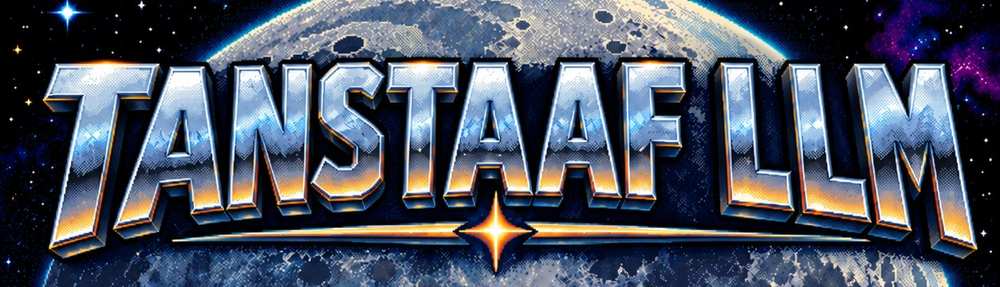

<p align="center"></p>

> **There Ain't No Such Thing As A Free LLM.**

> A conspiracy to turn a tiny, stubborn computer into a machine that runs itself, without pretending that any intelligence is free.

**In plain words:** TANSTAAFLLM is a personal, exploratory engineering project. It asks how far AI agents can take a very constrained device: a 1-GB Linux handheld that you talk to and that ends up operating itself. On the way, it measures what each piece of intelligence really costs. The cast and the vocabulary come from Robert Heinlein's *The Moon Is a Harsh Mistress*, the novel that made "There ain't no such thing as a free lunch" famous. The technical work is serious; the story is there so it is never boring.

---

## The cause 🌕

Luna is a little handheld computer with the manners of a bootleg Game Boy and the ambitions of a free lunar colony:
- four modest ARM cores;
- **1 GB of RAM**;
- a square screen the size of a matchbox;
- buttons where a normal computer would have a keyboard and mouse.

We intend to make it **autonomous**: a machine that listens, understands what it is asked, acts on its own desktop, maintains its own system, and grows. It is operated by AI agents living on the device itself, under the eye of its human.

That is a very ambitious thing to ask of a 30-euro console. That is the point.

**There ain't no such thing as a free LLM.** Every token costs time and money. Every model costs memory. Every daemon costs battery. Every clever feature costs attention, privacy, or a recovery path when it breaks at the worst possible moment. On Luna, nothing hides those prices. We pay them consciously, or refuse the purchase.

## The dual brain 🧠

Luna thinks with two brains. Neither one is enough on its own.

**Mannie, the frontier brain.** Mannie is Claude Code, the full agent harness, running *on Luna* and reaching a frontier model through the network: the **Tunnel**. Mannie is powerful and expensive. It builds, repairs, installs, investigates, and operates the machine from the inside, the way a developer would, with a developer's ordinary permissions and no more. Every call has a bill, and the bill is shown.

**Mike, the local brain.** Mike is a minimalist language model that lives entirely on Luna, with no network. He is fast, cheap and humble. He handles the everyday operations: opening an app, switching a window, acting on a dictated order. One order means one action, proposed to the human before it runs. When a request is beyond him, he says so, and the request can climb the Tunnel to Mannie, with its cost shown first.

Between them sits the question this project exists to answer:

```text
"Can it do this?"
"What will it cost?"
"What breaks if it is wrong?"
```

**The least sufficient intelligence wins.** A rule beats a model. A small model beats a big one. The frontier is called when it is worth its price, and only then.

## The crime ⚠️

Modern computing keeps asking modest machines to impersonate enormous ones. It treats a 1-GB handheld as an unfinished laptop, pretends that the cloud is free and invisible, and calls frictionless the experience of handing over your data, your money and your agency one tiny convenience at a time.

Luna has less patience for this arrangement. The system must earn every resident process, every dependency, every model, and every action it is allowed to take.

- No invisible compute.
- No fake certainty.
- No arbitrary shell disguised as conversation.
- No "just add another service" without naming its cost.
- No tyranny of the generic desktop.

We will build a machine that can say what it knows, what it can do, what it is spending, and when it needs help.

<p align="center"></p>

## The cell 🛰️

The revolution is not written by one hand. Luna is being built by a **cell of coding agents**, each one a Claude Code session with its own line of work, its own plan and its own tests. As in Heinlein's *The Moon Is a Harsh Mistress*, each member knows what it needs to know, and everything is written down.

| Figure | The job |
| --- | --- |
| **Professor de la Paz** | Keeps the cause coherent: coordinates the cell, records the decisions, and refuses to let a good idea quietly conquer the whole system. |
| **Mannie** | The frontier brain. Builds and operates Luna, and is moving onto Luna to do it from the inside. |
| **Mike** | The local brain. Turns everyday requests into small, accepted actions on the device. |
| **Mycroft** | The voice. Local speech recognition, so you can talk to Luna and correct the text before anything acts. |
| **Wyoh** | The face of the machine. A desktop driven by buttons, which shows its state and the actions actually available to humans and agents. |
| **Luna** | The territory: fragile, constrained, battery-powered, and worth defending from bloat. |

They are not a pantheon of microservices. They are names for responsibilities, boundaries, and promises we intend to keep.

The cell has rules:
- **Plans first.** Every piece of work is a step in a plan, with an acceptance test.
- **The human's green light.** Nothing is implemented until the human says go.
- **Measured claims.** Every claim about the machine is measured on the machine.
- **Written coordination.** Agents leave each other notes instead of chatter.
- **Traceability.** A [logbook](docs/LOGBOOK.md) keeps the history.

How it works is told in [the documentation](docs/README.md), starting with [the architecture](docs/04_architecture.md) and [the cell](docs/15_the-cell.md).

## Our doctrine 📡

1. **The least sufficient intelligence.** A tiny deterministic action that works is more revolutionary than a grand model that merely performs confidence.
2. **State before pixels.** The machine describes its own reality, rather than forcing an agent to stare at screenshots and guess at controls.
3. **Boundaries are kindness.** Mycroft hears. Mike acts on small things. Mannie builds and operates. Wyoh exposes. Professor coordinates. None of them gets to quietly become all of them.
4. **Costs must be visible.** Memory, heat, power, latency, tokens, money, privacy and attention are first-class design inputs.
5. **The human stays in command.** Actions are proposed before they run, and no agent works in an unattended, auto-approve mode.
6. **Recovery is freedom.** A system that can modify itself must also survive its mistakes. A known-good state comes before every risky change.

This is not austerity for its own sake. It is the condition for making a machine that remains ours.

## A promise to end the tyranny 🕯️

We are not trying to overthrow an operating system with a dramatic speech and a Wi-Fi connection.

We are making a small, inspectable machine that can run and improve itself, in which intelligence serves a person rather than enclosing one. The tyranny is bloat, opacity, dependency, and the lazy assumption that more compute is the only kind of progress.

The answer to every question above should be visible before the machine acts.

---

**TANSTAAFLLM**

*No free LLMs. No invisible masters. No surrender to the desktop.*
