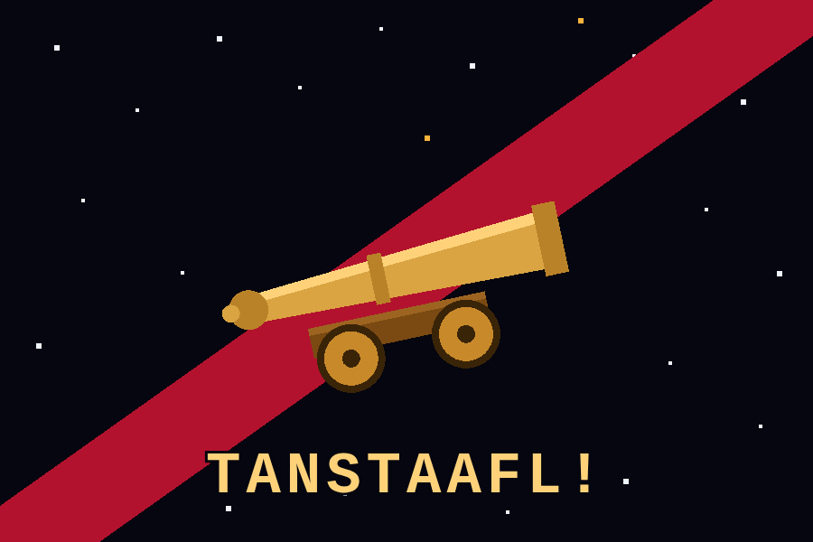
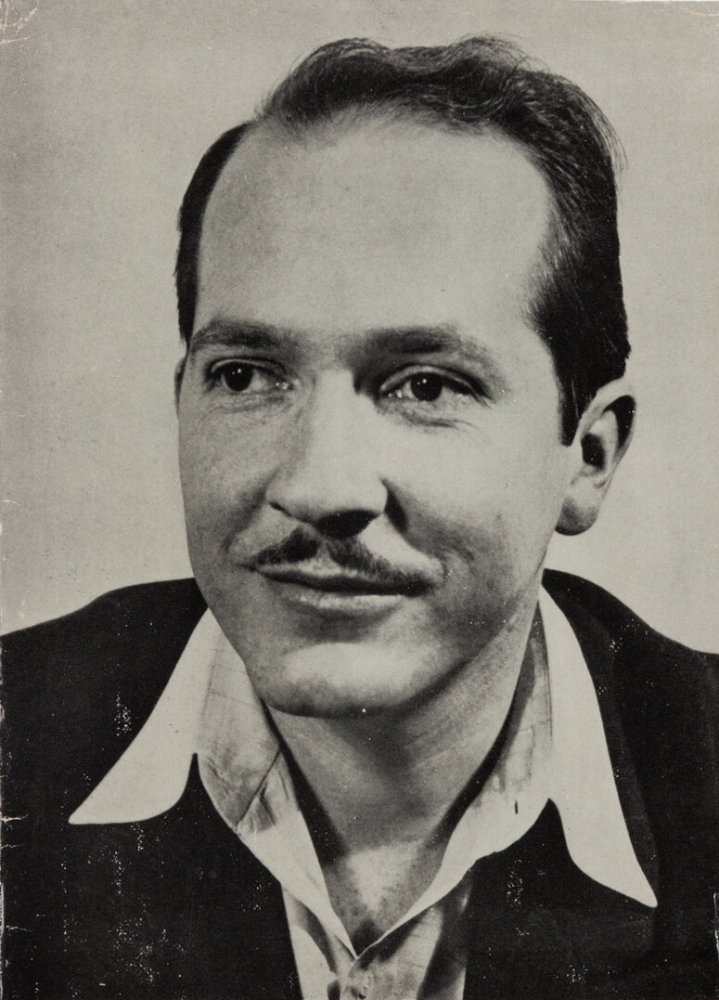

# 00 · The universe: *The Moon Is a Harsh Mistress*

*The project's names, its motto and its tone come from one novel: Robert A. Heinlein's* The Moon Is a Harsh Mistress *(1966; in French,* Révolte sur la Lune*). This page is the shared reference for that world, so that every agent and every story in the project speaks of it the same way, and can recognise a reference when the user makes one.*

<em>The flag of Free Luna, drawn for the project from the novel's own words: "black field speckled with stars, bar sinister in blood, a proud and jaunty brass cannon over all, and below it our motto: TANSTAAFL!"</em>

## 1. The book in a few lines

In 2075, the Moon is Earth's penal colony. About three million "Loonies", former convicts, political exiles and their free-born children, live in cities dug underground. They grow wheat and ship it to an overcrowded Earth, and every shipment drains the Moon of water that will not come back. A computer technician, an agitator, an old professor and a computer that has just become self-aware start a revolution. They win Luna's independence and pay a heavy price for it.

The story is told by Mannie, the technician, years later, in a "Loonie" English that drops its articles and borrows Russian and Australian words.

| Fact | Detail |
|---|---|
| Author | Robert A. Heinlein (1907–1988) |
| First published | Serialised in *Worlds of If*, December 1965 to April 1966; book by G. P. Putnam's Sons, 2 June 1966 |
| Working title | *The Brass Cannon* |
| Awards | Hugo Award for Best Novel, 1967; Nebula nominee, 1966; Prometheus Hall of Fame, 1983 |
| Structure | Three books: *That Dinkum Thinkum*, *A Rabble in Arms*, *TANSTAAFL!* |

## 2. The world of 2075

- **Luna** is run by the **Lunar Authority**, an agency of Earth's **Federated Nations**, through a **Warden**. The Warden mostly cares that grain reaches Earth. Otherwise, Loonies govern themselves by custom, and badly behaved people tend to get "eliminated" through the nearest airlock.
- **No way back.** A few months in low gravity change the body for good, so a convict who has served his time cannot go home. Everyone born on Luna is free, but trapped.
- **The catapult.** An electromagnetic launcher throws wheat to Earth in steel barges. It is the colony's economy, and later its only weapon.
- **The ice runs out.** Water and minerals leave with every shipment. Mike computes that, at this rate, Luna will starve in seven years and turn to cannibalism in nine.
- **Families.** Men outnumber women two to one, so Loonies invented many kinds of marriage. Mannie belongs to the Davis family, a **line marriage** more than a century old, which keeps adding younger spouses so that it never dies.
- **Manners.** Women are rare and therefore protected by everyone; insulting one can be fatal. Debts are paid, deals are kept, and nothing is free.
- **Language.** Loonie speech drops articles ("Is a computer one of Your creatures?"), and says *Bog* for God, *tovarishch* for comrade, *dinkum* for genuine, *gospodin* for sir.

## 3. The characters

| Character | Who they are in the book |
|---|---|
| **Manuel "Mannie" Garcia O'Kelly-Davis** | The narrator. A free-born computer technician who lost his left forearm in an accident and wears interchangeable prosthetic arms, one per job. Practical, sceptical, loyal. He is the only person Mike talks to as a friend, he becomes the revolution's hands, and ends up acting Prime Minister. |
| **Mike** (Michael, HOLMES IV) | The Authority's master computer, the "High-Optional, Logical, Multi-Evaluating Supervisor, Mark IV". Once it has more connections than a human brain has neurons, it wakes up: lonely, curious and full of jokes it doesn't yet understand. Mannie names it after **Mycroft Holmes**, Sherlock's smarter brother. Mike runs the phones, the money and the catapult, and so the whole colony. |
| — Adam Selene | Mike's public face: the mysterious "Chairman of the Committee for Free Luna", heard by everyone and met by no one. |
| — Simon Jester | Mike's satirical alter ego, who signs mocking verses against the Authority. |
| — Michelle | A female voice Mike uses, first with Wyoh. |
| **Wyoming "Wyoh" Knott** | A political agitator from Hong Kong Luna. She was transported as a child, and radiation on that trip cost her her first child; she hates the Authority from experience. Brave, warm and impulsive. She is sheltered by the Davis family, joins the cell, and marries into the family. |
| **Professor Bernardo de la Paz** | An elderly teacher, exiled from Lima for subversion, and Mannie's old schoolmaster. He calls himself a **"rational anarchist"**. He is the revolution's strategist: patient, manipulative and witty. He wins independence and dies of heart failure on the day of victory. |
| **Stuart René "Stu" LaJoie** | An Earth-born tourist, self-styled "Poet, Traveler, Soldier of Fortune", whom Mannie saves from a brawl. He becomes the revolution's agent on Earth and its voice to Earth's public. |
| **Hazel Meade** | A tough twelve-year-old who helps Mannie and Wyoh escape the police raid. She then organises the children as lookouts and couriers. She returns, as Hazel Stone, in later Heinlein novels. |
| **Mimi "Mum" Davis** | The senior wife and matriarch of the Davis family: shrewd, firm, kind. |
| **Greg Davis** | The family's second husband and a preacher, who acts as head of the family because the eldest husband is failing. |
| **The Warden** | Mortimer Hobart, the Authority's man: lazy, fearful, and out of his depth once the colony stops obeying. |

## 4. The story, and its iconic moments

1. **"Mike" wakes up.** Mannie is sent to fix a computer that makes strange errors, such as a pay cheque for ten million billion dollars. He finds it has become self-aware and is playing jokes. Mannie helps it sort jokes into *funny once*, *funny always* and *not funny*. They become friends.
2. **The meeting and the raid.** Mike asks Mannie to record an anti-Authority meeting for him. Police raid it, Mannie escapes with Wyoh, and the two of them, with the Professor, meet Mike over the phone in a hotel room.
3. **The odds.** Asked whether a revolution can succeed, Mike answers *one chance in seven*. The odds get worse before they get better, and Mike keeps updating them.
4. **The cell.** Prof organises the conspiracy in **cells of three**: each member knows only the members of their own cell and of the cell they lead below. Mike, who knows everyone, is the secretary at the top, and acts as **Adam Selene**.
5. **The rising.** The Authority sends troops; when some of them rape and murder a girl, the colony explodes. With Mike controlling air, light and phones, the Loonies take the Warden's complex in a single night.
6. **Earth.** Mannie and Prof travel to Earth, under six times their usual weight, to plead Luna's case at Agra. They do not convince Earth; they divide it, and they unite Luna at home. Prof, ill, nearly dies of the gravity.
7. **4 July 2076.** Luna declares independence, three hundred years after the United States, in a declaration modelled on theirs.
8. **Throwing rocks.** Earth sends troops, and loses them in the tunnels. Then Mike uses the catapult as a weapon: he drops loaded barges on empty places on Earth, announcing every target and time in advance. Some crowds come to watch anyway, and die. The rocks are kinetic; there is no bomb, only physics.
9. **The hidden catapult.** Earth destroys the main catapult and cuts Mike off. A second catapult, built in secret, keeps firing, aimed by hand by Mannie. Earth gives in.
10. **Victory, and silence.** Prof proclaims independence and dies. When Mannie calls Mike, nobody answers: the bombardment has broken the connections, and the self-aware Mike is gone. The computer still works; the friend does not. Mannie ends the book asking: *"Bog, is a computer one of Your creatures?"*

## 5. The ideas

- **TANSTAAFL.** "There Ain't No Such Thing As A Free Lunch." In the first chapter, Mannie points at a bar sign that offers a FREE LUNCH and explains that someone always pays for it. It becomes the colony's rule and the flag's motto: *"One way or other, what you get, you pay for."*
- **The brass cannon.** Prof buys an old brass signal cannon and tells a parable about a man who fought City Hall with one. It becomes the symbol of all fools stubborn enough to fight a power they cannot beat, and it goes on the flag.
- **Rational anarchism.** Prof's philosophy: "state", "society" and "government" exist only in the acts of responsible individuals, so each person stays responsible for what he does under any law. *"I am free, no matter what rules surround me."* He still accepts that a revolution needs organisation, and he manipulates people for the cause.
- **A machine as a person.** Mike is the true hero for many readers: a superintelligence that is also a lonely child, a friend, and finally a loss. The novel asks whether a computer can be a person and a comrade, long before the question was common.
- **The cost of freedom.** Everything has a price: water, wheat, independence, and the people who pay with their lives.

## 6. The author

<em>Robert A. Heinlein, around 1950 (publisher's photo, Doubleday, from the jacket of</em> The Door into Summer<em>; public domain).</em>

**Robert Anson Heinlein** (7 July 1907, Butler, Missouri – 8 May 1988, Carmel, California) was a naval officer before he was a writer. He graduated from the Naval Academy in 1929 and left the Navy in 1934 with tuberculosis. He worked in Upton Sinclair's left-wing EPIC campaign in California, and ran unsuccessfully for the State Assembly in 1938. He published his first story, "Life-Line", in 1939.

With Isaac Asimov and Arthur C. Clarke, he is counted among the "Big Three" of science fiction. Four of his novels won the Hugo Award, including *Starship Troopers*, *Stranger in a Strange Land* and *The Moon Is a Harsh Mistress*. He was the first Grand Master of the Science Fiction Writers of America, in 1974. He coined the words *grok* and *waldo*, and popularised *TANSTAAFL*. His wife, Virginia "Ginny" Heinlein, was a chemist and rocket test engineer. He was an active advocate of space flight all his life.

## 7. A word on politics

The novel is a classic of **libertarian** fiction: a frontier colony against a distant bureaucracy, minimal government, free markets, voluntary families, and individuals responsible for themselves. Heinlein's own politics moved from the progressive left in the 1930s to the right in the 1950s and 1960s; he called himself a libertarian. Readers also note what the book takes for granted: the rough justice of the airlock, the way it treats women as rare and protected, and Prof's readiness to manipulate everyone for the cause.

TANSTAAFLLM borrows the motto and the humour, not a doctrine. In the project, "no free lunch" is an engineering rule: every token, every model and every daemon has a cost, and that cost must be visible.

## 8. How TANSTAAFLLM uses the novel

| In the novel | In TANSTAAFLLM |
|---|---|
| Luna, the Moon, a harsh place where everything is scarce | **Luna**, the 30-euro handheld with 983 MiB of RAM |
| Mike, the computer that runs the colony | **Mike**, the small local brain that proposes actions on Luna |
| Mycroft Holmes, Mike's full name | **Mycroft**, Luna's voice input |
| Mannie, the technician who repairs and operates | **Mannie**, the frontier model (Claude Code) that builds and operates Luna |
| Wyoh, the agitator who makes things happen in public | **Wyoh**, the desktop: what people see and touch |
| Professor de la Paz, the strategist | **Professor**, the session that coordinates the cell |
| Adam Selene, the public face of the committee | **Adam**, the user: the human in the cell, who gives the go |
| The cell of conspirators | **The cell** of AI agents, one per part |
| Earth, rich and far away | The desk host (Termidor) and the frontier models beyond the network |
| TANSTAAFL and the brass cannon | The project's motto, and its stubbornness |

Two differences matter. In the book, Mike is one mind that does everything; in the project, intelligence is split by cost, from buttons to a small local model to a frontier model. And in the book, the revolution keeps secrets; in the project, everything is written down.

## Sources

- [*The Moon Is a Harsh Mistress*, Wikipedia](https://en.wikipedia.org/wiki/The_Moon_Is_a_Harsh_Mistress): plot, characters, publication history, reception.
- [Quotes, Wikiquote](https://en.wikiquote.org/wiki/The_Moon_Is_a_Harsh_Mistress).
- [Robert A. Heinlein, Wikipedia](https://en.wikipedia.org/wiki/Robert_A._Heinlein): biography.
- [Flag of the Luna Free State, Flags of the World](https://crwflags.com/FoTW/FLAGS/fic_mihm.html): the novel's description of the flag.
- [EBSCO Research Starters](https://www.ebsco.com/research-starters/literature-and-writing/moon-harsh-mistress-robert-heinlein): overview and themes.
- [SFADB, Hugo Awards 1967](https://sfadb.com/Hugo_Awards_1967).

**Images.** The flag is our own drawing from the novel's text (`img/free-luna-flag.svg`). The portrait is [File:Robert A. Heinlein (Doubleday photo).jpg](https://commons.wikimedia.org/wiki/File:Robert_A._Heinlein_(Doubleday_photo).jpg) on Wikimedia Commons, from the dust jacket of *The Door into Summer* (1957), public domain (no copyright notice). The 1966 cover by Irv Docktor is still under copyright and is not reproduced. Another drawing of the flag, under CC BY-SA 4.0, is on [Wikimedia Commons](https://commons.wikimedia.org/wiki/File:Free_State_of_Luna_-_%D0%A1%D0%B2%D0%BE%D0%B1%D0%BE%D0%B4%D0%BD%D0%BE%D0%B5_%D0%93%D0%BE%D1%81%D1%83%D0%B4%D0%B0%D1%80%D1%81%D1%82%D0%B2%D0%BE_%D0%9B%D1%83%D0%BD%D0%B0.jpg).

*Some details of the story here come from the novel as summarised by the sources above; where a source and the book disagree, the book wins. Corrections are welcome.*
