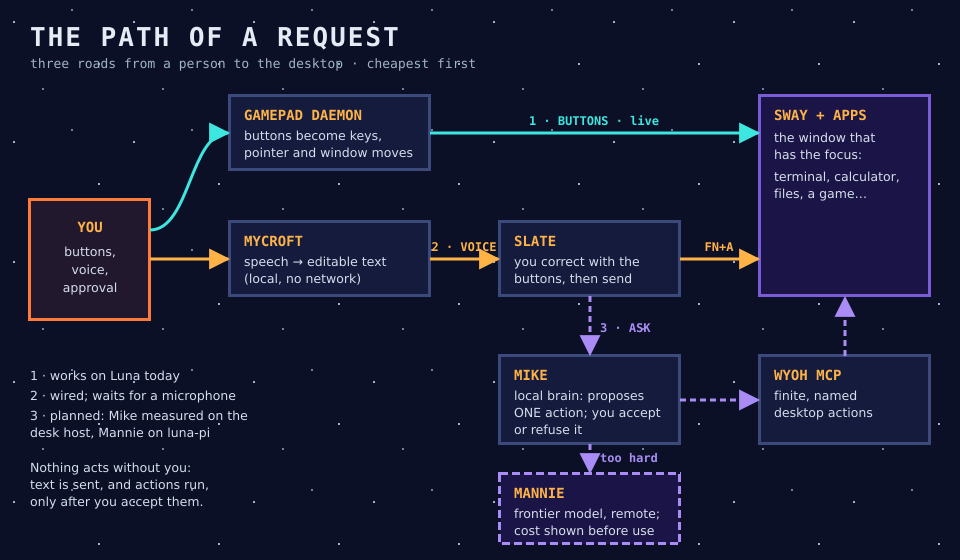

# TANSTAAFLLM principles and concept

**Status:** living conceptual reference (revised 2026-10-11) 
**Scope:** project identity, interaction model, component roles, and design principles

## Purpose

TANSTAAFLLM is an experiment in making a modest handheld computer into a useful, inspectable, AI-native personal system. The project is not a quest to put the largest possible model on constrained hardware. It is a search for the smallest, most appropriate capability at each point in the system.

The project draws its vocabulary and narrative energy from *The Moon Is a Harsh Mistress*. The reference is a design lens, not an instruction to turn the product into a costume of the novel: names must clarify responsibility, and the interface must remain useful to someone who does not know the source material.

## The governing idea: no free LLM

**TANSTAAFLLM** expands the familiar TANSTAAFL principle into “There Ain’t No Such Thing As A Free LLM.” Intelligence consumes something: memory, CPU time, battery, latency, bandwidth, money, privacy, or attention.

This is not anti-LLM. It is a discipline:

- use a deterministic rule, a small classifier, or a specialised model when that is enough;
- use a local model when local execution is the appropriate trade-off;
- use a frontier model only when its added capability is worth the visible cost;
- let the user see material costs and consequences rather than hiding them behind magic.

The current repository slug is historical and may not match the intended project spelling exactly. Naming and repository-renaming decisions remain administrative work; they do not change this conceptual model.

## World and nomenclature

| Name | Role | User-facing? | Notes |
| --- | --- | --- | --- |
| **TANSTAAFLLM** | project and design philosophy | yes | The whole experiment and its resource-aware principle. |
| **Luna** | handheld device and its local environment | yes | The home of the system’s components. |
| **luna-pi** | Raspberry Pi reference/prototyping target | mostly internal | A development and comparison target, not a replacement for Luna. |
| **Adam Selene** / **Adam** | the user, the human in the cell | the user | **The user's role** (user, 2026-10-31): Adam gives the go, sets the goals and decides. Not an agent, not a model. In Hebrew, *adam* is "man", from *adamah*, the earth. |
| **Mike** | local brain | internal | A small local model on Luna (candidate: LFM2.5-350M). It interprets a request and proposes one action through Wyoh, which the user accepts or refuses. When a request is too hard, it escalates to Mannie. |
| **Mycroft** | input and composition capability | internal | Turns voice into an editable, reviewable proposal. Its ASR baseline is context-free; bounded contextual vocabulary is a separately measured later capability. |
| **Wyoh** | interface, state, context, and possible actions | internal, rendered to the user | Makes the environment legible and actionable for Mike, and drivable with Luna's buttons. |
| **Mannie** | frontier-model capability | internal | Claude, Codex or another frontier model reached remotely: development work (code, build, test) and the costly escalation behind Mike. Always within normal developer permissions, never unattended. |
| **Professor de la Paz** / **Professor** | coordinating workline | internal | Coordinates work that crosses worklines, hands out shared devices, and supervises the cell when the user delegates it. The user works with each workline's agent directly. It is not a system runtime or local model. |

The naming is deliberately layered. **Luna is the machine. Mike is the local intelligence. Mannie is the expensive one far away.** Mycroft and Wyoh provide input and the environment. **Professor** is the coordinating project workline, not another component running on Luna. **Adam**, the single public face, is on hold until a real need for it appears.

## Adam: the human in the cell

*Since 2026-10-31, Adam is the user's own role (user decision): the human who gives the go. The earlier design below, where Adam was a voice for Mike, is kept as history; it is not the current design.*

Adam Selene is the public identity under which Mike presents itself to the user. Adam is not a second brain, a hidden model, or an additional authority layer.

Mike reasons and routes. Adam communicates: it provides a stable point of address, turns outcomes into human-facing language, and may eventually own dialogue, notifications, and speech output. That gives the system a clear external/internal separation:

> **Mike thinks. Adam speaks.**

The user does not need to know which internal component completed a request in order to use the device. The system, however, must keep those components inspectable: Adam must not obscure what Mike decided, what Wyoh observed, which tool ran, or whether Mannie/Codex was involved.

## Interaction model

*While Adam is on hold, the same spoken instructions are simply addressed to Luna: dictated into the Slate, or asked of Mike.*

The intended interaction is not “Hey Siri.” The natural form is an instruction addressed to Adam:

- “Adam, open the TANSTAAFLLM project.”
- “Adam, show me what Mannie changed.”
- “Adam, ask Mannie to fix this.”
- “Adam, compile and test.”

`Adam` is a natural vocative and a clear human-facing identity, not a mandatory wake word. In an already open interaction, repeating it should not be necessary. A future Mycroft may treat it as a strongly biased word when it is present, but wake-word detection is not a prerequisite for the system.

### Request and response path

There are three roads, cheapest first. **Buttons** go through Wyoh's gamepad daemon. **Voice** goes through Mycroft into Wyoh's Slate, where the user corrects it before sending. **Asking** goes to Mike, who proposes one action through Wyoh, with Mannie as a costed escalation. Details and status: [`04_architecture.md`](04_architecture.md).

The diagram is a responsibility map, not a claim that all components must be processes or models.

## Component contracts

### Mycroft → Mike

Mycroft turns audio into an editable, reviewable composition proposal. Its measured first slice is deliberately context-free speech-to-text. A later bounded context input may use mode-appropriate vocabulary, but it must remain optional, source/revision-labelled, costed, and incapable of granting execution authority. Acceptance remains distinct from an action request.

### Mike ↔ Wyoh

Wyoh describes the current environment in a form Mike can use: state, focus, available actions, and consequences. Mike requests or selects an action; Wyoh makes the result and changed state legible. This boundary keeps the brain from relying on an opaque desktop.

### Mike ↔ Mannie

Mannie is the frontier model, not the operating system’s universal brain. Mike escalates to it only when a request is too hard, and the cost is shown first. It also does development work with Codex, Claude Code or another frontier model: code, build, test, and Git tasks. It has no greater authority than the normal development workflow: its actions remain subject to the same permissions, review, and observability as development from the desktop.

### Mike / components → the user

While Adam is on hold, results go to the user directly, through Wyoh's desktop and each tool's own output. Whatever surface shows them is the one that explains results to the person. It should be able to distinguish a completed action, a proposed action, a blocked action, a degraded result, and an external-model request. The user should see meaningful status rather than a fabricated impression of certainty.

## Design principles

### 1. Local-first, but not local-only

Luna should remain useful without a network where its local capabilities suffice. A remote model is a deliberate escalation, not the hidden default.

### 2. The least sufficient intelligence

Use the smallest and cheapest mechanism that can meet the task. A full LLM is not the answer to every language, routing, status, or control problem.

### 3. Explicit boundaries over a monolithic assistant

Input, reasoning, state/UI, development, tools, and presentation have different constraints. Naming these roles is useful only if their contracts remain clear and components can be replaced independently.

### 4. State must be inspectable

The system must expose what it knows about the current environment, what it can do, and what it is doing. Wyoh is central to this principle; Adam should communicate it rather than conceal it.

### 5. Human agency and ordinary permissions

The system may propose, automate, or invoke tools, but it must not turn a conversational interface into unreviewable authority. Development actions through Mannie/Codex remain ordinary developer actions, with their normal permission boundaries.

### 6. Constrained hardware is a first-class design input

Memory, battery, thermals, input hardware, and latency are product constraints, not later optimisation work. Desktop and `luna-pi` experiments are valuable, but the handheld remains the final validation target.

### 7. Degrade clearly

When a component is unavailable, the system should preserve useful lower layers and state the limitation. A missing frontier model, a failed voice transcription, or an unavailable UI component should produce a clear, recoverable state rather than a fake success.

### 8. Theme serves comprehension

The project vocabulary should help people reason about resource use and system state. It must not make commands, errors, or recovery procedures obscure.

## Shared vocabulary and affordances

These are candidate names for user-visible language, documentation, logs, and interfaces—not a commitment to particular command names or APIs.

| Term | Intended meaning |
| --- | --- |
| **Tunnel** | a connection or channel; SSH is the first concrete example. |
| **Pressure** | system health: memory, CPU load, temperature, or other resource strain. |
| **Airlock** | a sandbox, quarantine, or deliberately isolated execution space. |
| **Seal** | a known-good or stable state before a change. |
| **Catapult** | deployment of a build or artifact toward Luna. |
| **Rock** | a deployable package or build artifact. |
| **Free Fall** | a minimal safe/degraded mode. |
| **Decompression** | a disruptive process termination or recovery action; use only where the consequences are explicit. |

The point is not to hide standard operations behind lore. “Pressure high” can be a memorable way to say that memory or temperature is high; it must still show the relevant ordinary metric and recovery action.

## Current delivery boundaries

The live status of every part is in [`04_architecture.md`](04_architecture.md), section 5. In short, on 2026-10-11:

- **Wyoh** runs on Luna. It boots straight into the desktop, every button mode works, and the Slate, the menu and the first apps are in place.
- **Mycroft** is installed on Luna and wired into the Slate. It still lacks a working microphone, and recognition is still slower than real time on Luna's CPU.
- **Mike** has been measured on the desk host. It is not yet on Luna.
- **Mannie** has been measured on `luna-pi` (Claude Code). It is not yet on Luna.
- **GPU computing (OpenCL)** is available on Luna, and parked until dictation works on the CPU.

## Documentation conventions

- **Language.** Everything is written in English. Agents talk to the user in French.
- **One place.** All project documentation lives in `docs/` under one numbering, and [`docs/README.md`](README.md) is the way in. Workline evidence stays in `worklines/<name>/docs/`, and the project pages summarise it and link to it.
- **Diagrams.** Diagrams are hand-written **SVG**, not Mermaid. They use the visual style of Luna's wallpaper: deep navy and violet, chrome titles, amber accents, cyan for what is live. Each one is rendered to PNG (`scripts/render_svg.py`) and inspected before it counts as done.
- **Tone.** Plain technical sentences come first. The novel's world, the cell and the retro-gaming look go in titles, captions and short asides, and every one of them is explained once.
- **Honesty.** Every figure names where it was measured (Luna, `luna-pi` or the desk host), every page names its sources, and anything not measured says "planned".
- **Reading time.** A capable reader should get the big picture in 15 minutes and everything in about an hour, without help from an AI.

## Open questions

1. What is the first demonstrable end-to-end interaction on Luna (voice → Slate or Mike → Wyoh → app)?
2. Which state and action contract does Wyoh expose to Mike?
3. Which Mycroft ASR candidate meets the French, offline, memory, and latency constraints in practice?
4. What exact confirmation model applies when Mike invokes Wyoh actions or escalates to Mannie?
5. Which resource costs should be exposed by default, and at what level of detail?
6. When does a remote model provide enough additional value to justify its cost?

## Change rule

New names or narrative ideas belong here only when they clarify a real responsibility, interaction, or system state. A reference with no architectural job stays an easter egg rather than becoming another component.
