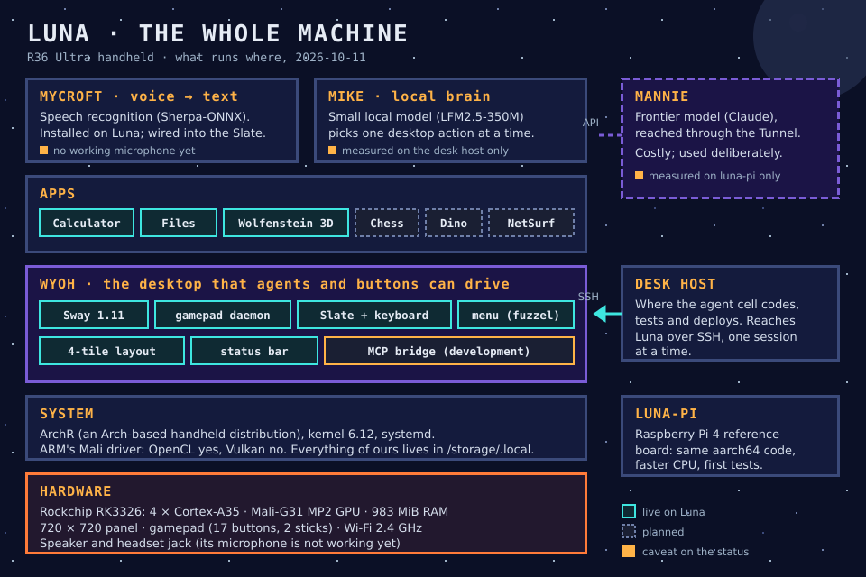
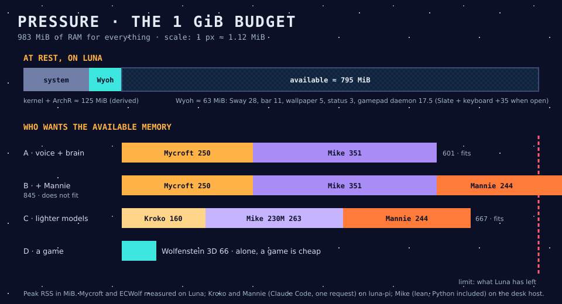

# 04 · Architecture

*The short version: one tiny Linux handheld, one desktop that both buttons and agents can drive, three kinds of intelligence from cheap to expensive, and a cell of AI agents that builds it all under one person's control.*

## 1. The machine

Luna is a **R36 Ultra**:
- Rockchip RK3326 with four Cortex-A35 cores, a Mali-G31 MP2 GPU and **983 MiB of RAM**;
- a square 720 × 720 panel and a gamepad of 17 buttons and two sticks;
- 2.4 GHz Wi-Fi.

It runs **ArchR**, an Arch-based distribution for handhelds. We keep ArchR as it is, and everything we add lives under `/storage/.local`, so the card stays recoverable.

On top sit, from bottom to top:

- **Wyoh**, the desktop. It is ArchR's own Sway compositor, driven by a small daemon that turns the gamepad into keys, a pointer and window commands. It boots straight into the desktop, with no login and no terminal.
- **The apps:** a Windows 3.1-style calculator, a two-pane file manager, and Wolfenstein 3D work today. Chess, the Chrome dinosaur game (in white on black) and the NetSurf browser are next.
- **Mycroft** turns speech into text, locally, with no network. It is installed on Luna and wired into the desktop. It is waiting for a working microphone: the headset jack does not deliver a signal under ArchR, so the next try is a USB-C microphone.
- **Mike**, the local brain, will choose one desktop action from a short list. So far it is measured on the desk host only.
- **Mannie**, the big model (Claude), lives on the far side of the **Tunnel**, our word for a network connection. He has been measured on the Raspberry Pi reference board (`luna-pi`) only, not yet on Luna.

Development happens on a desk host. The agents reach Luna over SSH, **one session at a time**, and reboot it after each test series.

## 2. The path of a request

There are three roads from a person to the desktop. They go from cheapest to most expensive, in line with the project's rule: **use the least intelligence that does the job.**

1. **Buttons (works today).** The gamepad daemon turns a press into a key, a pointer move or a window command. It needs no model, uses 17.5 MiB, and costs no CPU at rest.
2. **Voice (wired, waiting for a microphone).**
   - Mycroft writes what you say into the **Slate**, a small editor that opens over the desktop.
   - You correct the text with the buttons, then FN+A sends it to the window that has the focus.
   - Recognition runs locally, but it is not yet fast enough on Luna: it runs at about 0.75 × real time.
3. **Ask (planned).**
   - **Mike** proposes **one** action through Wyoh's list of named actions, and you accept or refuse it.
   - When the request is too hard for Mike, it can go to **Mannie**, with the cost shown first.

Nothing acts behind your back. Text is sent, and actions run, only after you accept them.

## 3. Pressure: where the memory goes

With the desktop running, about **795 MiB** are left. That is enough for voice plus the local brain (about 601 MiB). Adding Mannie's harness (about 845 MiB in all) is not. Lighter choices bring all three back under the limit:
- Mycroft with the **Kroko** model, about 160 MiB;
- Mike with a smaller **230M** model, about 263 MiB.

That trade-off, rather than raw speed, is what will shape the next decisions. A game alone is cheap: Wolfenstein 3D uses 66 MiB.

The figures come from different machines, and the diagram says which. Mycroft and the game were measured on Luna. Kroko and Mannie were measured on `luna-pi`. Mike was measured on the desk host, Python included.

## 4. The cell

Luna is built by AI agents. Each agent is one Claude session working on one **workline**: Wyoh, Mycroft, Mike, Mannie or Luna. Each workline has its plan in `worklines/<name>/`.

**The user works with each agent directly**, in that agent's own console: asking questions, giving instructions, testing on the device, and green-lighting steps ("🟩 go Step N").

**Professor** is called in only for what crosses agents:
- it coordinates work that involves several worklines;
- it records the decisions that cross worklines;
- it hands out the **Luna token**, because only one session may use the device at a time;
- it supervises the cell when the user delegates it for a while, for example to let the agents keep working while the user is away. Every decision it takes then is logged for the user's review.

The rules between agents:
- **Comrades don't message each other.** They leave notes in each other's `docs/`, or go through Professor.
- **The plan is the channel.** Every request lands in a plan step, so the user can open any plan and see where it stands.
- **When an agent is blocked, it stops.** It writes its state in its plan and asks the user in its own console.

In the novel, revolutionaries organise in cells of three, so that nobody knows too much. Our agents do the same, except that everything is written down.

## 5. What is live, and what is not

| Part | State |
|---|---|
| Wyoh desktop, gamepad, Slate, menu, four-tile layout | live on Luna, boots straight into it |
| Calculator, Files, Wolfenstein 3D | live on Luna |
| Chess, Dino, NetSurf | next |
| Mycroft dictation | installed and wired on Luna; no working microphone yet |
| Mike | measured on the desk host |
| Mannie (Claude Code) | measured on `luna-pi` |
| GPU computing (OpenCL) | available, parked until dictation works on the CPU |

**Sources:** the Wyoh, Mycroft, Mike, Mannie and Luna plans; the results `wyoh/0407_01`, `wyoh/0506_01`, `wyoh/0605_01`, `mycroft/0703_01`, `mycroft/0802_01`, `mycroft/0903_02`, `mike/0302_05`, `mannie/0203_01` and `luna/0802_01`.
