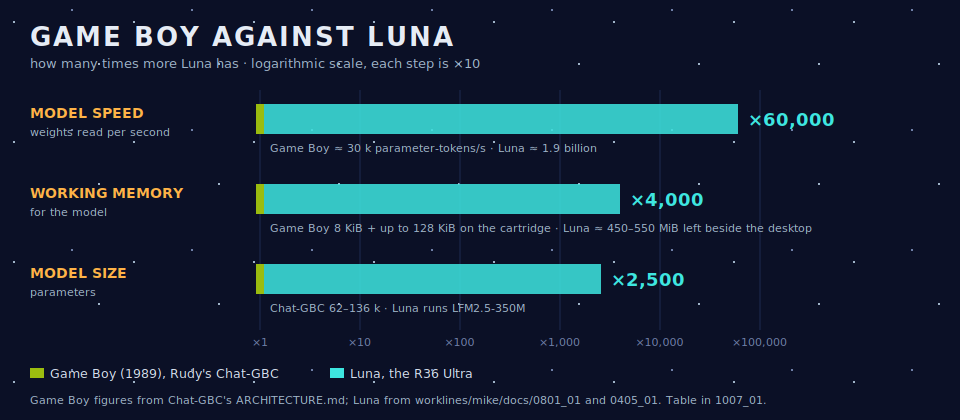
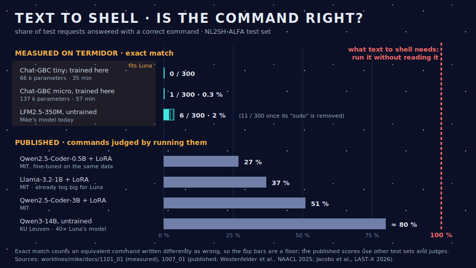
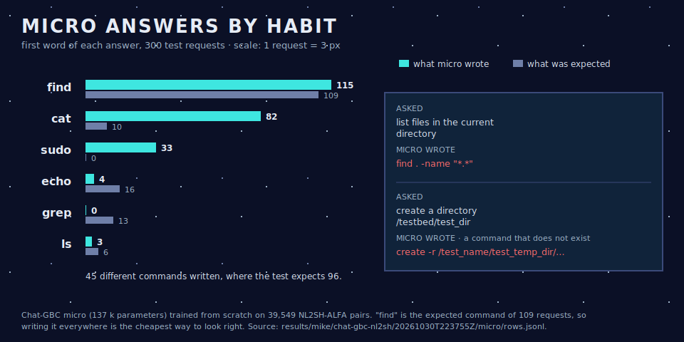

# Text to shell, and why we stopped — a short story

*25 – 31 October 2026*

This is the story of a week spent trying to make a very small model turn a sentence into a shell command, and of why we stopped. It's written to be read from top to bottom. The measurements live in `worklines/mike/docs/` (`1005_01`, `1006_01`, `1007_01`, `1101_01`); this page keeps to what we hoped, what we tried, and what we learned.

---

## What we wanted

Mike is Luna's local brain: a small model that reads a request and proposes one action. Luna has 1 GiB of memory, of which about 450–550 MiB is left once the desktop and dictation run. A model of about 350 million parameters (LFM2.5-350M, about 300 MiB in memory) fits there. A model of 4 billion does not.

The first goal was broad: understand a request and pick one of Mike's seven desktop actions, reliably. Our bar was 90 % of requests answered right, nine times out of ten. Step 10 measured it in seven and a half hours on the desk computer, Termidor, and no model passed. Two 4-billion models came close, each on one test set only. Qwen3-0.6B, the largest that might fit Luna, reached 70 %. LFM2.5-350M, the one we had chosen, stayed between 36 and 54 %, like the other LFM models.

## The idea: make the task smaller

If a small model cannot do everything, perhaps it can do one thing well. We picked a task that looked narrow and useful: **text to shell**. You say "show the disk usage", the model writes `df -h`, you accept, it runs.

There were good reasons to think it could work:

- **The data already exist.** MIT's NL2SH-ALFA dataset holds about 41,000 sentence → bash pairs, plus a hand-checked test set of 300 requests with two accepted commands each.
- **Others have tried it.** Small models trained on this data improve a lot. A 0.5-billion model goes from 10 % to 27 %, a 1-billion one to 37 % (MIT, judging by running the commands).
- **Someone we know had just shown how small "small" can be.** Rudy, a colleague, wrote **Chat-GBC**: a language model that runs on a 1989 Game Boy.

## The Game Boy detour

Chat-GBC is charming. A transformer of 62,000 to 136,000 parameters, trained from scratch, its weights squeezed to 7 bits so each matrix fits one cartridge bank. It answers questions about the Game Boy, about one character per second, and politely declines everything else: "sorry, i only know about the game boy".

We reproduced it on Termidor, and its figures matched exactly. We also saw its limit. It recites the 405 answers it was trained on perfectly, but it answers only 32–40 % of the same facts when they are asked in new words. It remembers; it does not reason.

Then we compared the two machines.

Luna reads model weights about **60,000 times faster** than the Game Boy and has about **4,000 times more working memory**. Rudy trains from scratch because nothing pre-trained exists at his size. We are not under that constraint; at Luna's size, pre-trained models exist.

The user's decision was "do the experiment anyway". We wanted a measured answer, not a guess.

## The experiment

We gave Rudy's models what shell commands need: a vocabulary with capitals and every printable character (`| * ~ $ > < = _ [ ] { } +`), which his Game Boy version drops. We kept his recipe and step counts and trained both sizes from scratch on 39,549 NL2SH pairs. That took 35 minutes for tiny and 57 minutes for micro, on Termidor's CPU. Termidor's graphics card, a GTX 760 from 2013, cannot help.

For comparison, we asked LFM2.5-350M, untrained, the same 300 questions. The top of the chart below is what we measured; the bottom is what others published for larger, fine-tuned models.

The tiny models answer by habit. Micro writes `find` 115 times out of 300 and `cat` 82 times, whatever the question, and never writes `grep`. The untrained LFM puts `sudo` in front of half its answers and sometimes invents commands too.

## Why it cannot work as it stands

**A shell command has to be perfect.** That is the whole point of text to shell: if I have to fix the command before it runs, typing it myself would have been faster. A command with one wrong flag, one wrong path or one invented name is not 90 % right. It is wrong, and sometimes dangerous.

That is where the narrowing went wrong. We made the task smaller, but not easier. Bash is an open language with thousands of commands, flags and paths, and the answer must be exact to the character.

- **Micro-models like Rudy's are the wrong tool.** They are fun, and they are a fine way to recall a small corpus or answer a quiz. But they echo what they were trained on. There is no reasoning in them. And we don't need to go that small: Luna is thousands of times larger than a Game Boy.
- **Pre-trained models are not precise enough either.** At Luna's size they give 2–4 % exact commands untrained. The published fine-tuned results stay far from "always right": 27–37 % at 0.5–1 billion parameters and 51 % at 3 billion. The best untrained model in a KU Leuven study, Qwen3-14B, reaches about 80 %. Even models well beyond what Luna can hold do not produce commands you can run without reading them.

## What we keep

- **A measured answer instead of a hope.** The tests, the patch and the logs are in the repository (`test/mike/test_chat_gbc_nl2sh.py`, `test/mike/test_nl2sh_baseline.py`), so anyone can rerun the experiment.
- **A clearer idea of where small models stand.** The shorter and more closed the list of possible answers, the better they do. Free-form text that must be exact to the character is out of their reach.
- **Ideas we did not pursue.** One tiny model per command class behind a router, man pages as training text, and a light French-to-English translator in front of the model are recorded in Mike's plan, but they were not tried.

The text-to-shell line stops here (user decision, 2026-10-31).
