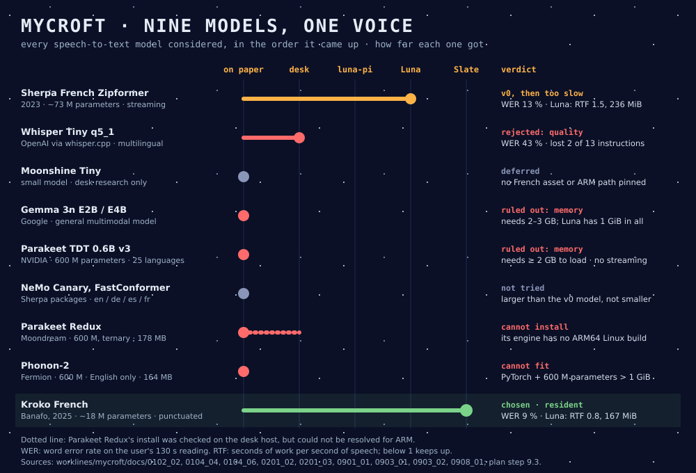
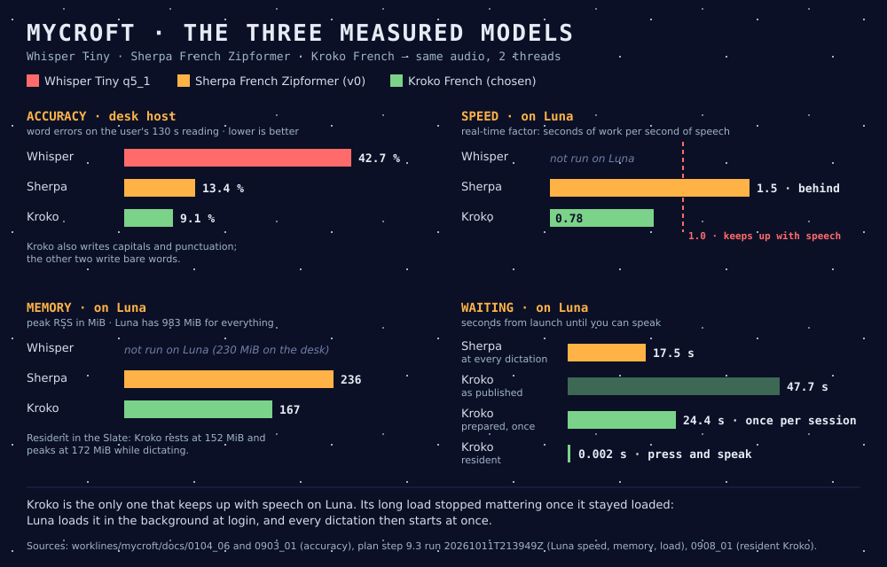

# From a first French model to Kroko — the speech-to-text story

*September – October 2026*

This is the story of how Mycroft, Luna's voice-to-text part, got its model: what we chose first, why it was not enough on the handheld, and how a much smaller model called Kroko ended up running in the Slate. It's written to be read from top to bottom. The measurements live in `worklines/mycroft/docs/`. This page names the documents behind each figure and keeps to what we hoped, what we tried, and what we learned.

---

## What we wanted

The user wants to speak to Luna in French and get editable text: dictate, correct, send. Three rules came with it:

- **Offline:** the model runs on Luna itself, with no network and no cloud.
- **Small:** Luna has 1 GiB of memory, which it shares with Linux, the desktop and, later, Mike.
- **Honest:** a model counts only once it has been measured on the real device; a desk result is only a hint.

## The first choice: a French model built for streaming

The first step was a review of what exists, followed by two candidates tested on the desk computer, Termidor (`0102_02`, `0104_04`).

- **Sherpa-ONNX with a French "Zipformer"** is a speech model made for French, and it streams: words appear while you speak. Its engine is a native library, and it publishes a ready-made build for ARM, Luna's processor family.
- **Whisper Tiny** is OpenAI's smallest model, run through `whisper.cpp`.
- **Moonshine Tiny**, another small model, stayed on paper: no French asset, licence and ARM path could be pinned (`0102_02`).
- **The big names were ruled out on paper.** Google's Gemma 3n needs 2–3 GB, and NVIDIA's Parakeet 0.6B about 2 GB (`0201_02`, `0201_03`). No quality advantage pays for memory the device does not have.

On three public French clips, and then on a 130-second reading by the user covering commands, code and project names, Sherpa won clearly:

- **Word error rate (WER) on the reading:** 13 % for Sherpa against 43 % for Whisper.
- **The user's 13 instructions:** Sherpa kept all of them; Whisper dropped two, and lost its way on the proper nouns.

Sherpa's French Zipformer became the v0 model (25 September).

## A console, then a voice for the Slate

Before Luna, we needed something to dictate into. Mycroft got a small text console on the desk. It took a few rounds of user feedback:

- the screen filled with repeated lines;
- F5 clashed with VS Code, so Space now starts and stops dictation;
- the model's output was all in capitals, so the console now shows lower case.

The user found live dictation "pas mal".

Then came the real target: **Wyoh's Slate**, the text box Luna shows over any window. Mycroft and Wyoh agreed on a simple contract (`0704_01`). Wyoh's gamepad daemon starts Mycroft as a separate process, Mycroft sends JSON lines (`ready`, `partial`, `final`), and Wyoh owns the text. A `--fake` mode let Wyoh build its side without a model.

## Luna says no: too slow, too long to start

The first measurement on Luna was sobering (`0703_01`):

- **Load time:** about 18 seconds before the first word.
- **Memory:** about 250 MiB.
- **Speed:** on one thread, decoding was about twice as slow as speech (RTF 2.1), so the text fell further and further behind.

We then looked for the slow part, step by step (`0802_01`):

- **Threads:** 2 threads is Luna's best setting. 4 threads is worse than 1. Even at 2, the model stays slower than speech: its real-time factor (RTF) is 1.3–1.5 depending on the measure, and below 1 means it keeps up.
- **The long start:** it is the model being prepared in memory by ONNX Runtime, the engine under Sherpa, not the card being read. Preparing the model once in advance saved 21 %.
- **Python or C++:** Sherpa's own C++ program loads just as slowly, decodes no faster, and saves only 15 MiB. Mycroft stays in Python.

So the problem was the model itself: too big for Luna's four small cores.

## Known words, and the limits of tuning

The user also wanted Luna to recognise a few names: Michael, Wyoh, Luna, Mycroft, Wolfenstein. Sherpa has "hotwords" for that (`0901_01`). They work, but they act on spelling, not on sound. "Wyoh" is spoken roughly "ouaïo", so a list that spells W-Y-O-H barely helps.

Fine-tuning would not make the model smaller, and it was already French only. The user decided to stop tuning it and to look for **a substantially lighter model** instead.

## Looking elsewhere: Kroko, Parakeet Redux, Phonon-2

Three names came up: the user had noted two of them, and Charlie, a colleague, suggested Phonon-2. The user was even ready to speak English to Luna for a tiny, efficient model.

- **Parakeet Redux and Phonon-2** are compressed versions of NVIDIA's Parakeet, small to download (164–178 MB) but still about 600 million parameters to compute. Parakeet Redux's engine publishes no build for ARM Linux. Phonon-2 runs on PyTorch, which would fill Luna's memory by itself. Both were rejected (`0903_01`).
- **Sherpa's multilingual models** (NVIDIA's Canary and FastConformer, which include French) were not tried: they are larger than the v0 model, not smaller (`0901_01`).
- **Kroko**, a French model published by Banafo and packaged for Sherpa, has about **18 million parameters**, a quarter of the old model. Its text comes with capitals and punctuation.

On the desk, against the old model, on the user's reading (`0903_01`):

| Desk | Old model | Kroko |
| --- | --- | --- |
| Word error rate | 13.4 % | **9.1 %** |
| CPU time | 1× | **½** |
| Memory | 216 MiB | **160 MiB** |
| Text | CAPITALS, no punctuation | **Sentences, with punctuation** |

The user tried it live on Termidor and decided: "the quality is top, with fewer errors and punctuation. We keep Kroko."

The user also asked us to try it first on `luna-pi`, the Raspberry Pi reference. That trial showed the catch: Kroko decodes twice as fast, but loads 2.7 times slower (`0903_02`). Preparing the file once in advance cut that load by 44 %.

## Kroko on Luna

On the handheld, at 2 threads (`0903_02`, step 9.3):

| Luna | Old model | Kroko |
| --- | --- | --- |
| Speed (RTF) | 1.5, slower than speech | **0.8, keeps up** |
| Peak memory | 236 MiB | **167 MiB** |
| Load | 17.5 s | 47.7 s |

For the first time, Luna could keep up with someone speaking. But nearly 48 seconds to start was not acceptable.

## Never wait: a resident model

The user was clear: "4, 10 or 15 seconds between pressing the button and being able to dictate is not acceptable." So the model had to be **resident**: loaded once and kept in memory, ready for the next dictation. Wyoh relayed the same decision for the Slate (`0903_03`).

- **Mycroft gained a resident mode.** It loads once, then waits with the microphone closed. `start` opens the microphone, `stop` returns the final text, and it goes back to waiting.
- **Testing it found a bug.** At each stop, Kroko dropped the last word of the sentence. It needs about a second of silence after the speech to finish its sentence, and 0.66 s was measured too short. Mycroft now adds 1.0 s, at the cost of about one more second before the final text.

On Luna, with the prepared Kroko (`0908_01`):

| | Value |
| --- | --- |
| Load, once per session | **24.4 s** (47.7 s with the published files) |
| Memory | 152 MiB at rest, 172 MiB while dictating |
| From `start` to listening | **0.002 s** |

## In the Slate

Wyoh wired it in (Wyoh step 12.4). Kroko loads in the background when Luna's session starts, so it is ready before the user needs it. In the Slate, L2 starts and stops dictation. On the desktop, L2 opens the Slate straight into dictation. The user's voice tests worked, and the next fixes were about keys pressed during a dictation.

The last check came after Luna's move to Arch Linux ARM (`0808_01`). With the desktop running and Kroko resident, about **520 MiB of Luna's 983 MiB stay available**. That leaves room for Mannie (~180 MiB) beside it. The user's verdict: "It will hold."

## The final comparison

Nine models came up between September and October. Six never ran: four were stopped by memory or by a missing ARM build, two were set aside. Three were measured, and only one reached the Slate.

| # | Model | Size | Furthest stage | What decided | Verdict |
| --- | --- | --- | --- | --- | --- |
| 1 | Sherpa French Zipformer (2023) | ~73 M parameters | Luna | WER 13.4 %; on Luna RTF 1.5, 236 MiB, 17.5 s load | v0, then replaced: too slow on Luna |
| 2 | Whisper Tiny q5_1 | 31 MB file | desk | WER 42.7 %; lost 2 of the 13 instructions | Rejected: quality |
| 3 | Moonshine Tiny | — | paper | no French asset, licence or ARM path pinned | Deferred |
| 4 | Gemma 3n E2B / E4B | general multimodal | paper | 2–3 GB minimum | Ruled out: memory |
| 5 | Parakeet TDT 0.6B v3 | 600 M | paper | ≥ 2 GB to load, no streaming | Ruled out: memory |
| 6 | NeMo Canary, FastConformer | 100–150 MB int8 | paper | larger than the v0 model | Not tried |
| 7 | Parakeet Redux | 600 M, ternary | install check | its engine has no ARM64 Linux build | Cannot install |
| 8 | Phonon-2 | 600 M, English only | paper | PyTorch plus 600 M parameters exceed 1 GiB | Cannot fit |
| 9 | **Kroko French (2025)** | **~18 M** | **the Slate** | **WER 9.1 %, punctuated; on Luna RTF 0.78, 167 MiB** | **Chosen, resident** |

The three measured models, side by side, on the same audio and at 2 threads:

| | Whisper Tiny | Sherpa Zipformer | Kroko |
| --- | --- | --- | --- |
| Word errors, user's reading (desk) | 42.7 % | 13.4 % | **9.1 %** |
| Capitals and punctuation | no | no | **yes** |
| Speed on Luna (RTF, below 1 keeps up) | not run | 1.5 | **0.78** |
| Peak memory on Luna | not run (230 MiB on the desk) | 236 MiB | **167 MiB** |
| From launch to speaking, on Luna | not run | 17.5 s at every dictation | 24.4 s once per session, then **0.002 s** |

Whisper never reached Luna: it failed the quality test on the desk, and a model that loses instructions is not worth measuring further. The Luna figures for Sherpa and Kroko come from the same run (plan step 9.3); the resident figures from `0908_01`.

## What we keep

- **Measure on the device, early.** Each desk result was a hint; Luna's figures decided every turn: 2 threads, Python, a smaller model, a resident process.
- **Smaller beat tuning.** Kroko has a quarter of the parameters, makes fewer errors on the user's voice, uses half the CPU, and punctuates. No amount of work on the old model would have given that.
- **Loading is a cost of its own.** Kroko's load is longer than the old model's. The answer was to load once, not to chase the load time.
- **Small bugs hide at the edges.** The lost last word came from the end of the stream, not from the model.

**Still open:** Kroko's licence. Banafo states "CC-BY-SA", but no licence text ships with the weights. We use it privately for now; before Kroko goes into a Luna image that others download, we need the exact licence text.
