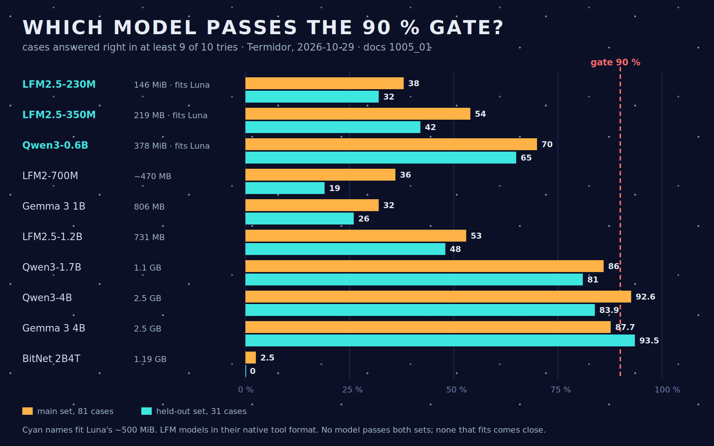

# From a tool-caller to a companion — how Mike's model was chosen

*October – November 2026*

This is the story of the small language model behind Mike, Luna's local brain: every model we tried, what we were asking of it at the time, and why each one was picked, set aside, or brought back. The question changed twice along the way, and each change of question changed the answer. The measurements live in `worklines/mike/docs/`; each figure below names the record it comes from.

---

## What we wanted

Mike was meant to turn a short French request ("ouvre le terminal", "mets Firefox à gauche") into one Wyoh action that the user then accepts. Three limits came with it:

- **Luna's memory:** 983 MiB in all. Kroko (speech to text), the desktop and Mannie also need room, so the user set a budget of a 300–400 MB model file (2026-10-09).
- **Luna's processor:** four Cortex-A35 cores, without the dot-product instructions that make small models fast elsewhere.
- **No training:** Mike uses models as they ship. Training and fine-tuning are outside its scope.

## The first shortlist: models built for tool calls (October 9–13)

A survey of models of 400 MB or less that were trained to call tools (`0000_01`) gave three candidates:

- Liquid AI's **LFM2.5-230M** and **LFM2.5-350M**: a hybrid design, with a small state to keep and fast writing;
- Google's **FunctionGemma 270M**, a model made only for function calls.

On 13 short French requests on Termidor (`0302_01`), LFM2.5-350M picked the right action 6 times, LFM2.5-230M 5 times, and FunctionGemma 4 times. FunctionGemma also needed the most memory (554–580 MiB). It is published as a base to fine-tune, which we were not going to do, so it was set aside.

On the full evaluation sets (`0302_03`), 81 main requests and 31 held-out ones, the 350M beat the 230M, and the 230M dropped further with constrained output. A plain keyword table was the baseline to beat: it got 14 of the 31 held-out requests.

**The user picked LFM2.5-350M on October 11** ("350 is impressive and fast"; `0304_01`). The 230M was a big step down for little memory saved. **Qwen3-0.6B** was noted and not run: its 378 MiB file and its KV cache, about ten times larger, looked too big for Luna.

## Making it small enough (October 11–19)

The user found about 500 MiB "far too much". Two measures brought it down:

- turning off llama.cpp's repacked copy of the weights and using small batches (the "lean" setting) gave 351 MiB in Python (`0302_05`);
- `llama-server` in C++ gave 306 MiB, and Q4_0 turned out the best file: 10 MiB smaller than Q4_K_M and better on the main set (55/81 against 45/81; `03b3_01`).

The **QAD** variant of Q4_0, recommended in a ChatGPT discussion, was no better and did worse on the held-out set. It was dropped. The choice became **LFM2.5-350M Q4_0, lean, in `llama-server`**.

## Luna says no: 105 seconds per request (October 25)

On Luna itself (`0405_01`), the model fit in about 300 MiB. But it read the 680-token tool prompt at 6.6–6.8 tokens per second: **about 105 s per request, against a budget of 1 s.** Writing ran at 2.8–3.6 tokens per second.

From those two speeds, `0801_01` derived what any model can afford on Luna. For an answer in about a second, a model may read and write only a few dozen tokens. The user's ruling, the same day: LFM2.5-350M "is not usable on Luna as it is". Mike went back to desk studies, and Luna went back to Mannie.

## The 90 % gate, and a wider net (October 29–30)

The user then set a gate before any further work on Luna: **at least 90 % of the cases answered right, steadily**, on both evaluation sets. A case counted only if at least 9 of its 10 answers were right. This time we tried every model we could get, including ones far too big for Luna, to find where the ceiling was (`1005_01`).

- **No model passed on both sets.** Qwen3-4B reached 92.6 % on the main set and 83.9 % on the held-out set. Gemma 3 4B did the reverse: 87.7 % and 93.5 %. Both have 2.5 GB files.
- **Size mattered more than anything else.** Qwen3 rose from 70 % (0.6B) to 86 % (1.7B) to 93 % (4B). The LFM models stayed between 36 % and 54 % from 230M up to **LFM2.5-1.2B**. LFM2-700M and Gemma 3 1B did no better.
- **Of the models that fit Luna, Qwen3-0.6B was the best**, at 70 % and 65 %, ahead of every LFM model, though still far from the gate. It came back from the October 13 shortlist.
- **BitNet b1.58 2B4T**, Microsoft's model with weights of −1, 0 and +1, was the worst of all: 2/81 and 0/31.

## A detour through the very small: Chat-GBC and text to shell (October 29–31)

Rudy's **Chat-GBC** runs a transformer on a 1989 Game Boy. Its published tiny model has 62k parameters and its micro model 136k. On Termidor, its published numbers reproduced exactly (`1006_01`). It recites the 405 Game Boy facts it was trained on, and answers only 32–40 % of new phrasings of those facts. It shows that a very small model works after training on its task, and training is outside Mike's scope.

At the user's request we tried anyway: we trained tiny and micro models on 39,549 shell-command pairs (`1101_01`). These variants have 66,000 and 136,640 parameters, because their vocabulary is learned from shell commands. They wrote 0 and 1 exact commands out of 300. The untrained LFM2.5-350M wrote 6. The story is told in [05 · The text-to-shell story](05_text-to-shell-story.md). Its conclusion closed that line of work: a command must be exact, and no model small enough for Luna writes exact commands.

## The question changes: small talk (October 31)

Since a model small enough for Luna could not be trusted to act, the user turned Mike into a **small-talk companion**, with LFM2.5-350M as it ships: no training, a short system prompt, and the conversation kept as token ids so that each turn reads only its own new tokens. This was the same model that had failed as a tool caller. It came back because the question no longer needed exact answers, only fluent ones, and it was already measured on Luna.

On Luna (`1205_01`):

- the first word comes after 2.2–2.7 s (median), and the answer streams at 4.6–5.0 tokens per second;
- it starts in 3.7 s when its system prompt is saved, and the server takes about 300 MiB.

It was fast enough to be pleasant. The user found it "psychedelic", though: fluent and often wrong.

## Measuring the hallucinations (November 1)

- **Asking it to doubt does nothing** (`1305_01`). With a sentence telling it to say when it is unsure, it admitted doubt 0 times out of 6 on questions it could not know. It invented the user's neighbour, breakfast and serial number.
- **A full assessment, nothing changed, graded by Professor** (`1704_01`):
  - **In French it is not good enough:** the sea is "white", water boils at 20 °C, and Shakespeare becomes Victor Hugo.
  - **In English it is usable for light small talk.**
  - Its memory within a conversation holds for 15–20 turns, and it reads facts from a supplied text perfectly: 24 out of 24.
  - It never says "I don't know": 0 out of 24.
- **Then an English-only rival, SmolLM2-360M-Instruct** (Q4_0, 230 MB, Apache-2.0; `1704_01` § 17.5). Neither model was clearly better:
  - SmolLM2 is more concise and gets simple practical facts right, such as how to open a Coke bottle. It knows it is Mike, but it forgets the user's name and invents a life of its own ("I have a cat named Luna").
  - LFM2.5-350M follows the user better.
  - Both read a supplied text perfectly, and both invent rather than abstain.

The language turned out to matter much more than the choice between these two models.

## Every model, at a glance

| Model | File | Fits Luna | Tested for | Best result | Outcome | Record |
| --- | --- | --- | --- | --- | --- | --- |
| LFM2.5-230M | 146 MiB | yes | tool calls | 5/13 smoke; 38 % / 32 % at the gate | set aside: weaker than 350M for little saving | `0302_01`, `1005_01` |
| **LFM2.5-350M** | 219 MB (Q4_0) | yes, ~300 MiB | tool calls, then small talk | 54 % / 42 % at the gate; first word 2.2–2.7 s on Luna | **chosen** (Oct 11); too slow for tools on Luna; **kept for small talk** | `0304_01`, `0405_01`, `1205_01`, `1704_01` |
| LFM2.5-350M QAD Q4_0 | 219 MB | yes | tool calls | no better than Q4_0 | dropped | `03b3_01` |
| FunctionGemma 270M | 241 MiB | yes | tool calls | 4/13 smoke | set aside: a base for fine-tuning | `0302_01` |
| Qwen3-0.6B | 378 MiB | yes, tightly | tool calls | 70 % / 65 % at the gate | best that fits; below the gate | `1005_01` |
| LFM2-700M | 469 MB | no | tool calls | 36 % / 19 % | no better than 350M | `1005_01` |
| Gemma 3 1B | 806 MB | no | tool calls | 32 % / 26 % | reference | `1005_01` |
| LFM2.5-1.2B | 731 MB | no | tool calls | 53 % / 48 % | same family, no gain | `1005_01` |
| Qwen3-1.7B | 1.1 GB | no | tool calls | 86 % / 81 % | reference | `1005_01` |
| Qwen3-4B | 2.5 GB | no | tool calls | 92.6 % / 83.9 % | ceiling, not a candidate | `1005_01` |
| Gemma 3 4B | 2.5 GB | no | tool calls | 87.7 % / 93.5 % | ceiling, not a candidate | `1005_01` |
| BitNet b1.58 2B4T | 1.19 GB | no | tool calls | 2.5 % / 0 % | worst of all | `1005_01` |
| Chat-GBC tiny / micro | 62k / 136k parameters (shell variants 66k / 137k) | yes | Game Boy facts, then shell commands (trained) | 32–40 % on new phrasings; 0–1 shell commands out of 300 | needs training; out of scope | `1006_01`, `1101_01` |
| SmolLM2-360M-Instruct | 230 MB | probably (340 MiB on the desk) | English small talk | as good as LFM in English, different flaws | a peer, not a winner; not measured on Luna | `1704_01` |

## What we keep

- **The model is LFM2.5-350M Q4_0, as shipped,** for small talk. It is measured on Luna, it is fast enough there, and it follows the conversation.
- **Size buys accuracy, and Luna cannot afford size.** Only 4B models reach the 90 % gate, and they are ten times too big.
- **No model this small knows what it does not know.** Honesty has to come from the code around it: answer only from a passage retrieved from Luna's guide, and say "I don't know" when none matches (Step 14).
- **English is the better language for Mike's model.** The user decided on 2026-11-01 to try working with Mike in English. Mycroft's Step 10 is evaluating Kroko in English, and the user's own English reading test is pending. French dictation stays for the Slate.

**Still open:** SmolLM2's speed and memory on Luna; whether a model between 1B and 4B could fit once Mannie and Mike never run together; and Kroko's English on the user's own voice.
