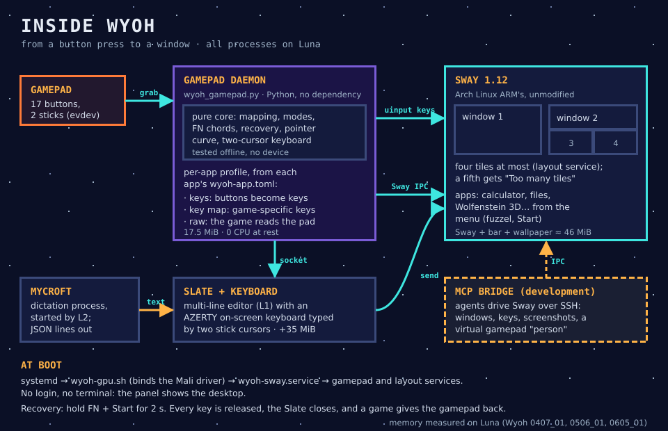

# 10 · Wyoh, the desktop

> In the novel, Wyoh is the one who makes the revolution visible and gets people moving. Here, Wyoh makes the desktop visible to agents and movable with a gamepad.

## In one sentence

Wyoh turns ArchR's own Sway compositor into a desktop that you drive with Luna's buttons, and that an agent can read and drive through a small set of named actions.

## Where it lives

| Piece | Code | On Luna | Started by |
|---|---|---|---|
| Sway session and its configuration | `src/wyoh/deploy/luna/` (`sway.conf`, `wyoh-sway.service`, `wyoh-gpu.sh`) | ArchR's Sway 1.11, with our config under `/storage/.local/share/tanstfaafllm/wyoh/` | systemd at boot |
| Gamepad daemon | `src/wyoh/wyoh_gamepad.py`, `deploy/luna/gamepad.toml` | same | `wyoh-gamepad.service` |
| Slate (multi-line editor) | `src/wyoh/wyoh_slate.py` | a floating terminal window | the daemon, on L1 |
| On-screen keyboard | `src/wyoh/wvkbd/` (a patch to wvkbd 0.15: AZERTY and two cursors) | built on `luna-pi`, deployed under `/storage` | the daemon, with the Slate |
| Four-tile layout | `src/wyoh/wyoh_layout.py` | same | `wyoh-layout.service` |
| Apps and menu | `src/wyoh/apps/<app>/` (a `wyoh-app.toml` manifest and a `run` launcher), `wyoh_apps.py` | apps under `/storage/.local/opt/`, menu entries generated | fuzzel menu, on Start |
| MCP bridge (development) | `src/wyoh/wyoh_mcp_server.py`, `wyoh_virtual_input.py` | started over SSH, owns no port | an agent, for tests |

You deploy with `make wyoh-luna-deploy`, and boot into the session with `make wyoh-luna-enable`. Removing it gives back ArchR's text console.

## How it talks to the others

- **Gamepad → daemon.** The daemon takes the gamepad exclusively (an evdev grab) and answers through a virtual keyboard and mouse (uinput), plus Sway commands over Sway's IPC socket: focus, close, full screen, workspaces.
- **Daemon ↔ Slate.** A private Unix socket. The Slate owns the text, and nothing is written to disk or to a log.
- **Mycroft → Slate.** On L2, the daemon starts Mycroft's dictation process. It reads its `ready` / `partial` / `final` JSON lines and passes them to the Slate. Provisional text is underlined, and final text is inserted at the cursor.
- **Apps.** Each app declares in its manifest how it wants the gamepad:
  - **keys:** the buttons become keys;
  - **a key map:** Wolfenstein's own keys;
  - **raw:** the daemon releases the gamepad while the app has the focus.

  FN+B (close) and the recovery chord always stay with Wyoh.
- **Agents.** In development, an agent drives Sway through the MCP bridge over SSH: it opens windows, types, takes screenshots, and acts as a "person" with a virtual gamepad. That is how every scenario is tested and its screenshots inspected.

The full button table is in [`worklines/wyoh/docs/0512_01_luna-controls-reference.md`](../worklines/wyoh/docs/0512_01_luna-controls-reference.md), which is checked against the code by a test. The illustrated French cheat sheet is [`0609_01`](../worklines/wyoh/docs/0609_01_luna-cheat-sheet.svg).

## What it costs (measured on Luna)

| Part | Memory |
|---|---|
| Sway + status bar + wallpaper + status script | ≈ 46 MiB |
| Gamepad daemon | 17.5 MiB, no CPU at rest, 3.8 % of one core with a stick held |
| Slate + on-screen keyboard, only while open | 22.3 + 13.0 MiB |
| Menu (fuzzel), only while open | ≈ 9 MiB |
| Wolfenstein 3D (ECWolf), as an example app | ≈ 66 MiB |

With the session running, about 795 MiB of Luna's 983 MiB stay available for everything else.

## Why it is like this

- **Sway, unmodified.** Sway already exposes its whole state, windows and focus as structured data. So agents don't need pixels to understand the screen, and we don't need to fork a compositor. A thin adapter comes only if Sway cannot express something we need.
- **Our own gamepad daemon**, rather than the handheld world's `gptokeyb`. Intercepting the buttons at the lowest level lets Wyoh give them modes: desktop, Slate, game. Later, it will let an AI prepare or complete an action. Its core is pure code, tested without any device.
- **Light apps only.** A GTK editor measured 48 MiB, against 15 MiB for a terminal editor, so the apps are terminal or SDL programs. A calculator was written from scratch rather than borrowed.
- **The GPU display fix.** Mali apps first showed nothing under Sway: they sent buffers through Mali's private protocol, which Sway cannot import. One environment variable (`MALI_WAYLAND_DMABUF_PROTOCOL=1`) makes them use the standard one.
- **Typing into apps through the virtual keyboard.** The usual Wayland typing tool crashed SDL apps, so the Slate sends text through the daemon's own virtual keyboard.

## Status and limits

- **Live on Luna:**
  - booting straight into the desktop;
  - every button mode, and recovery;
  - the Slate, with two-thumb typing;
  - the four-tile layout;
  - the menu, the calculator, Files and Wolfenstein 3D.

  Wyoh has 266 offline tests, plus live scenarios with inspected screenshots.
- **Waiting for the user's hands:** the check of the physical controls, the whole-cross press, and readability.
- **Waiting for a microphone:** dictation in the Slate.
- **Next:** chess, the Dino game, NetSurf, a Wi-Fi panel driven by the buttons, and possibly desktop icons and a full-screen-only window policy.
- **Known limit:** the exclusive grab mutes ArchR's own gamepad hotkeys. The brightness shortcut is one of them.

**Sources:** `worklines/wyoh/plan_wyoh.md`, Steps 1, 5, 6, 9 and 12; results `0407_01`, `0408_01`, `0506_01`, `0605_01`; the controls reference `0512_01`.
