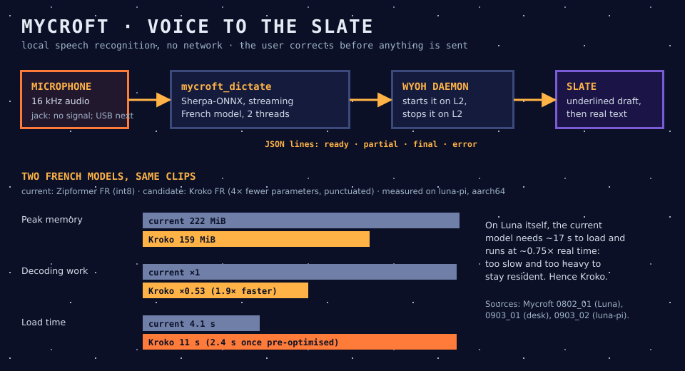

# 11 · Mycroft, voice to text

> In the novel, MYCROFT is the secret phone number that lets the revolutionaries reach Mike from anywhere. Here, Mycroft is how your voice reaches Luna.

## In one sentence

Mycroft turns French speech into editable text, locally and with no network, and writes it into Wyoh's Slate, where you correct it before sending.

## Where it lives

| Piece | Code | Runs on |
|---|---|---|
| Dictation provider `mycroft_dictate.py` | `worklines/mycroft/scripts/` | Luna (scripts in `/storage/.local/share/tanstfaafllm/mycroft/`, model in `/storage/.local/opt/mycroft/`) |
| Text console `mycroft_console.py` | same | desk host: speak, see the draft, edit it, accept it |
| Benchmarks and model tools | `benchmark_asr.py`, `preoptimise_model.py`; tests in `test/mycroft/` | desk host, `luna-pi`, Luna |

## How it talks to the others

- **Wyoh starts it.** L2 in the Slate starts the provider, and L2 again (or any key) stops it.
- **Lines on its output:** `ready`, then `partial` drafts while you speak, then a `final` text, or an `error`. These are JSON lines on standard output. Closing its input stops it.
- **The Slate owns the text.** Drafts are underlined, and the final text is inserted at the cursor. Nothing is sent until you press FN+A. The contract is in [`worklines/mycroft/docs/0704_01`](../worklines/mycroft/docs/0704_01_dictation-provider.md).
- **Known words.** The model accepts a list of words to favour, such as names like Wyoh, Luna or Michael. This works, but it has not yet been measured on the user's own voice.

## What it costs

| Where | Load | Speed | Memory |
|---|---|---|---|
| Luna, current model, 2 threads | ≈ 17 s (≈ 13 s pre-optimised) | ≈ 0.75 × real time: a 7 s sentence ends 3.6 s late | ≈ 252 MiB |
| `luna-pi`, current model | 4.1 s | — | 222 MiB |
| `luna-pi`, Kroko | 11 s (2.4 s for its encoder once pre-optimised) | 1.9 × faster than the current model | 159 MiB |

## Why it is like this

- **Sherpa-ONNX with a streaming French Zipformer.** It was chosen over whisper.cpp tiny in the first desk benchmark, and it streams partial results while you speak. It has stayed the reference since.
- **Two threads, not four.** On Luna's Cortex-A35 cores, four threads decode more slowly than one and burn 2.5 times the CPU. Two is the best setting.
- **Python stays.** Sherpa's own C++ binary saved only about 15 MiB, and it neither loaded nor decoded faster. The heavy work is compiled code in both cases.
- **The load is computation, not disk.** About 15 of the 17 s go to ONNX Runtime preparing the model. Saving a pre-optimised model removes part of it. Keeping the model resident would remove all of it, at a permanent cost of about 250 MiB.
- **Hence Kroko.** It is about four times smaller, half the CPU, 60 MiB lighter, and it outputs punctuation and capitals. It was more accurate on the user's own reading (word error 9 % against 13 %).
- **GPU later.** Luna's Mali exposes OpenCL. It is parked until dictation works well on the CPU.

## Status and limits

- **Done:**
  - the console works on the desk host, and the user judged live dictation there "pas mal";
  - the provider is installed on Luna and wired into the Slate, and is tested with a fake provider.
- **Blocking:** no microphone on Luna yet.
  - The headset jack gives no signal under ArchR, even with the factory codec values.
  - A passive USB-C adapter is not a sound card.
  - The next try is a USB sound card or a USB microphone.
- **Open:**
  - Kroko's licence must be confirmed;
  - Kroko must be measured on Luna itself;
  - known words must be measured on the user's voice;
  - the "re-format" action (punctuation on demand) is not designed yet.

**Sources:** `worklines/mycroft/plan_mycroft.md`, Steps 4, 5, 7, 8 and 9; results `0104_04`, `0703_01`, `0802_01`, `0901_01`, `0903_01` and `0903_02`; contract `0704_01`.
