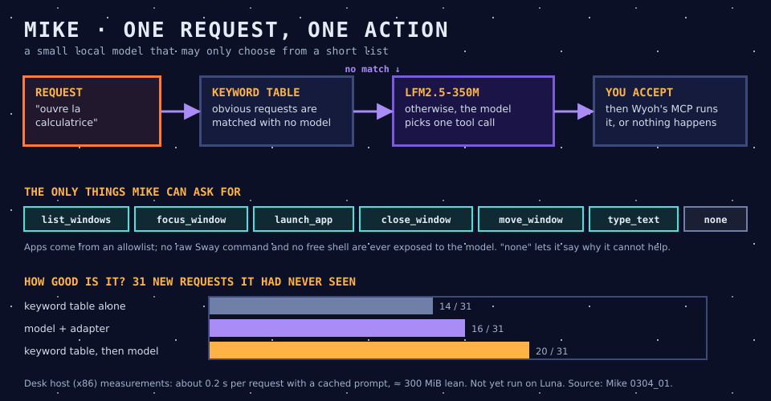

# 12 · Mike, the local brain

> In the novel, Mike is the Lunar Authority's computer, which woke up and learned to act on the world around it. Here, Mike is a very small model that learns to act on Luna's desktop, and is allowed to do very little.

## In one sentence

Mike reads a short request ("ouvre la calculatrice") and proposes **one** desktop action from a list of seven. You accept it or refuse it, and Wyoh carries it out.

## Where it lives

| Piece | Code |
|---|---|
| Tool contract: tools, allowed values, mapping onto Wyoh | `src/mike/mike_contract.py`, [`worklines/mike/docs/0102_01`](../worklines/mike/docs/0102_01_tool-contract.md) |
| Evaluation sets, fake Wyoh, scoring | `test/mike/` (81 requests, plus 31 held-out ones it never saw) |
| Manual chat, to try a model by hand | `worklines/mike/scripts/mike_chat.py` |
| Models (GGUF, not committed) | `/data/…/mike-assets/` on the desk host |

The runtime is llama.cpp through `llama-cpp-python` (the `mike` dependency group).

## How it talks to the others

- **In:** plain text. It comes from typing today, and later from Mycroft's dictation.
- **Out:** one tool call, mapped by an adapter onto Wyoh's MCP actions. For example, `launch_app("calculator")` becomes a Sway `exec` of the calculator's menu entry. Closing a window asks a second time.
- **Read-only questions run without asking.** `list_windows` is one. Everything else waits for you to accept.
- **Too hard:** the model answers `none` with a reason. Escalating to Mannie is designed in, but not built.

## What it costs (desk host, x86)

| Model | Memory, lean settings | Time per request | Held-out score |
|---|---|---|---|
| **LFM2.5-350M** (chosen) | ≈ 351 MiB with Python, ≈ 300 MiB without | ≈ 0.2 s with a cached prompt, ≈ 2 s otherwise | 16/31 alone, **20/31** behind the keyword table |
| LFM2.5-230M | ≈ 263 MiB | a little faster | 21/31 behind the keyword table |

"Lean" turns off a repacked copy of the weights, which is an x86 speed layout, and uses smaller batches. That cut about 140 MiB. Nothing has run on Luna yet.

## Why it is like this

- **Tool-calling, not chatting.** A model that may only pick from seven named tools cannot run a raw Sway command or a shell. Its mistakes stay small and visible.
- **The keyword table goes first.** Rules catch the obvious requests at no cost, and the model handles the rest. Together they score better than either alone. This is "the least sufficient intelligence".
- **LFM2.5-350M** was the user's choice. It is the best at the task, and "impressive" in hand-tried conversation, where the 230M model confused itself with the user and invented tools.
- **Accepting is not optional.** The model proposes, and the user decides.

## Status and limits

- **Done:**
  - the contract;
  - the evaluation harness, with 55 offline tests;
  - the comparison of four candidates;
  - the model choice.
- **Waiting for the user:**
  - approval of the tool contract, including whether "focus a closed app" should launch it;
  - the routing option;
  - trimming the vocabulary (17 % of it is scripts the user never needs);
  - whether to leave Python for a C++ or Rust runtime with a very small harness.
- **Not yet:** measuring on `luna-pi` and Luna, and the console that runs accepted actions.
- **Honest limit:** about two in three unseen requests are right. That is acceptable only because every action needs your approval.

**Sources:** `worklines/mike/plan_mike.md`; results `0302_01` to `0302_05` and the comparison `0304_01`; contract `0102_01`.
