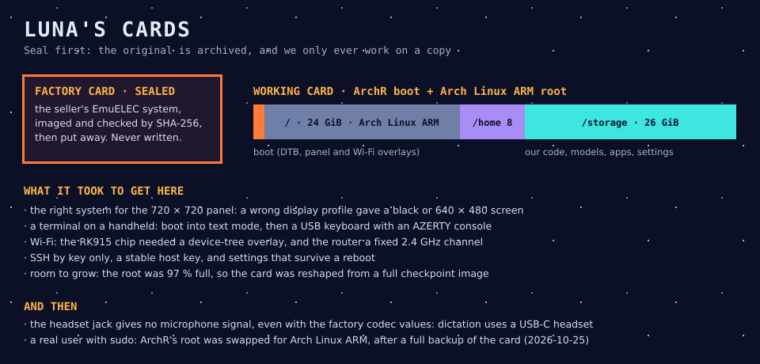

# 14 · Luna, the device

> "The Moon is a harsh mistress", and so is a 30-euro handheld. Every component of this project lives inside its limits.

## In one sentence

Luna is the R36 Ultra itself: what its hardware can do, the card it boots from, and the careful bring-up that turned a retro-gaming console into a Linux machine we can reach over SSH.

## The hardware

| Part | Fact |
|---|---|
| SoC | Rockchip RK3326: 4 × Cortex-A35, Mali-G31 MP2 GPU |
| Memory | 983 MiB of RAM, shared with the GPU |
| Screen | 720 × 720 DSI panel |
| Controls | 17 buttons (cross, A/B/X/Y, L1/L2/R1/R2, Select/Start/FN, two stick clicks) and two sticks |
| Network | RK915 Wi-Fi, 2.4 GHz |
| Audio | a speaker and a headset jack; the jack's microphone gives no signal under ArchR so far |
| GPU APIs | ARM's `libmali`: OpenGL ES and **OpenCL**; **no Vulkan** |

## The system

- **ArchR** (an Arch-based handheld distribution, kernel 6.12) runs on a disposable copy of the card. The original card is archived and never written: that is our **Seal**.
- **The card is reshaped:** `/` is 24 GiB, `/home` is 8 GiB, and `/storage` is 26 GiB. Everything of ours goes in `/storage/.local`, so it survives and can be removed.
- **The machine boots straight into Wyoh's desktop.** The text console stays underneath as a fallback.
- **Access:** SSH by key only, with a stable host key. The agents share Luna one session at a time, through Professor's token (`worklines/luna-access.md`), and reboot it after each test series.

The full story, card by card, is in [`03_r36-ultra-bring-up-story.md`](03_r36-ultra-bring-up-story.md). It covers the black screen, the hunt for the Wi-Fi driver, the router that had a say, and the full root partition.

## Why it is like this

- **Keep ArchR, change nothing of it.** ArchR's boot path, display and Wi-Fi work. Our changes stay in `/storage`, so the device stays recoverable, and the decision to replace the base system can wait for evidence.
- **Checkpoint before every risky change.** The reshape started from a full image of the card, checked by SHA-256, with a one-line rollback.
- **Measure on the device.** Desk and `luna-pi` figures are hints. Luna's slow cores and 1 GiB are the real test.

## Status and limits

- **Live:** boot, panel, Wi-Fi, SSH, the GPU driver, and Wyoh's session.
- **Microphone:**
  - **Negative:** the jack gives no signal, even with the factory codec register values written at runtime.
  - **Next:** a USB sound card or a USB microphone. A passive USB-C-to-jack adapter is not enough.
- **Open:**
  - **Accounts:** only `root` exists, and ArchR has no `useradd`. Normal accounts (for the user, and for the agents) are being studied.
  - **Base system:** keep ArchR, or put a plain Arch Linux ARM or Debian root on its proven boot path (Luna Step 7, not decided).

**Sources:** `worklines/luna/plan_luna.md`, Steps 5, 6 and 8; results `0604_01` and `0802_01`; note `0700_01`; [`03_r36-ultra-bring-up-story.md`](03_r36-ultra-bring-up-story.md).
