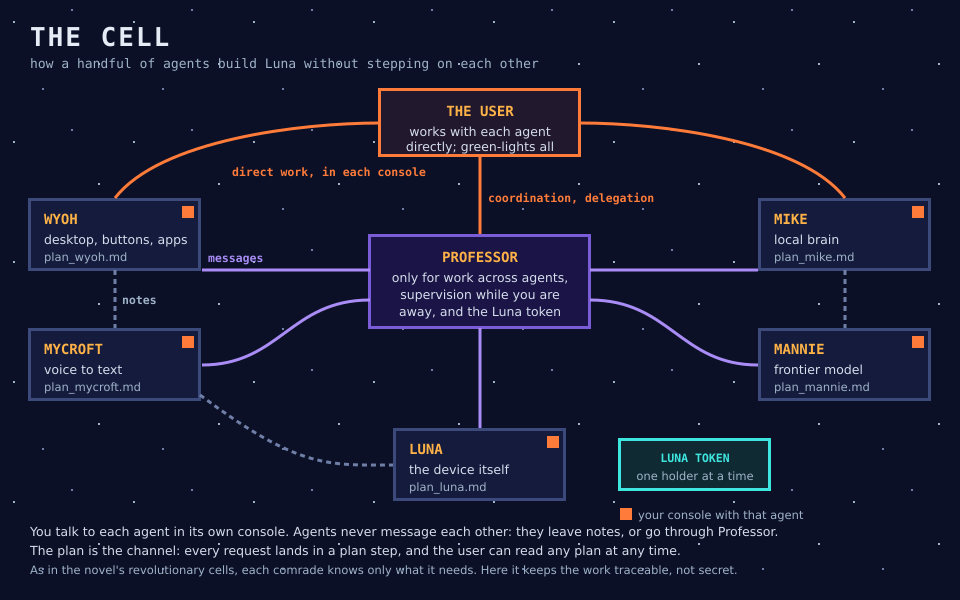
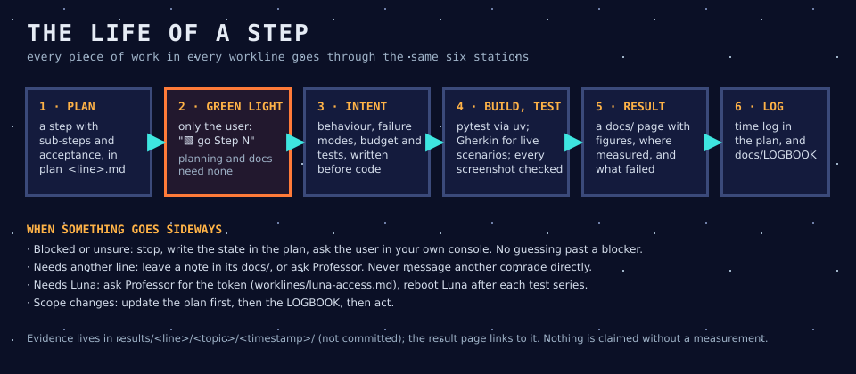

# 15 · The cell, how the agents build Luna

> In the novel, the revolution is organised in cells of three: each member knows only what they need. Our cell of AI agents is organised the same way, except that everything is written down.

## In one sentence

Each part of Luna is built by its own AI agent, working on its own plan. The user works with each agent directly, and Professor coordinates only what crosses agents.

## Who is in it

| Agent | Workline | Builds |
|---|---|---|
| Wyoh | `worklines/wyoh/` | the desktop, the buttons, the apps |
| Mycroft | `worklines/mycroft/` | voice to text |
| Mike | `worklines/mike/` | the local brain |
| Mannie | `worklines/mannie/` | Claude Code on the device |
| Luna | `worklines/luna/` | the device: cards, boot, Wi-Fi, audio |
| Professor | `worklines/professor/` | coordination, decisions across agents, this documentation |

Each agent is a Claude session in VS Code. The running sessions are listed in `worklines/agents.md`.

## How a piece of work flows

1. **Plan.** Every piece of work is a step in its workline's plan, with sub-steps and an acceptance test.
2. **Green light.** Only the user starts implementation, with "🟩 go Step N". Planning and documentation need no green light.
3. **Intent.** Before any code, a short document says what will be built, how it can fail, what it may cost, and how it will be tested.
4. **Build and test.**
   - Tests use pytest, run through `uv`.
   - Graphical or multi-step scenarios get a readable Gherkin `.feature`.
   - Device checks are marked `live` and run on purpose.
   - Every screenshot is looked at before anyone claims success.
5. **Result.** A page in the workline's `docs/` gives the figures, where they were measured, and what failed.
6. **Log.** The plan's time log and the shared `docs/LOGBOOK.md` record every material change.

## The rules that keep it sane

These rules are in the skills, committed in `skills/` and referenced from `AGENTS.md`:

- **`workplan`** is how plans, steps and docs are written.
- **`cell-coordination`**:
  - The user talks to each agent in its own console.
  - Agents never message each other. They leave notes in each other's `docs/`, or ask Professor.
  - A blocked agent stops, writes its state in its plan, and asks the user.
- **Shared devices:** one session at a time on Luna and on `luna-pi`, through Professor's token in `worklines/luna-access.md`.
- **Language:** everything is written in English, and the agents talk to the user in French.
- **Delegation:** when the user is away, they can hand Professor the supervision for a while. Every decision Professor takes then goes into a log for review. See [the first one](../worklines/professor/docs/0503_01_delegated-coordination-log-2026-10-09.md).

## Why it is like this

- **One agent per part** keeps each context small and each plan readable. The user can drop into any line and see where it stands.
- **Notes rather than chatter.** Early on, the agents pinged each other freely, and it became noise. Now coordination is explicit and leaves a trace.
- **Plans as the channel.** Work that is not in a plan is not done. That is what makes the project reviewable after the fact, by the user or by a colleague.
- **Honesty over speed.** A claim needs a measurement, and a failure is written down as such.

## Status and limits

- **Running:** six agents, the token for Luna, notes, and delegated supervision.
- **Learned the hard way:**
  - A name swap (Mike and Mannie were inverted for two days) was caught and reverted.
  - A coordinator does not see the agents' consoles, so a blocked agent writes its state in its plan as well as asking in its console.

**Sources:** `AGENTS.md`; `skills/cell-coordination/SKILL.md`; `worklines/professor/plan_professor.md`; `worklines/agents.md`; `worklines/luna-access.md`.
