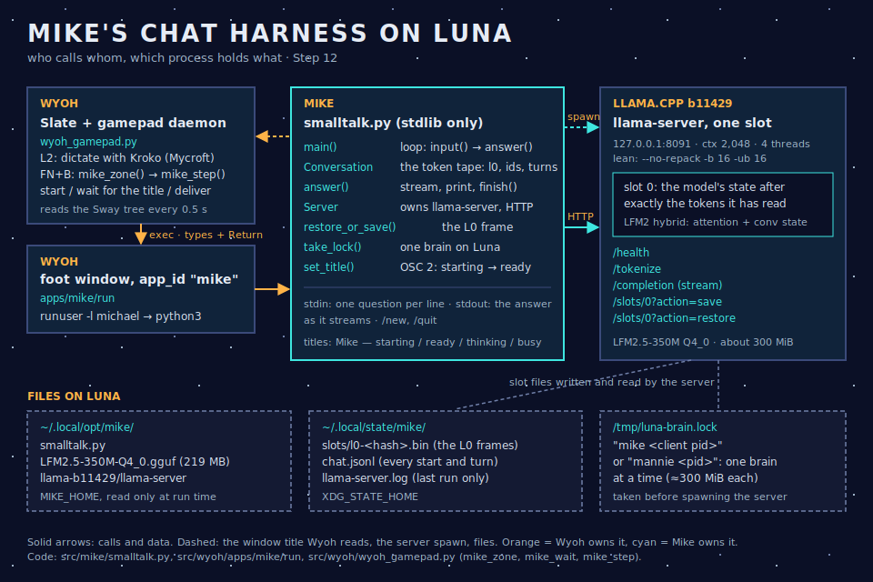
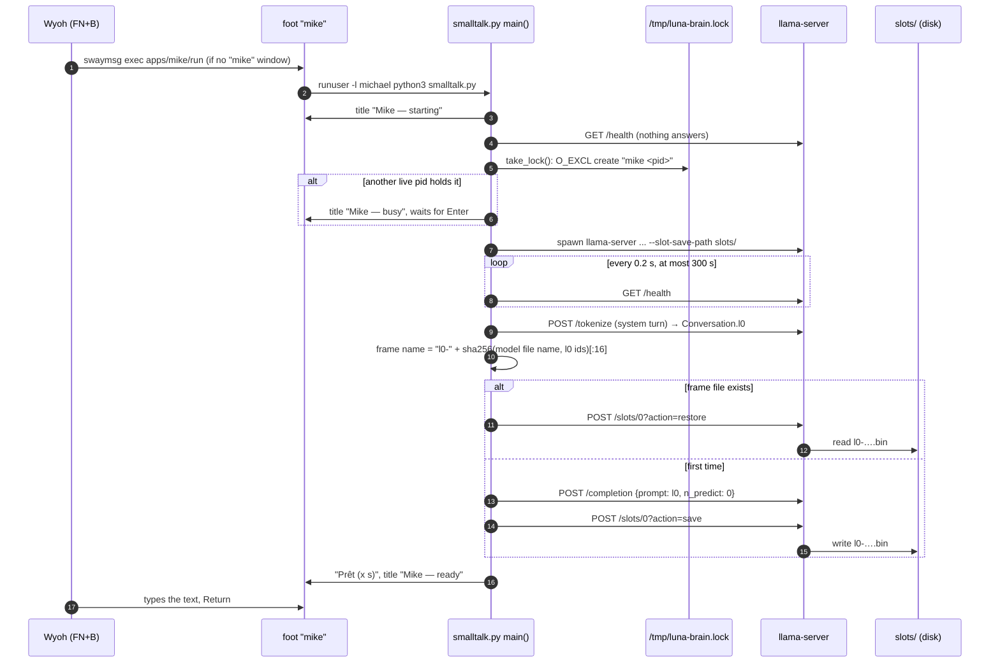
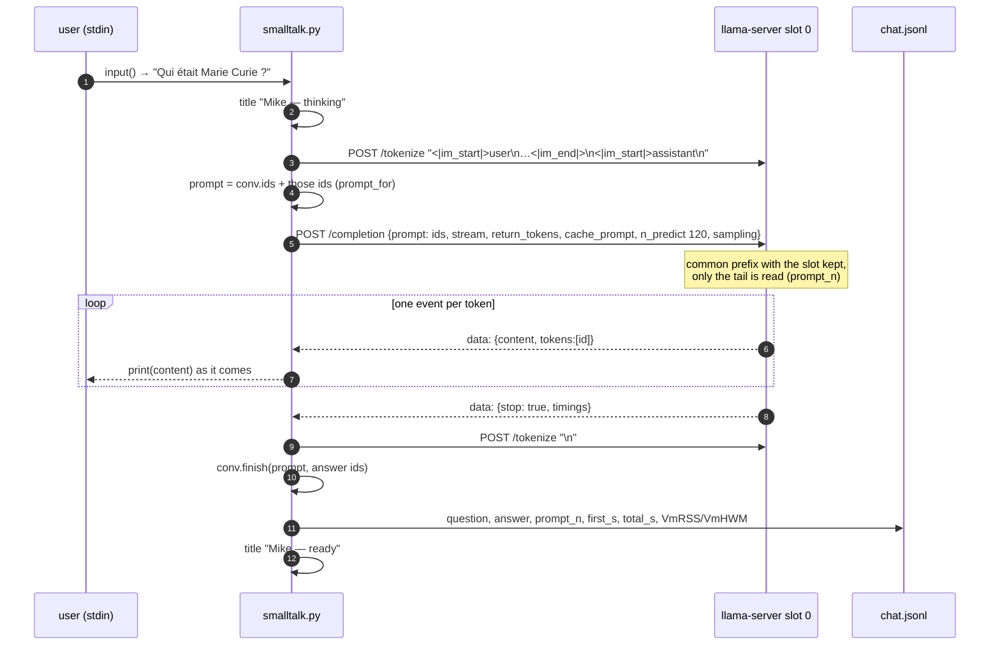
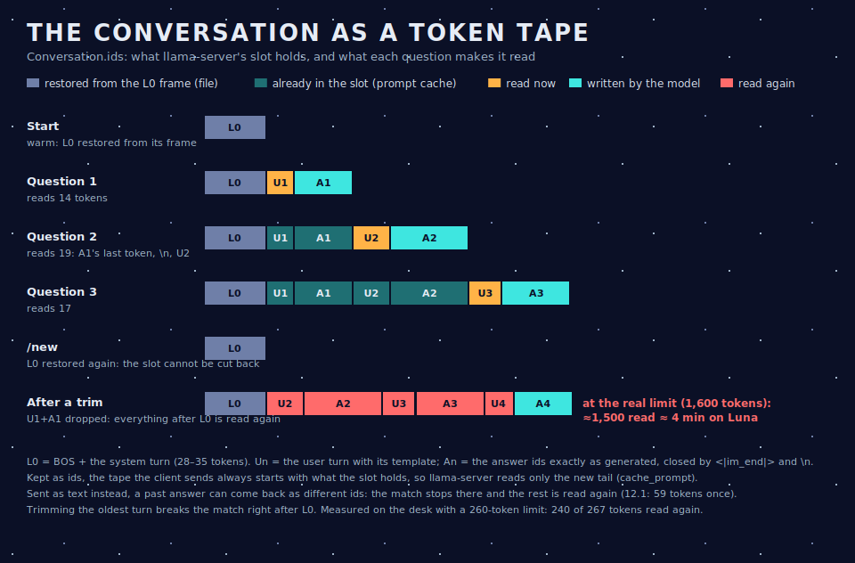
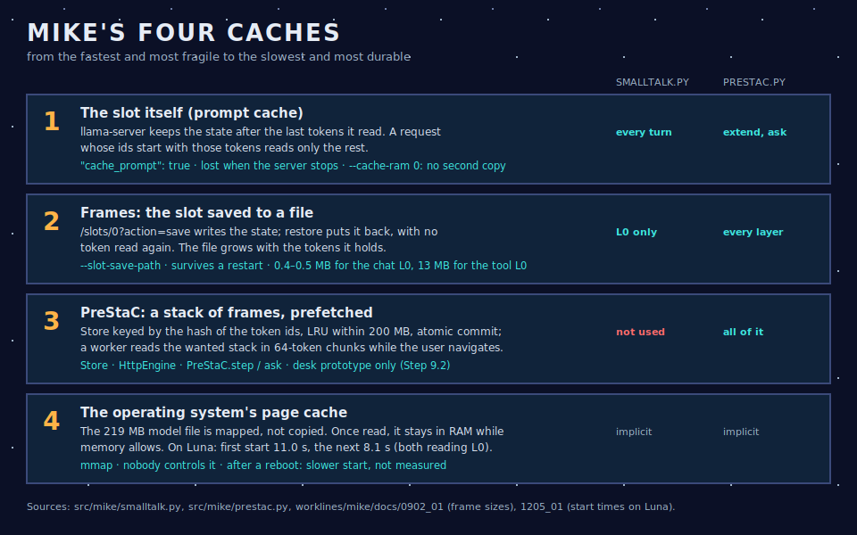
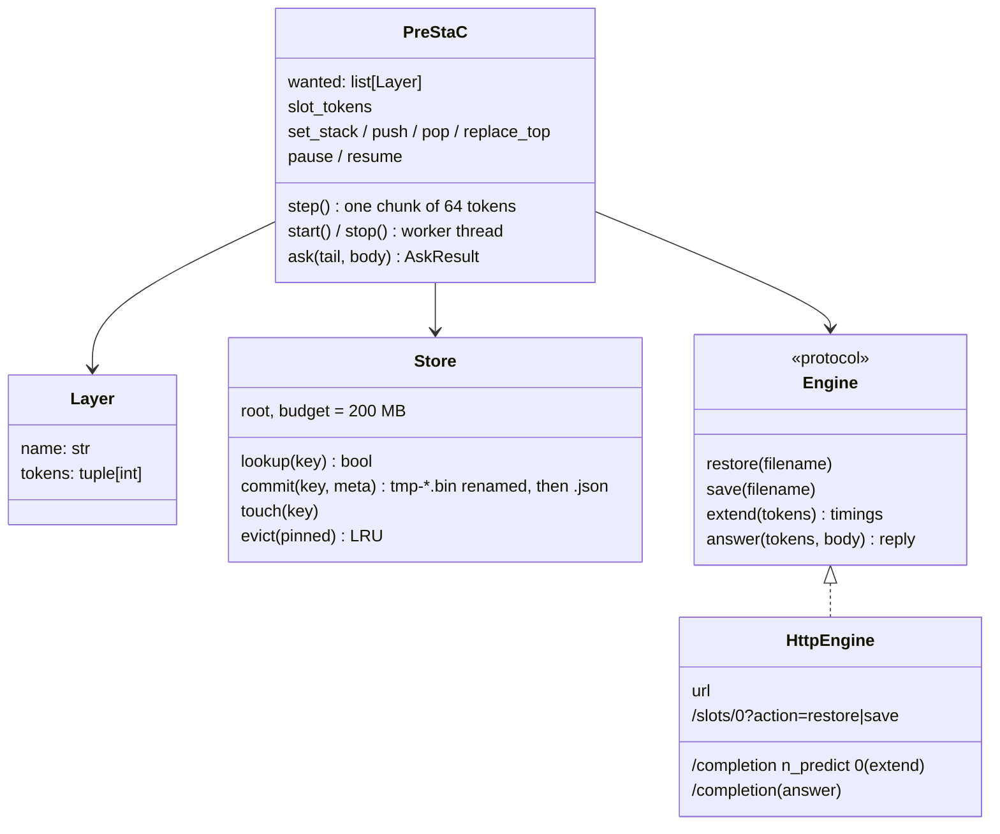

# 16 · Mike's chat harness and its caches

> For a code review. This page describes the code that runs Mike's small talk on Luna (Step 12) and every cache it relies on: what each piece does, who calls whom, with links to the lines. It ends with what the review should look at: problems found, two of them measured, and the choices to make.

**State described:** `main` at commit `bb53c0c` (2026-10-31). Mike's side is [`src/mike/smalltalk.py`](../src/mike/smalltalk.py) (320 lines, standard library only) and [`src/mike/prestac.py`](../src/mike/prestac.py) (336 lines). Wyoh's side is the launcher [`src/wyoh/apps/mike/run`](../src/wyoh/apps/mike/run) and FN+B in [`src/wyoh/wyoh_gamepad.py`](../src/wyoh/wyoh_gamepad.py#L885-L895). The model is LFM2.5-350M Q4_0 in llama.cpp's `llama-server` b11429.

**Measured so far:**
- Desk: [`worklines/mike/docs/1201_01`](../worklines/mike/docs/1201_01_smalltalk-desk-result.md).
- Luna: [`1205_01`](../worklines/mike/docs/1205_01_smalltalk-on-luna.md). First word after 2.2–2.7 s (median), last word after 9–14 s, about 300 MiB.
- PreStaC on the desk: [`0902_01`](../worklines/mike/docs/0902_01_prestac-desk-result.md).

---

## 1. The pieces

| Piece | Owner | Where | Role |
| --- | --- | --- | --- |
| Slate + FN+B | Wyoh | [`wyoh_gamepad.py` `mike_zone`](../src/wyoh/wyoh_gamepad.py#L1601-L1626), [`mike_wait`](../src/wyoh/wyoh_gamepad.py#L1628-L1646), [`mike_step`](../src/wyoh/wyoh_gamepad.py#L885-L895) | Starts Mike's window if absent, waits for the title "Mike — ready" (polls the Sway tree every 0.5 s, 90 s at most), then types the dictated text and Return. "Mike — busy" gives the notice "Mike cannot start while Mannie runs". |
| Window | Wyoh | [`apps/mike/run`](../src/wyoh/apps/mike/run), [`wyoh-app.toml`](../src/wyoh/apps/mike/wyoh-app.toml) | `foot -a mike`, then `runuser -l michael` and `python3 $MIKE_HOME/smalltalk.py`. Tiled, not fullscreen (the floating Slate must stay visible). |
| Client | Mike | [`smalltalk.py`](../src/mike/smalltalk.py) | The loop, the conversation as token ids, the L0 frame, the brain lock, the titles, the log. |
| Model server | llama.cpp | `~/.local/opt/mike/llama-b11429/llama-server` | One slot, context 2,048. Spawned by the client ([`Server.__init__`](../src/mike/smalltalk.py#L101-L114)). |
| PreStaC library | Mike | [`prestac.py`](../src/mike/prestac.py) | Stack of frames with prefetch. Used by the desk prototype of Step 9.2, **not by the chat client** (§ 6). |

### What the client contains

| Function or class | Lines | Does |
| --- | --- | --- |
| [`Conversation`](../src/mike/smalltalk.py#L57-L90) | 57–90 | The token tape: `l0`, `ids`, `turns`; `prompt_for()`, `finish()`, `reset()`; drops the oldest turns past `KEEP_CTX`. |
| [`sse_events`](../src/mike/smalltalk.py#L93-L98) | 93–98 | Parses the server-sent-events stream of `/completion`. |
| [`Server`](../src/mike/smalltalk.py#L101-L188) | 101–188 | Starts or finds `llama-server`, takes the lock, stops it. Also `post`, `tokenize`, `stream`, `rss_kib` and `restore_or_save`. |
| [`take_lock`, `release_lock`](../src/mike/smalltalk.py#L195-L218) | 195–218 | `/tmp/luna-brain.lock` holds "mike <pid>". The client refuses to start while a live process holds the lock, and removes a stale lock. |
| [`set_title`](../src/mike/smalltalk.py#L221-L223) | 221–223 | OSC 2 escape sequence. foot passes it to Sway as the window's `name`. |
| [`answer`](../src/mike/smalltalk.py#L226-L250) | 226–250 | One turn: stream, print, `finish`, and the turn's record. |
| [`main`](../src/mike/smalltalk.py#L253-L316) | 253–316 | Arguments and environment variables, start, the L0 frame, the input loop, the `/new` and `/quit` commands, the log. |

**Settings** ([lines 45–54](../src/mike/smalltalk.py#L45-L54)):
- system prompt in French or English ("two or three short sentences");
- sampling from the model card: temperature 0.1, top-k 50, repeat penalty 1.05, no seed;
- `MAX_TOKENS` 120;
- `KEEP_CTX` 1,600.

**Environment:** `MIKE_HOME`, `MIKE_LANG`, `MIKE_PORT` (8091), `MIKE_SERVER`, `MIKE_MODEL`, `MIKE_LOCK`, `MIKE_REPACK`, `MIKE_THREADS` (4), `XDG_STATE_HOME`.

---

## 2. Start

Measured on Luna ([`1205_01`](../worklines/mike/docs/1205_01_smalltalk-on-luna.md)):
- **3.7 s** to "ready" when the frame exists;
- **8.1 s** when L0 has to be read (the second start, with the model file probably still in memory);
- **11.0 s** the first time.

Wyoh measured FN+B with Mike closed: the question was delivered at 6.5 s and answered at 13 s.

---

## 3. One turn

**Code path:** [`main` loop](../src/mike/smalltalk.py#L293-L311) → [`answer`](../src/mike/smalltalk.py#L226-L250) → [`Conversation.prompt_for`](../src/mike/smalltalk.py#L75-L77) → [`Server.stream`](../src/mike/smalltalk.py#L171-L176) → [`sse_events`](../src/mike/smalltalk.py#L93-L98) → [`Conversation.finish`](../src/mike/smalltalk.py#L79-L90).

**Each line of `chat.jsonl`** holds:
- the question and the answer;
- `prompt_tokens` (the size of the tape) and `prompt_n` (what the server really read);
- `predicted_n`, `first_s`, `total_s`, `prompt_ms`, `predicted_ms` and `stop`;
- `VmRSS` and `VmHWM` when the server belongs to the client.

---

## 4. The conversation as a token tape

The cache works only if what the client sends starts with **exactly** the tokens the slot holds. So the client never re-renders the history as text. It keeps the ids:

- **L0** ([line 68](../src/mike/smalltalk.py#L68)) is `BOS` (id 1) plus the tokenised system turn: 28–35 tokens.
- **The question** ([line 77](../src/mike/smalltalk.py#L77)) is the user turn wrapped in LFM2's template, tokenised by the server with `parse_special`, so that `<|im_start|>` and `<|im_end|>` become single ids.
- **The answer** ([lines 79–85](../src/mike/smalltalk.py#L79-L85)) is the ids exactly as generated. They end with `<|im_end|>` (id 7) when the model stops by itself; the client adds that id when the answer was cut at 120 tokens. Then comes `\n`.
- **The last generated token is not yet in the slot:** the model sampled it but never read it back. The next request therefore reads it, which is why a follow-up reads "the question + 2–3".
- **Why ids and not text:** in Step 12.1, sending the history as text once made the server read 59 tokens instead of about 16. A past answer, turned back into tokens, did not match the ids the model had generated.
- **LFM2 is a hybrid model** (attention plus convolution state). Its state can be extended, or replaced by a restore, but not cut back to an arbitrary earlier token. `/new` therefore restores the L0 frame from disk ([line 304](../src/mike/smalltalk.py#L304)) instead of asking the server to forget the turns.

---

## 5. The four caches

### 5.1 The slot (prompt cache)

- **Turned on per request** with `"cache_prompt": true` ([line 174](../src/mike/smalltalk.py#L174)). The server compares the new prompt with what the slot holds, keeps the common prefix and reads the rest. `timings.prompt_n` says how many tokens it read.
- **One slot** (`-np 1`) and `--cache-ram 0`: no host-RAM cache of other prompts. Memory is the constraint on Luna.
- **For the hybrid model**, reuse works here because the client only ever extends the slot. The desk setting `lean-ckpt` (context checkpoints) gave the same results as `lean` in 12.1 (`results/mike/chat-baseline/20261031T110034Z/`), so the client does not use checkpoints.

### 5.2 Frames: the slot saved to a file

- **Saving and restoring:** [`restore_or_save`](../src/mike/smalltalk.py#L178-L188) uses `POST /slots/0?action=save|restore` with a file name. The server writes under `--slot-save-path` (`~/.local/state/mike/slots/`).
- **Size:** about 12.4 KB per token (`0902_01`). The chat L0 frame is 0.4–0.5 MB (`results/mike/smalltalk-desk/…/slots/`); the 1,053-token tool prompt of Step 9 made 13 MB.
- **The client saves one frame only, L0, named** `l0-` + the first 16 hex digits of `sha256(json([model file name, l0 ids]))` ([lines 281–283](../src/mike/smalltalk.py#L281-L283)).

### 5.3 PreStaC (the library)

See § 6. The chat client does not use it.

### 5.4 The page cache

- **The model is memory-mapped.** About 230 MiB of the server's RSS is the file (`RssFile`), shared with the kernel's page cache.
- **On Luna, the first start took 11.0 s and the next 8.1 s.** Both read L0, so the 3 s difference is most likely the file already being in memory. Starting after a reboot has not been measured.

### 5.5 `llama-server` flags used by the client

From [`Server.__init__`](../src/mike/smalltalk.py#L104-L111):

| Flag | Value | Why |
| --- | --- | --- |
| `-c` | 2048 | Context; `KEEP_CTX` 1,600 leaves room for a question and 120 tokens of answer |
| `-np` | 1 | One slot: one conversation |
| `-t` | 4 (`MIKE_THREADS`) | Luna's four cores; Kroko is idle while Mike answers |
| `--cache-ram` | 0 | No host copy of other prompts |
| `-b`, `-ub` | 16, 16 | "Lean": small batches, less memory (`0302_05`) |
| `--no-repack` | unless `MIKE_REPACK=1` | The repacked copy costs memory and was no faster on Luna (4.63 against 4.59–4.98 tokens/s) |
| `--slot-save-path` | `state/slots` | Allows the frames |
| `--no-webui` | | |

---

## 6. PreStaC, the library ([`prestac.py`](../src/mike/prestac.py))

PreStaC was designed for Mike's **tool** prompt (Step 9; study [`0901_01`](../worklines/mike/docs/0901_01_prestac-study.md)). That prompt has a fixed L0 of about 1,000 tokens, then a desktop layer, then app layers, and the question last. While the user navigates, a background worker reads each layer on top of the frame below and saves the result. A question then restores the deepest ready frame and reads only its own tokens.

| Part | Lines | Notes |
| --- | --- | --- |
| [`frame_keys`](../src/mike/prestac.py#L41-L48) | 41–48 | A chained SHA-256 of the namespace and each layer's ids. A frame's key covers every token below it. The namespace in the prototype: `model|b11429|prestac-l0-v1`. |
| [`Store`](../src/mike/prestac.py#L53-L109) | 53–109 | `<key>.bin` plus `<key>.json`. Commit renames the server's `tmp-<key>.bin`, so a crash never leaves a half-written frame. LRU eviction stays within the budget, and the wanted stack's frames are pinned. |
| [`HttpEngine`](../src/mike/prestac.py#L121-L145) | 121–145 | `extend` sends the whole frame so far with `n_predict: 0`; the prompt cache reads only the new chunk. |
| [`PreStaC.step`](../src/mike/prestac.py#L234-L276) | 234–276 | Finds the first missing frame. If the slot does not already hold a prefix of it, restores the frame below. Then reads up to 64 more tokens, and saves and commits when the frame is complete. A question waiting (`_asking`) or `pause()` (dictation) stops the worker between chunks. |
| [`PreStaC.ask`](../src/mike/prestac.py#L307-L336) | 307–336 | Waits at most for the chunk in progress (`_lock`), then uses the slot if it already holds the frame, otherwise restores the deepest ready frame, then answers. |

**Who uses it:**
- the desk prototype [`test/mike/test_prestac_desk.py`](../test/mike/test_prestac_desk.py#L70-L73), with the layers of [`test/mike/prestac_layers.py`](../test/mike/prestac_layers.py);
- the deterministic tests [`test/mike/test_prestac.py`](../test/mike/test_prestac.py), with a fake engine.

**Measured** (`0902_01`): 98.3 % of the prompt tokens restored over 117 questions, a median of 18 tokens read per question, the same answers with and without the cache (28/28).

**The chat client uses none of it:** it has one fixed layer (L0) and a history that grows by itself. That is a choice to review (finding F4).

---

## 7. Process lifetime and the brain lock

- **Luna runs one brain at a time** (user's rule): Mike's server and Mannie's Claude process need about 300 MiB each. About 400 MiB is available once Kroko and the desktop are loaded.
- **The lock holds "mike <client pid>"** ([line 208](../src/mike/smalltalk.py#L208)). It is taken just before the server is spawned, and released in [`Server.stop`](../src/mike/smalltalk.py#L140-L149), which `main`'s `finally` calls ([line 315](../src/mike/smalltalk.py#L315)).
- **When the window closes**, foot hangs up its terminal. Wyoh saw the server stop and the lock disappear on Luna (Wyoh 6.11).
- **A server found running is used as is:** if something already answers on the port, the client neither takes the lock nor owns the server ([line 124](../src/mike/smalltalk.py#L124)).

---

## 8. Tests

| Test | Kind | What it checks |
| --- | --- | --- |
| [`test_smalltalk.py`](../test/mike/test_smalltalk.py) | default | The tape (`prompt_for` and `finish`, the cut answer closed, the oldest turns dropped), SSE parsing, the brain lock |
| same, `test_smalltalk_desk` | integration | 12.1's conversations through the client against a real server, cold then warm. Follow-ups read at most 40 tokens; after a restart, L0 is restored. |
| [`test_smalltalk_luna.py`](../test/mike/test_smalltalk_luna.py) | live | Four runs on Luna; timings and memory from `chat.jsonl` |
| [`test_chat_baseline.py`](../test/mike/test_chat_baseline.py) | integration | The OpenAI chat endpoint with the history as text (the comparison), and the answer length |
| [`test_prestac.py`](../test/mike/test_prestac.py), [`test_prestac_desk.py`](../test/mike/test_prestac_desk.py) | default, integration | The library with a fake engine and against `llama-server` |

---

## 9. For the review: what to change

Ordered by impact. **Measured** means reproduced on Termidor for this review; the other findings come from reading the code.

| # | Finding | Evidence | Effect | Options |
| --- | --- | --- | --- | --- |
| **F1** | **Dropping the oldest turn breaks the cache.** [`finish`](../src/mike/smalltalk.py#L87-L90) cuts a turn out of the middle of the tape, so the next request matches only up to L0 and reads everything after it again. | **Measured:** with `KEEP_CTX` lowered to 260, the turn after the trim read 240 of 267 tokens. | At the real limit of 1,600 tokens: about 1,500 tokens read, **about 4 min on Luna** for one question, after 30–40 turns. | (a) At the limit, start a new conversation with a notice. (b) Keep the last turn or two and read them once, a few hundred tokens: about 30–60 s, announced. (c) A one-sentence summary as a new layer. (d) A larger context, at a memory cost. |
| **F2** | **The lock names the client, not the server.** If the client dies without running `finally`, the server keeps running and keeps its 300 MiB, while the lock points to a dead pid. The next lock check then treats the lock as stale. | **Measured:** a `SIGHUP` sent to the client alone left `llama-server` running, reparented, with the lock holding the dead client pid. On Luna, closing the window happened to stop both. | Mannie could start beside an orphan server: out of memory. A new client finds the orphan through `/health` and uses it with no lock. | Handle `SIGHUP` and `SIGTERM` in the client so that `finally` runs. Start the server in its own process group and stop the group. Write the server's pid into the lock. At start, treat a server that answers without a lock as an orphan and stop it. |
| **F3** | **A server found running is trusted blindly** ([line 124](../src/mike/smalltalk.py#L124)): no lock, no ownership, and nobody stops it. | Code | Works with F2's orphans; two clients could share one slot and overwrite each other's state. | Refuse, or adopt the server only through the lock. |
| **F4** | **Two implementations of frames.** The client's [`restore_or_save`](../src/mike/smalltalk.py#L178-L188) does not use `prestac.Store`. | Code | The client has no atomic save, no metadata, no eviction (one stale file per edited prompt), and keys the frame on the model's **file name** (F5). | Move the L0 frame onto `prestac.Store` + `HttpEngine`, which are stdlib-only and fit Luna. Or keep it tiny on purpose and say so. |
| **F5** | **The frame key ignores the model's content and the runtime build.** | Code | A model file replaced under the same name, or a new `llama-server`, could restore an incompatible state. Whether llama.cpp detects this is not checked. | Put the model's size and modification time (or its SHA-256, once) and the build number into the key, as PreStaC's namespace does. |
| **F6** | **The save is not atomic** (written straight to the final name). | Code | A crash during the save leaves a truncated file. The next restore probably fails with an HTTP error (not checked) and falls back to reading L0 again and overwriting the file. | `Store.commit`'s temporary name, then a rename. |
| **F7** | **Ctrl+C quits Mike entirely**, even in the middle of an answer. | Code | No way to stop a long answer and keep talking. | Catch the interrupt inside `answer`, close the stream, keep the ids generated so far (as for a cut answer). |
| **F8** | **The template is hard-coded for LFM2** (`BOS` 1, `IM_END` 7, the `<|im_start|>` strings). | [Lines 46, 68, 77](../src/mike/smalltalk.py#L46) | Changing the model means changing the code. | Read the BOS from `/props` and tokenise `<|im_end|>` once at start. |
| **F9** | **Two `/tokenize` calls per turn**, one of them for the constant `"\n"`. | [Line 85](../src/mike/smalltalk.py#L85) | Negligible (local HTTP). | Tokenise `"\n"` once at start. |
| **F10** | **No guard on a long question.** 1,600 + a 300-token dictation + 120 tokens of answer comes close to 2,048. | Code | Rare; the server would refuse or cut. | Cap the question, or trim before it is added. |
| **F11** | **The model's Markdown is printed raw** (`**deux**`). | 12.1 answers | Cosmetic, in a terminal. | Strip `**` and `#` while printing, or ask for plain text in the prompt. |
| **F12** | **`PreStaC.ask` forgets the slot after answering** ([line 329](../src/mike/prestac.py#L329)). The next prefetch always restores a frame, even when the slot already holds the prefix. | Code | One avoidable restore per question in the tool harness. | Keep `slot_tokens` = the prompt sent (without the answer) when it is useful. |

**Decisions for you:**
1. **F1:** what should happen when a conversation gets long? Options (a)–(d) above.
2. **F2 and F3:** which process is the brain: the client, the server, or both? This decides what the lock names.
3. **F4:** does the chat client become a PreStaC user (one code path, Store, keys, eviction), or stay deliberately minimal?
4. **Not in the code yet:**
   - the user's real dictation into Mike;
   - a start after a reboot;
   - the "busy" notice while Mannie runs (Wyoh 6.11 has not checked it).

*Written by Mike, 2026-10-31, for the user's code review. F1 and F2 were reproduced on Termidor for this page (the trim with a 260-token limit; a `SIGHUP` sent to the client alone).*
