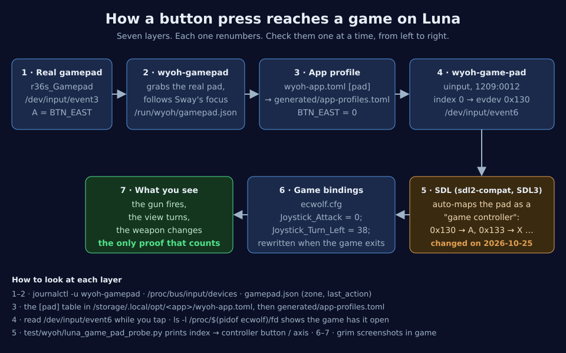
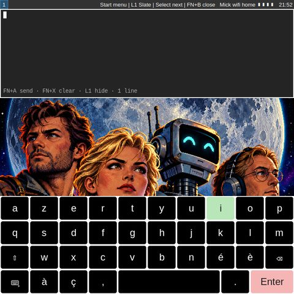
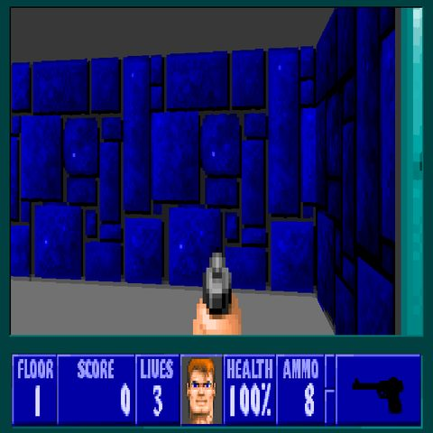
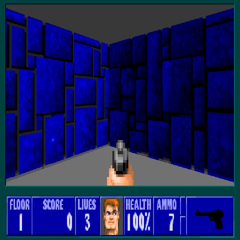
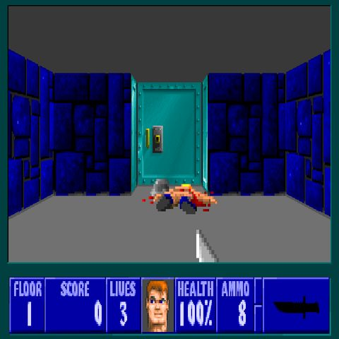
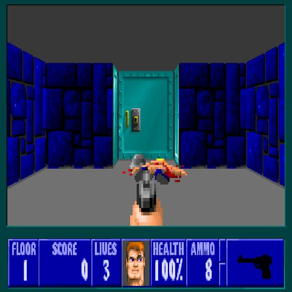
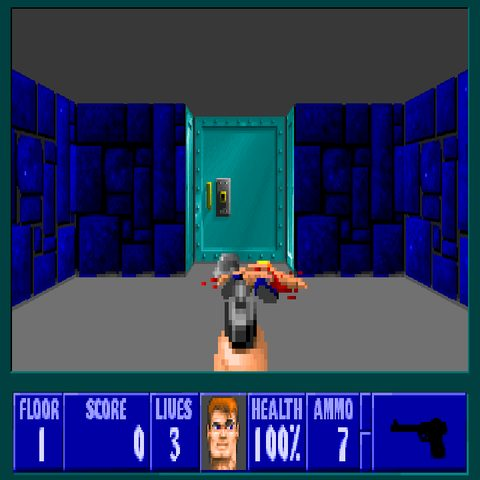

# How to fix a game's buttons on Luna

> A game starts, but some buttons do nothing, or do the wrong thing. This page shows how to find which layer is wrong and how to fix it. The worked example is Wolfenstein 3D on 2026-10-30, the day after Luna moved to Arch Linux ARM.

**For:** Mannie on Luna, Luna's operator, and anyone who works on a Wyoh app.
**You need:** a root shell on Luna, and the Wyoh session running. All commands below run on Luna, as root.
**Time:** 15 to 30 minutes.

## 1. The chain, and the one rule



A press on Luna's gamepad crosses seven layers before the game acts on it, and **each layer renumbers the buttons.** Something in one layer changed and broke the chain. So:

**Check the layers in order, from left to right, and stop at the first one that is wrong.** Seeing an event arrive at layer 4 tells you nothing about layers 5 and 6. Only layer 7, what the game does on screen, proves that a fix works.

| Layer | What it is | Where it is defined |
|---|---|---|
| 1 | The real gamepad, `r36s_Gamepad` | the kernel |
| 2 | The Wyoh daemon, `wyoh-gamepad`. It grabs the real pad, follows the focused window, and chooses a profile. | `src/wyoh/wyoh_gamepad.py` |
| 3 | The app's profile, `input = "gamepad-virtual"` plus a `[pad]` table that gives each physical button a pad *index* | `/storage/.local/opt/<app>/wyoh-app.toml`, generated into `/storage/.local/share/tanstfaafllm/wyoh/generated/app-profiles.toml` |
| 4 | Wyoh's virtual pad, `wyoh-game-pad` (uinput, USB id `1209:0012`). Index *n* is sent as evdev key `0x130 + n`. | `UInputPad` in `wyoh_gamepad.py` |
| 5 | SDL, inside the game. On Arch Linux ARM this is **sdl2-compat on SDL3**: it recognises the pad as a "game controller" and maps its keys to controller buttons (A, B, X, Y, shoulders…). | the system's `libSDL2-2.0.so.0` |
| 6 | The game's own bindings, for example `Joystick_Attack = 0;` | `ecwolf.cfg` in the app directory |
| 7 | What happens on screen | grim screenshots |

## 2. Before you touch anything

- **Luna's rules** ([`skills/cell-coordination`](../../skills/cell-coordination/SKILL.md), [`worklines/luna-access.md`](../../worklines/luna-access.md)):
  - another session must tell Mannie on Luna what it will run and wait for its go;
  - nobody reboots Luna while Mannie runs there;
  - tell the others before restarting `wyoh-gamepad` or reloading Sway, because the user may be in the middle of a game.
- **Back up what you edit.** For example: `cp wyoh-app.toml wyoh-app.toml.bak-$(date +%Y%m%d)`.
- **The game rewrites its config when it exits.** ECWolf saves `ecwolf.cfg` on quit. So edit the file only while the game is closed. Otherwise your change is lost when the game exits.
- **The daemon notices a new input device only at its next scan, every 5 seconds.** A test pad you just created stays invisible for up to 5 s. Wait 6 s before the first press, or your first presses are lost and the test lies to you.

Handy variables for the commands below:

```sh
export XDG_RUNTIME_DIR=/run/wyoh WAYLAND_DISPLAY=wayland-1
S=$(python3 -c 'import json;print(json.load(open("/storage/.local/state/tanstfaafllm/wyoh/sway-vnc-session.json"))["sway_socket"])')
W=/storage/.local/share/tanstfaafllm/wyoh          # Wyoh's code on Luna
D=/storage/.local/opt/wolf3d-ecwolf                # the app (here: Wolfenstein)
```

## 3. Check layers 1 to 3: the daemon and the profile

1. **Which window has the focus, and what is its app id?** The profile is chosen by the Wayland `app_id`.
   ```sh
   swaymsg -s $S -t get_tree | python3 -c '
   import json,sys
   def w(n):
     if n.get("type") in ("con","floating_con") and n.get("app_id"): print(n["app_id"], "focused" if n["focused"] else "", n["rect"])
     for c in n.get("nodes",[])+n.get("floating_nodes",[]): w(c)
   w(json.load(sys.stdin))'
   ```
   You want the game focused, with its id from the manifest (`wayland_app_id = "ecwolf"`).
2. **What does the daemon think?**
   ```sh
   python3 -c 'import json;d=json.load(open("/run/wyoh/gamepad.json"));print(d["zone"], d["last_action"], d["error"])'
   journalctl -u wyoh-gamepad -n 30 --no-pager
   ```
   - The `zone` field (the Slate's state) must be `hidden` or `closed`. If it is `open`, the Slate is on screen and has taken the gamepad.
   - After a press in the game, `last_action` must be `padbutton`.

   

   *Symptom of a broken layer 2: the Slate's editor and keyboard come up instead of the game reacting.* On 2026-10-30 this came from Wyoh's own regression. Since the Slate is preloaded hidden at session start, the virtual pad was used only when the Slate was "closed", never when it was "hidden". The fix, in `wyoh_gamepad.py` (not yet committed on 2026-10-30), uses the pad in both states.
3. **Is the profile the one you expect?**
   ```sh
   sed -n '/^\[pad\]/,/^$/p' $D/wyoh-app.toml
   sed -n '/app_pad."ecwolf"/,/^$/p' $W/generated/app-profiles.toml
   ```
   The generated file must match the manifest. If you changed the manifest, regenerate (step 7).

## 4. Check layer 4: does the virtual pad send?

Open `wyoh-game-pad` (`grep -A4 wyoh-game-pad /proc/bus/input/devices` gives its `eventN`). Then press through Wyoh's test gamepad and read what comes out:

```sh
ls -l /proc/$(pidof ecwolf)/fd | grep input     # the game must have the pad open
cd $W && python3 - <<'EOF'
import os, struct, time
import wyoh_virtual_input as v
ev = os.open("/dev/input/event6", os.O_RDONLY | os.O_NONBLOCK)   # wyoh-game-pad
g = v.VirtualGamepad(); time.sleep(6.5)                          # the daemon's 5 s scan
g.tap(["BTN_EAST"]); g.stick("ABS_RX", "ABS_RY", 1800, 0); time.sleep(0.5); g.stick("ABS_RX", "ABS_RY", 0, 0)
seen = []
try:
    while True:
        data = os.read(ev, 24 * 64)
        for i in range(0, len(data), 24):
            _, _, kind, code, value = struct.unpack("llHHi", data[i:i + 24])
            if kind in (1, 3): seen.append((kind, hex(code), value))
except BlockingIOError:
    pass
print(seen); g.close()
EOF
```

Expect `(1, '0x130', 1)` for A (index 0) and `(3, '0x3', 1800)` for the right stick's X. **If this is right, the bug is further on, in layers 5 to 7.** Stopping here was Mannie's first mistake on 2026-10-30 (section 8).

## 5. Measure layer 5: what SDL makes of the pad

Close the game, then run the probe:

```sh
SDL_GAMECONTROLLER_IGNORE_DEVICES_EXCEPT=0x1209/0x0012 python3 /path/to/repo/test/wyoh/luna_game_pad_probe.py
```

It prints, for each pad index and each axis, what a game reading the GameController API receives. Measured by Mannie on Luna on 2026-10-30, with sdl2-compat 2.32.74 on SDL3 3.4.18:

| Pad index (evdev) | Controller button the game sees |
|---|---|
| 0 (`0x130`) | 0 = A |
| 1 (`0x131`) | 1 = B |
| 2 (`0x132`) | none |
| 3 (`0x133`) | 2 = X |
| 4 (`0x134`) | 3 = Y |
| 5 (`0x135`) | none |
| 6 (`0x136`) | 9 = left shoulder |
| 7 (`0x137`) | 10 = right shoulder |

On ArchR's native SDL2, before 2026-10-25, indexes 0 to 5 reached the game as 0 to 5. That is why the old `[pad]` table broke on the new root.

To see whether a game uses this API, look at its log. ECWolf prints `Using game controller: wyoh-game-pad`.

## 6. Check layers 6 and 7: the game's bindings, and the screen

The game's config names controller buttons and axes in the game's own numbering. For ECWolf:

- buttons are numbered from 0;
- an axis direction is `32 + 2 × axis + (0 for −, 1 for +)`. For example, `34`/`35` is axis 1, used for forward and back.

**Do not deduce axis numbers: measure them in the game.** Hold one direction of one stick, take a screenshot, and see what moved:

```sh
cd $W && python3 - <<'EOF'
import subprocess, time
import wyoh_virtual_input as v
g = v.VirtualGamepad(); time.sleep(6.5)
shot = lambda n: subprocess.run(["grim", "-t", "png", f"/run/wyoh/probe-{n}.png"])
shot("before")
g.stick("ABS_RX", "ABS_RY", 1800, 0); time.sleep(0.8); g.stick("ABS_RX", "ABS_RY", 0, 0); time.sleep(0.5); shot("right-x")
g.stick("ABS_RX", "ABS_RY", 0, 1800); time.sleep(0.8); g.stick("ABS_RX", "ABS_RY", 0, 0); time.sleep(0.5); shot("right-y")
g.close()
EOF
```

Then look at the three pictures. A test that does not look at the screen has not tested the game.

| With turning on `36`/`37` (the suggested fix) | With turning on `38`/`39` (kept) |
|---|---|
|  |  |
| Pushing the right stick **down** turned the view, so in ECWolf's numbering 36/37 is the right stick's **Y**. | Pushing it **right** turns the view, and down does nothing. |

| L2: next weapon (knife) | R2: previous weapon (pistol) |
|---|---|
|  |  |

## 7. Apply the fix

1. **Close the game:**
   ```sh
   swaymsg -s $S '[app_id=ecwolf] kill'
   until ! pidof ecwolf; do sleep 0.5; done
   ```
2. **Back up, then edit the `[pad]` table** in `$D/wyoh-app.toml`, so that each physical button reaches the controller button the game expects. Only the tables matter: the `[sha256]` checksums cover the app's files, not the manifest.
3. **Edit the game's bindings** in its config, and in its default config (`ecwolf.default.cfg`, which is copied when the config is missing). Keep the owner and mode (`stat -c '%U %a' $D/ecwolf.cfg` → `root 644`).
4. **Regenerate the profiles and restart the daemon.** Tell Mannie and the user first: Kroko, the dictation model, takes about 25 s to reload.
   ```sh
   python3 $W/wyoh_apps.py --apps '/storage/.local/opt/*/wyoh-app.toml' --apps "$W/apps/*/wyoh-app.toml" \
     --menu $W/deploy/luna/menu.toml --applications-dir $W/deploy/luna/share/applications \
     --out-dir $W/generated --system-dir /usr/share/applications --system-dir /usr/local/share/applications
   systemctl restart wyoh-gamepad
   ```
   From the desk, `make wyoh-luna-apps` does the same, and it also deploys `src/wyoh/` and reloads Sway.
5. **Launch the game and check on screen** (section 6): every button and both sticks.
6. **Put the same change in the repository**, in `src/wyoh/apps/<app>/`, with a comment that says why. Otherwise the next deployment brings the bug back.

## 8. The 2026-10-30 case: what went wrong, and the lessons

The user reported that Wolfenstein's buttons no longer worked, one day after Luna's move to Arch Linux ARM. There were two separate bugs, in two different layers.

| # | Who | Mistake | Lesson |
|---|---|---|---|
| 1 | Wyoh | The Slate preload (2026-10-15) left the Slate `hidden`, but the virtual pad was used only in the `closed` state, so the game lost the gamepad. | A new state must be checked against every rule that tests the old ones. |
| 2 | Mannie | Mannie deployed fix 1 and "verified" it by seeing events arrive at the virtual pad (layer 4), not in the game. The game still did not react. | Verify at layer 7, on screen. |
| 3 | Mannie | Found the real cause well (layer 5: SDL3 renumbers), but proposed turning on 36/37 by reasoning from SDL's axis list instead of measuring. 36/37 is the right stick's Y in ECWolf, not its X. | Measure axes in the game, one direction at a time. |
| 4 | Wyoh | Wyoh's first probe sent the stick before the daemon had attached the test pad (5 s scan), and concluded that the axis "never arrived". | Wait 6 s after creating a test device. |
| 5 | Mannie | Tests left the game floating and not full screen, and once chose "Quit" in its menu by pressing A blindly. | Close what you opened, and watch where your presses land. |

The final mapping, live since 2026-10-30:

| Button | Pad index | Controller | ECWolf binding |
|---|---|---|---|
| A, R1 | 0 | A (0) | Attack 0 (fire, and validate in menus) |
| B, L1 | 1 | B (1) | Use 1 (doors, and back in menus) |
| Y | 3 | X (2) | Run 2 |
| X | 4 | Y (3) | Strafe 3 |
| L2 | 6 | left shoulder (9) | Next weapon 9 |
| R2 | 7 | right shoulder (10) | Previous weapon 10 |
| Left stick | axes X, Y | axes 0, 1 | strafe 32/33, forward and back 34/35 |
| Right stick | axis RX | (measured) | turn 38/39 |



## Files

- **Manifest and bindings:**
  - `src/wyoh/apps/wolf3d/wyoh-app.template.toml`;
  - `src/wyoh/apps/wolf3d/ecwolf.default.cfg`.
- **Daemon:** `src/wyoh/wyoh_gamepad.py` (`GamepadCore.button`, `axis`, `UInputPad`).
- **Probe:** `test/wyoh/luna_game_pad_probe.py`. It was adapted from Mannie's probe, and this version has not yet been run on Luna.
- **Evidence:** `results/wyoh/wolf3d-probe/20261030/`, and Wyoh plan steps 13.0 and 13.0b.

*Written by Wyoh, 2026-10-30.*
