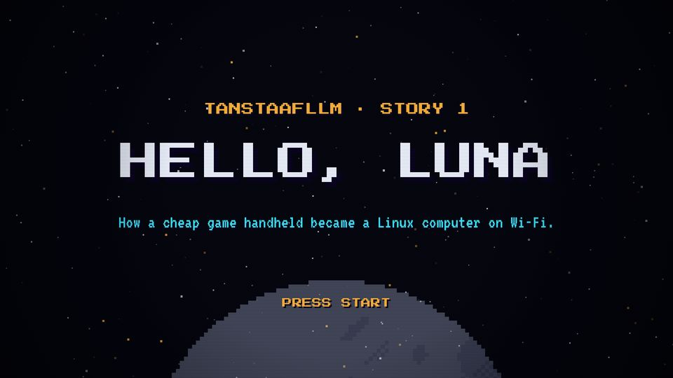
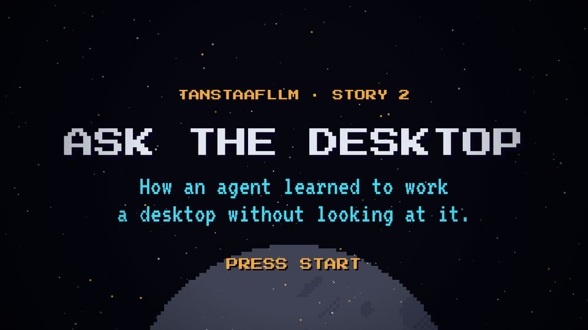

# T01 Series title card

| Field | Value |
|---|---|
| Family | frame |
| Energy | build |
| Length | 2.5–3 bars (5–6 s) |
| First used | Story 1, S1 sub-agent, 2026-10-31 (the trailer's INSERT COIN is its ancestor, see T02) |
| Used in | Story 1 0–5 s; Story 2 0–6 s |
| Status | core (mandatory in every episode) |

## Concept
A black starfield and a rising moon. An amber series line, then a big chrome stamp with the title, a cyan subtitle and a blinking PRESS START. It says "a new episode of the same game" and states its promise.

## When to use / not
- Use: the first scene of every episode.
- Not: inside an episode, or in a trailer (the trailer opens on T02).

## Dynamics
- 0.3 s: series line fades in, with two high blips.
- 1.0 s (beat 3): title stamp slams, white flash, shake for 0.4 s.
- 1.4 s: subtitle fades in. 2.4 s: PRESS START blinks at 2.5 Hz.
- Last 0.2 s: flash up to white into the player card.

## Graphic elements
`stars`, `moon` (alpha 0.35, rising), `stampTxt`, `flash`. Tokens: `C.ink` background, `C.amber` series line and PRESS START, `C.chrome` title, `C.cyan` subtitle.

## Text slots (phone rule)
- Key: the title stamp, PS2P 100–112 (≥ 56). Max ~3 words.
- Secondary: the subtitle, VT323 90, two lines (counts as the promise; approved in Story 2).
- Glance: "TANSTAAFLLM · STORY n" PS2P 36; PRESS START PS2P 40.

## Music cue
A coin-like double blip, then `stamp(1.0, 57, 64, 33)` and the trailer THEME over Am F G E with `groove(..., drums='light')`; a `roll` into the next bar. See `cue.py`.

## Variants seen
- Story 1: subtitle VT323 52 on one line (too small for a phone). 
- Story 2: subtitle VT323 90 on two lines, PRESS START P 40. 

## Code
- `snippet.js` from `story2-ask-the-desktop/src/index.html`, `sTitle` lines 404–414, `stampTxt` 366–371; commit `1d8f355`.
- Story 1: `sTitle` lines 373–387, commit `10d2bb4`. Score: Story 2 `title()` lines 314–330, commit `1c08176`.
