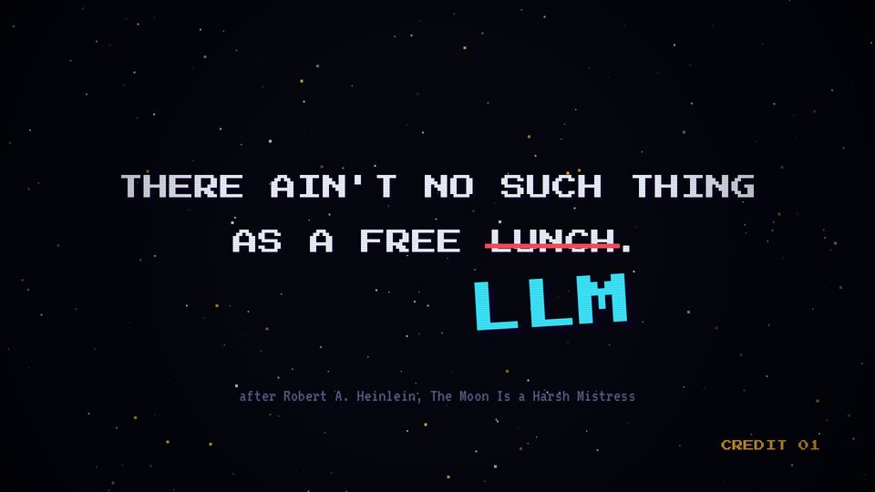

# T02 Insert coin

| Field | Value |
|---|---|
| Family | reveal |
| Energy | calm → hit |
| Length | 2 bars of choreography (4 s), 7 s with the reading hold |
| First used | Trailer, trailer sub-agent, 2026-10-25 |
| Used in | Trailer 0–7 s (output) |
| Status | optional (unused since the trailer) |

## Concept
An arcade INSERT COIN screen. A coin drops, a sentence is typed, one word is struck out in red and a new word is stamped under it. It tells the joke of the title in one gesture: a correction.

## When to use / not
- Use: to open a trailer or a special episode; for any "the old rule, corrected" moment.
- Not: as a regular episode opener (T01 does that). Only once per video.

## Dynamics
- 0–1 s: INSERT COIN blinks, the coin falls; coin sound at 1.0 s, CREDIT 01.
- 1.15 s: typing at 30 chars/s, one tick per char.
- 2.55 s: red strike-through grows over the word (0.2 s).
- 2.95 s: stamp of the new word (scale 2.4 → 1, shake). 3.25 s: credit line.
- Hold, then a riser and a white flash on the cut.

## Graphic elements
`coin` sprite, `stars`, block cursor (`C.amber`), red strike `rect` (`C.red`), stamp in `C.cyan`, credit in `C.dim`.

## Text slots (phone rule)
- Key: the stamped word, PS2P 120.
- Secondary: the typed sentence, PS2P 56 (at the key size; keep it to 2 short lines).
- Glance: INSERT COIN P 64 (before the sentence), CREDIT 01 P 24, credit VT323 40 (raise to 48).

## Music cue
`attract()`: a slow 12.5 % Am9 arpeggio, `coin(P1, 1.0)`, `typing(...)` with `tick`, a falling note and `nz` on the strike, `hit_all(2.95, ..., cym='boom')` on the stamp, a suspended swell and `roll` into the drop.

## Variants seen
- Trailer: "THERE AIN'T NO SUCH THING AS A FREE LUNCH." → LLM. 

## Code
- `snippet.js` from `trailer/src/index.html`, `scene1` lines 254–298; commit `3039e69` (content from `d9b7b7f`).
- Score: `trailer/src/score.py` `attract()` lines 214–241.
