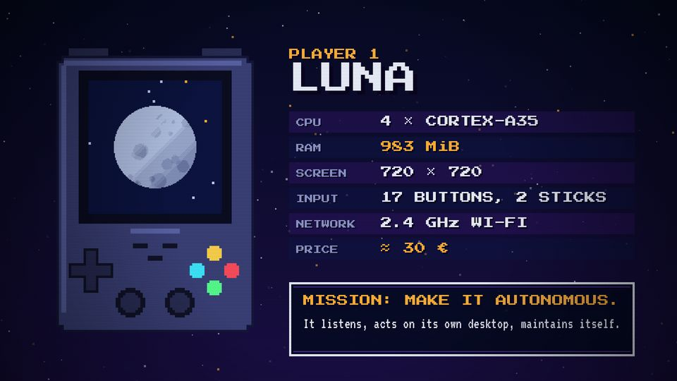
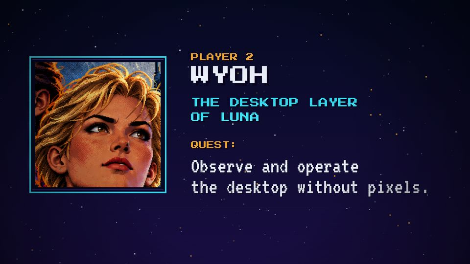

# T04 Player card

| Field | Value |
|---|---|
| Family | reveal |
| Energy | build |
| Length | 3.5–4 bars (7–8 s) |
| First used | Trailer, trailer sub-agent, 2026-10-25 |
| Used in | Trailer 12–22 s (Luna); Story 1 5–12 s (R36 Ultra); Story 2 6–14 s (Wyoh) |
| Status | core |

## Concept
The hero of the episode flies in: a sprite or a key-art face, a name, a few stat rows on blips, and a QUEST box. It says who plays this episode and what it wants.

## When to use / not
- Use: right after the title card, once per episode.
- Not: for a second character in the same video (use T15 or a tile in T13).

## Dynamics
- Bar 1, beat 1: flash, the portrait flies in from below (`easeBack`, 0.5 s) and bobs.
- Beat 1.2: PLAYER n and NAME slide in from the right.
- Beats 2–4: one stat row per beat (0.4–0.5 s), each on a blip.
- Bar 2 or 3: QUEST label, then the quest line. Last 0.25 s: block dissolve.

## Graphic elements
`device`/`luna` sprite at s = 7, or `face(name)` in a `box` with a `C.cyan` edge. Rows alternate `C.violet` / `C.navy2`. Tokens: `C.amber` PLAYER n and QUEST, `C.chrome` name, `C.cyan` tagline.

## Text slots (phone rule)
- Key: the quest line, VT323 90, ≤ 2 lines.
- Secondary: the tagline (e.g. THE DESKTOP LAYER OF LUNA), PS2P 40. The NAME (P 80) is a name tag.
- Glance: PLAYER n, QUEST: (P 32). Stat rows are glance text (P 28) or cut, as in Story 2.

## Music cue
`stamp(t0, 69, 76, 33)` on the flash, `groove(t0, Am F C G)`, the hero's motif with `melody()` (Wyoh: E A B C rising), one `blip` per stat row, `nz` on QUEST, `noise_sweep` into the next stage.

## Variants seen
- Trailer, Luna: six stat rows and a MISSION box. 
- Story 1, R36 Ultra: three rows, QUEST in P 32 + VT 48.
- Story 2, Wyoh: key-art face, no stat rows, quest at VT 90. 

## Code
- `snippet.js`: Story 2 `sPlayer` lines 417–434 (commit `1d8f355`); trailer `STATS` 316–319 and rows + mission 329–348 (commit `3039e69`).
- Story 1: `sPlayer` lines 391–409, commit `10d2bb4`. Score: Story 2 `player()` lines 331–341.
