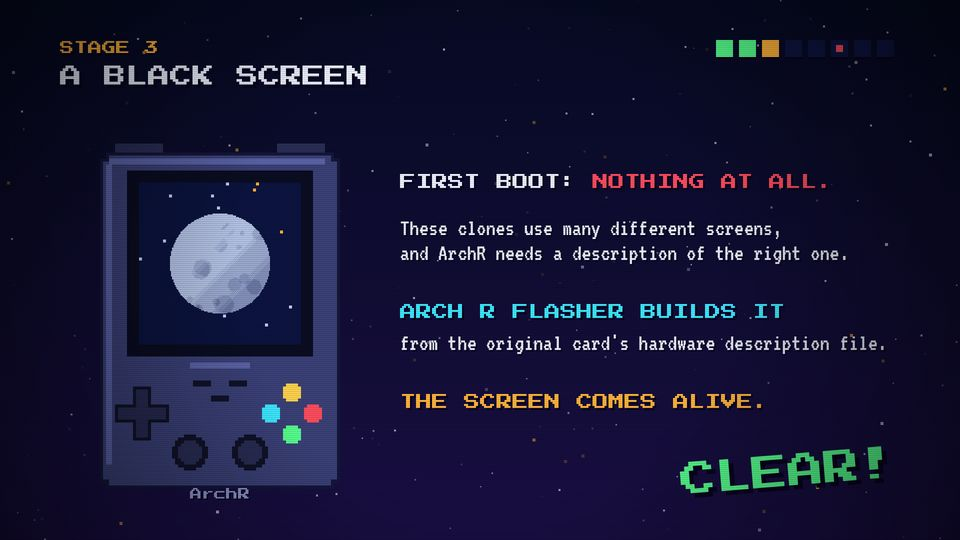

# T05 Stage frame

| Field | Value |
|---|---|
| Family | frame (a container, not content) |
| Energy | build |
| Length | 3–5 bars (6–10 s) per stage |
| First used | Story 1, S1 sub-agent, 2026-10-31 |
| Used in | Story 1: 8 stages (12–82 s); Story 2: 7 stages (14–72 s) |
| Status | core, with a cap: at most half of an episode's scenes |

## Concept
"STAGE n" and a title slide in at top left, a row of stage pips at top right, and a green CLEAR! stamp lands on a jingle near the end. It turns a story into levels. It holds other templates; it is not a message by itself.

## When to use / not
- Use: to number the steps of a story.
- Not: around every scene. The count in `docs/0501_01` shows that 15 of 26 story scenes were stage frames: it makes episodes look alike. Mix in scenes without a frame (T13, T15, T17, T20…).

## Dynamics
- Bar 1, beat 1: white flash (0.3 s), stage-start sting; HUD slides in (0.3 s).
- Content in the middle bars.
- Last bar, beat 2 (end − 1.5 s): CLEAR! stamp (scale 2.2 → 1, shake), jingle.
- Last half beat: a snare `roll` into the next cut.

## Graphic elements
`stageBg` (sky + stars; boss stage gets a red sky), `hud` (pips: green done, blinking amber current, `C.navy2` to come, a red dot on the boss pip), `clearStamp`. Tokens: `C.amber`, `C.chrome`, `C.red` (boss), `C.green`.

## Text slots (phone rule)
- The HUD keeps the series look: STAGE n P 28, title P 44. It counts as one ≥ 35 px line.
- CLEAR! P 72 at bottom right (y ≈ 980): keep everything else clear of it.
- The content inside follows its own template's slots.

## Music cue
`stage_start(t)` (four rising blips, crash, kick) and `clear(t)` (coin + major arpeggio). See `cue.py`.

## Variants seen
- Story 1, stage 3 "A BLACK SCREEN". 
- Story 2, stage 1 "THE SCREENSHOT TRAP". 

## Code
- `snippet.js` from Story 2 `index.html`: `STAGES` lines 254–261, `stageBg`/`hud`/`clearStamp` 374–392; commit `1d8f355`.
- Story 1: `stageBg`/`hud`/`clearStamp` lines 343–363 (with the `DISP` renumbering), commit `10d2bb4`.
