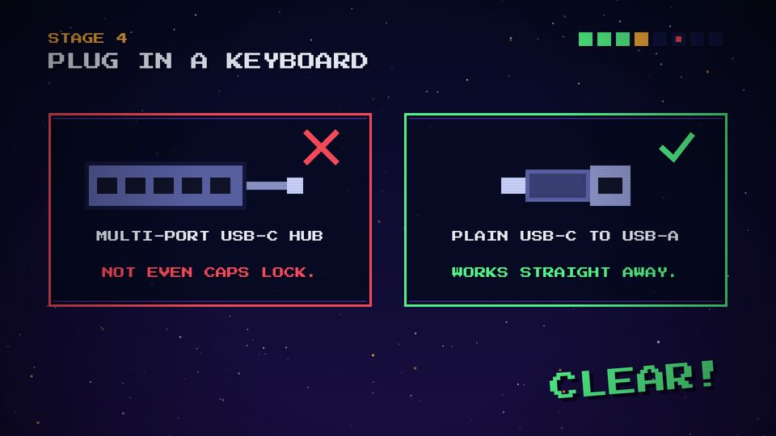
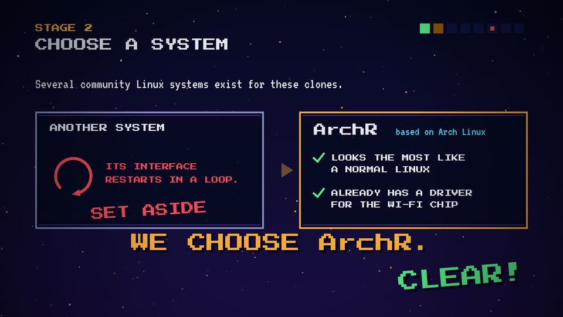

# T06 Two boxes: fails / works

| Field | Value |
|---|---|
| Family | stage |
| Energy | build |
| Length | 2–3 bars (4–6 s) |
| First used | Story 1, S1 sub-agent, 2026-10-31 |
| Used in | Story 1: stage 3 keyboard 34–40 s, stage 2 choose 20–26 s (and the cut "copy #1/#2"); Story 2: stage 2 HIOM 20–28 s (partial) |
| Status | optional |

## Concept
A box with a red cross against a box with a green check, shown one after the other. Before and after, or the wrong choice and the right one. The viewer compares two things at a glance.

## When to use / not
- Use: a real either/or, a failed first try and the fix.
- Not: when there are three or more options (use T10), or when the "fail" is only an anecdote (Story 1's "62 BYTES" was cut for that).

## Dynamics
- Beat 2: left box fades in (0.2 s). About 1.3 beats later: red edge, cross, fail line, `buzz`.
- Next bar: right box fades in. About 1.3 beats later: green edge, check, works line, `ding`.
- Then a stamp (T08) or CLEAR!.

## Graphic elements
Two `box` of 780–800 × 400–480 at x = M and x = 1000; sprites (`hub`, `adapter`, `loopIcon`…), `cross` (`C.red`), `check` (`C.green`), edges `C.chrome` → `C.red` / `C.green`. A dimmed box (alpha 0.55) means "set aside".

## Text slots (phone rule)
- Key: the verdict, one stamp (e.g. WE CHOOSE ArchR., P 64), or the works line if raised to P 56.
- Secondary: the two box labels, P 40.
- Glance: details inside the boxes (P 28). Story 1 used P 24–28 throughout: too small.

## Music cue
`buzz(t)` on the fail, `ding(t)` on the works, then `clear(t)`. Story 2 adds `tri_drop` under the buzz.

## Variants seen
- Story 1 stage 3: hub ✗ / adapter ✓. 
- Story 1 stage 2: another system (loops, SET ASIDE) / ArchR with checks and a cursor. 
- Story 2 stage 2: one box only (HIOM), REOPENED, then a green lesson box.

## Code
- `snippet.js` from Story 1 `index.html`, `s3` lines 516–535; commit `10d2bb4` (source times; the cut plays them +6 s).
- Story 1 `sChoose` 460–496; Story 2 `s2` 463–500 (commit `1d8f355`). Score: Story 1 `stage3()` 382–392.
