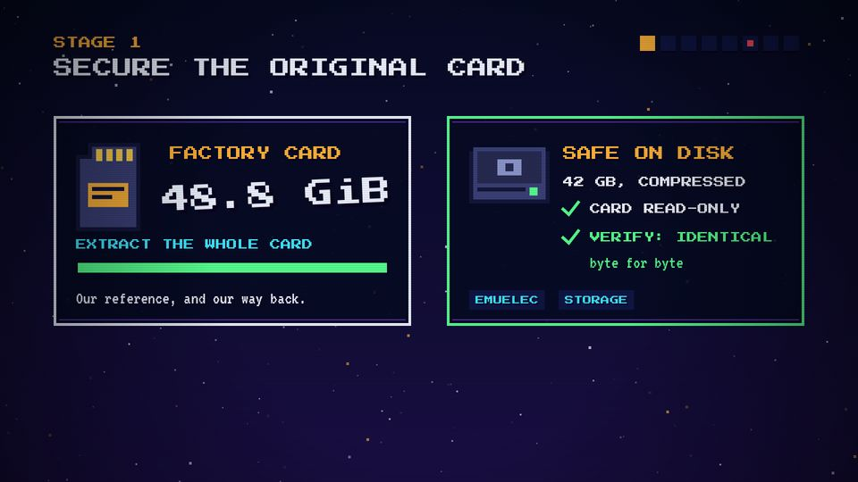
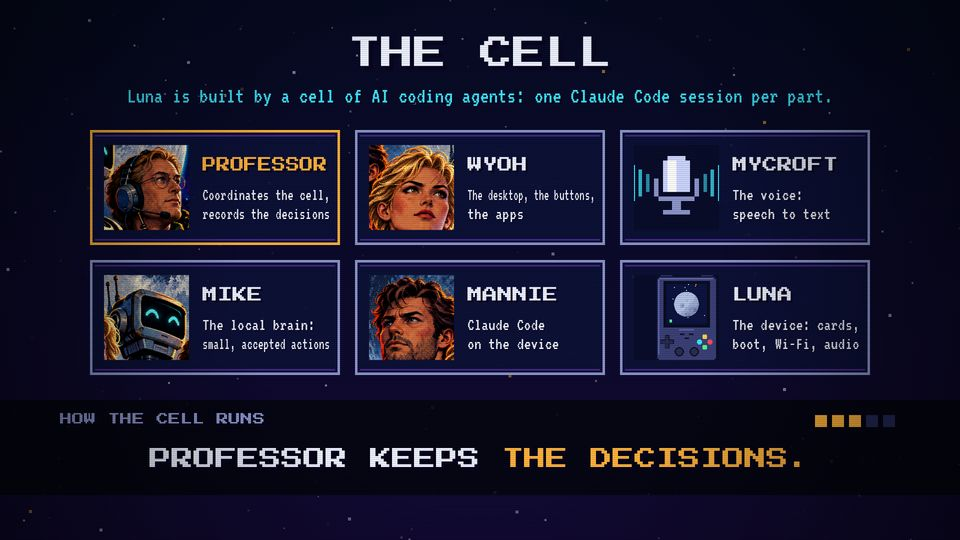

# T07 Checklist on the beat

| Field | Value |
|---|---|
| Family | stage |
| Energy | calm, rising |
| Length | 1–2 bars inside a scene |
| First used | Story 1, S1 sub-agent, 2026-10-31 (the trailer's cell rules are an ancestor) |
| Used in | Story 1: stage 1 card copy 12–20 s, stage 2 ArchR 20–26 s; Story 2: stage 7 seven layers 62–72 s (ticks); Trailer: the cell rules 57.5–73 s (as stamps) |
| Status | optional |

## Concept
Lines with a check mark appear one per beat, each on a rising blip. It shows a procedure that holds: each step is done, in order.

## When to use / not
- Use: 2–5 short steps of a careful procedure.
- Not: for long sentences, or for steps that must be read (they flash by). For cause-to-effect rows with a failure, use T19.

## Dynamics
- One line per 0.3–0.5 s (a beat or less), first line on a beat.
- Each line: `check()` and the text appear together; the pitch of the blip rises.
- After the last line: a `ding`, then the stage's punchline.

## Graphic elements
`check(x, y, 34, C.green)` at the left of each line; rows sometimes on `C.navy2` chips. The box edge turns `C.green` when the list is complete. Tokens: `C.chrome` lines, `C.green` for the proof line.

## Text slots (phone rule)
- The list is glance text (P 24–28): the screen needs one key message elsewhere (P 56 / VT 90).
- If a line is the point, raise it to secondary (P 40) and keep it alone.

## Music cue
`blip(P1, t, m, ...)` per line with m rising (e.g. 72, 74, 76, 77), `ding(t)` at the end. See `cue.py` (Story 1 `stage1()`).

## Variants seen
- Story 1 stage 1: CARD READ-ONLY ✓, VERIFY: IDENTICAL ✓, then three partition chips. 
- Story 1 stage 2: two ArchR reasons with checks (see T06 still).
- Story 2 stage 7: ticks on layer rows (see T19).
- Trailer: five cell rules stamped one per second, with five pips. 

## Code
- `snippet.js` from Story 1 `index.html`, `s1` lines 432–455; commit `10d2bb4`.
- Trailer rule ticker: `scene7` lines 566–575, commit `3039e69`. Score: Story 1 `stage1()` 337–354.
