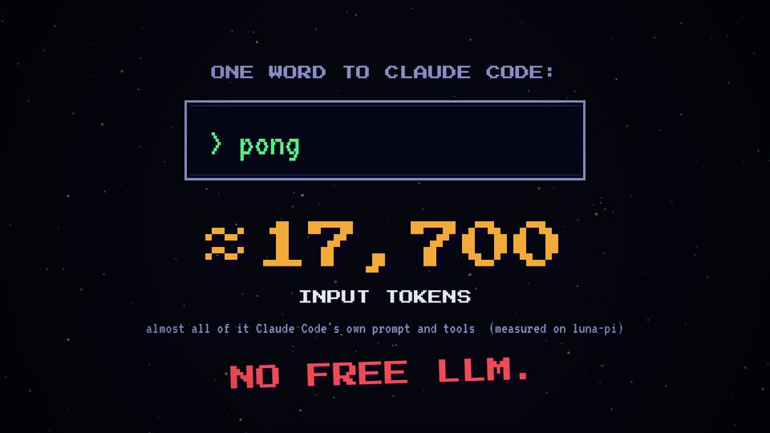
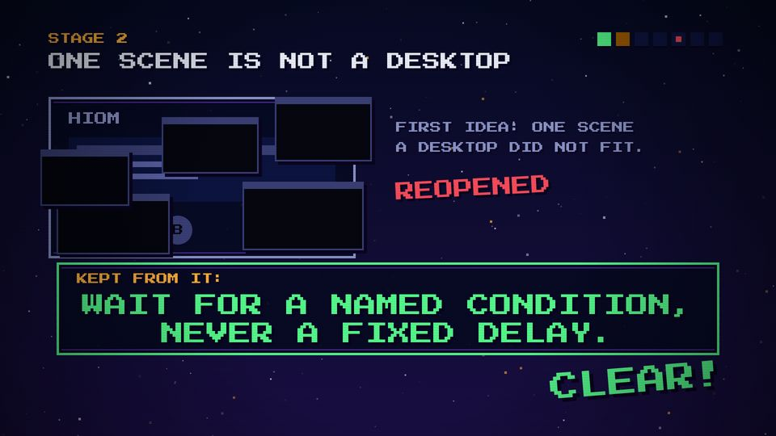

# T08 Stamp slam

| Field | Value |
|---|---|
| Family | stage (punchline) |
| Energy | hit |
| Length | 1 beat to land; it stays to the cut |
| First used | Trailer, trailer sub-agent, 2026-10-25 |
| Used in | Trailer 3 (price list 22–27.5, NO FREE LLM 30.1, doctrine 79–82.5); Story 1 6 (SET ASIDE, WE CHOOSE ArchR., the screen comes alive, AUTO → 11, patches, HELLO, LUNA.); Story 2 5 (REOPENED + lesson, 26 TOOLS, BLACK., the last layer, payoff) |
| Status | core (the most used template: watch the count) |

## Concept
One to three big words slam in on a music hit, with a scale-down, a shake and often a flash. It is the punchline of a screen: the one thing to remember.

## When to use / not
- Use: once per screen, for the key message.
- Not: twice on the same screen, or for a sentence longer than ~6 words. A stamp on every scene stops being a hit.

## Dynamics
- On a beat (usually beat 1 or 3 of the last full bar before CLEAR!).
- 0–0.15 s: scale 2.0–2.4 → 1 (`easeOut`), alpha 0 → 1.
- 0–0.35 s: horizontal shake, sin(t·90)·8–10 px, decaying.
- Optional: white flash 0.3 s; a slight rotation (−0.03 to −0.08 rad).
- Stop-time variant: three slams, one per beat, nothing else moving.

## Graphic elements
`stampTxt` (Story 2) or the inline form (trailer). Colour carries meaning: `C.red` no/danger, `C.green` lesson/fix, `C.amber` decision, `C.chrome` title, `C.cyan` correction.

## Text slots (phone rule)
- Key: the stamp itself, PS2P 56–112 (≥ 56), ≤ 6 words, ≤ 2 lines.
- Secondary: none on the stamp; one VT323 64 line may follow it.

## Music cue
`stamp(t, m1, m2, root)` = `hit_all(..., cym='boom')`; for stop-time slams `hit_all(t, ..., tau=30)` with the drums out (trailer `prices()`). Bad news: `buzz` + `tri_drop` instead.

## Variants seen
- Trailer: NO FREE LLM. in red under the counter. 
- Story 2 stage 2: the lesson in green, two lines at P 56. 
- Story 1: SET ASIDE (red), WE CHOOSE ArchR. (amber), 11 over a struck AUTO.

## Code
- `snippet.js`: Story 2 `stampTxt` lines 366–371 (commit `1d8f355`); trailer price slams `scene4` 354–374 (commit `3039e69`).
- Score: Story 2 `stamp()` 305–308; trailer `prices()` 309–322.
