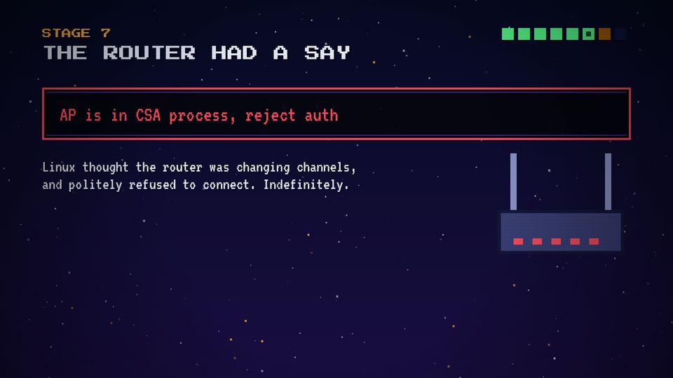
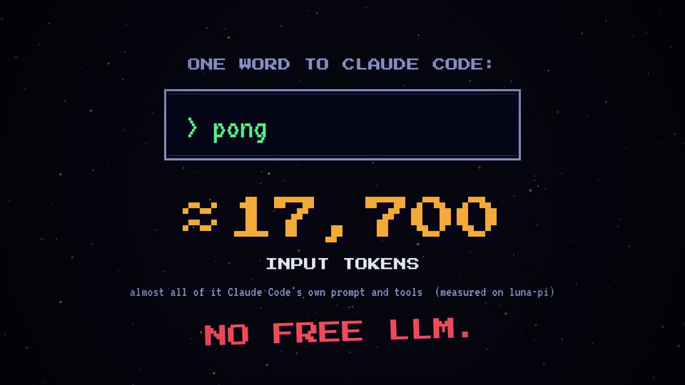

# T09 Terminal typing

| Field | Value |
|---|---|
| Family | data |
| Energy | calm (stop-time) |
| Length | 1–2 bars |
| First used | Trailer, trailer sub-agent, 2026-10-25 |
| Used in | Trailer 27.5–32 s (`> pong`, ≈17,700 tokens); Story 1: terminal 40–48, router error 66–74, `$ ssh luna` 74–82; Story 2: `sway_get_tree` 72–78 (a label, see T20) |
| Status | optional |

## Concept
Real text is typed in a dark terminal box with a blinking cursor; sometimes a counter rolls up under it. It shows the real command or the real message, so the viewer trusts the story.

## When to use / not
- Use: one short real command, error or answer (≤ ~35 chars).
- Not: for long logs, or for invented output. Never a screenshot of a real terminal (series rule).

## Dynamics
- Bar 1: the box appears; typing at 10–32 chars/s, one `tick`/`key` per char.
- Cursor blinks at 4 Hz until the line is done.
- Error variant: the box edge turns `C.red` while the error is on screen; a `buzz`.
- Counter variant: rolls for ~1.1 s (`easeOut`), then lands with a bump and a `≈`.

## Graphic elements
`termBox` (`#05060f` fill), `typed(s, t, t0, cps)`, `cursor()`. Text in `C.green` (command, OK) or `C.red` (error); counter in `C.amber`.

## Text slots (phone rule)
- Key: the typed line, VT323 ≥ 90 or the counter at PS2P ≥ 56 (trailer: 128).
- Secondary: the unit or the label (INPUT TOKENS, P 40).
- Glance: the box title, the machine tag (luna-pi).

## Music cue
Stop-time: the groove drops out, `typing(t0, cps, text, key)`, an error `buzz`, a suspended `chord_arp` (Dsus4) while waiting; the stamp brings the groove back.

## Variants seen
- Story 1 stage 6: the router's error typed in red. 
- Trailer: `> pong` and the token counter. 
- Story 1 stage 7: `$ ssh luna` on the PC's monitor (see T14 still).

## Code
- `snippet.js`: Story 1 `termBox`/`typed`/`cursor` lines 364–369 and `s6` start 617–623 (commit `10d2bb4`); trailer `scene4` pong 375–390 (commit `3039e69`).
- Score: Story 1 `router()` 455–470; trailer `pong()` 323–351.
