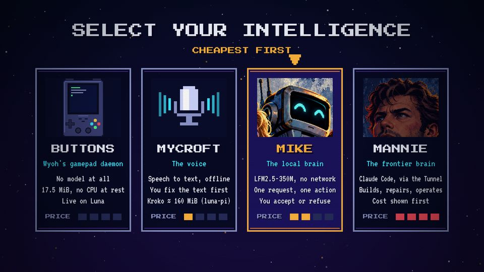
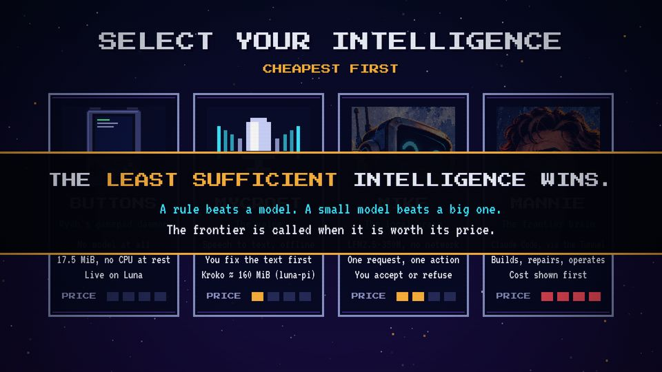

# T10 Character select

| Field | Value |
|---|---|
| Family | data |
| Energy | build |
| Length | 5 bars of choreography (10 s), 12 s with holds |
| First used | Trailer, trailer sub-agent, 2026-10-25 |
| Used in | Trailer 32–44 s (output); Story 1's "choose a system" is a two-card echo (see T06) |
| Status | optional (a good candidate to bring back) |

## Concept
Cards in a row, cheapest first, each with a portrait, three lines and a price meter. A cursor walks across them, then a banner gives the rule. It compares options by their cost, which is the series' core idea.

## When to use / not
- Use: 3–4 options with a real cost each (memory, time, money).
- Not: for two options (T06), or when the costs are not measured.

## Dynamics
- Bar 1: title, then the cards rise from below one after the other (0.1 s apart, `easeBack`).
- One card selected per 1.5 s (3 beats): amber edge, a blinking arrow above, the others dimmed.
- Last 1.5 bars: a dark band with amber rules drops across; the rule line, then two VT lines.

## Graphic elements
`box` cards 380 × 650; portraits via `face`, `mic`, `device`; four price pips (`C.amber`, `C.red` at max, `#262c5a` empty). Tokens: `C.amber` selection, `C.dim` idle edge, `C.cyan` role.

## Text slots (phone rule)
- Key: the banner rule, PS2P 56 (trailer: 48), ≤ 6 words.
- Secondary: the card name, P 40 (trailer: 36).
- Glance: role and lines on the cards (VT 48); the trailer's VT 36 lines are too small: cut them to one line.

## Music cue
`select()`: a menu theme; each card adds a layer (cheap to expensive); a two-note `blip` per selection; `coin(P2, ...)` on the expensive one; `hit_all` on the banner. See `cue.py`.

## Variants seen
- Trailer: BUTTONS, MYCROFT, MIKE, MANNIE; cursor on MIKE. 
- Trailer: the banner THE LEAST SUFFICIENT INTELLIGENCE WINS. 

## Code
- `snippet.js` from `trailer/src/index.html`, `CARDS`/`SEL`/`scene5` lines 399–452; commit `3039e69`.
- Score: `trailer/src/score.py` `select()` lines 352–401.
