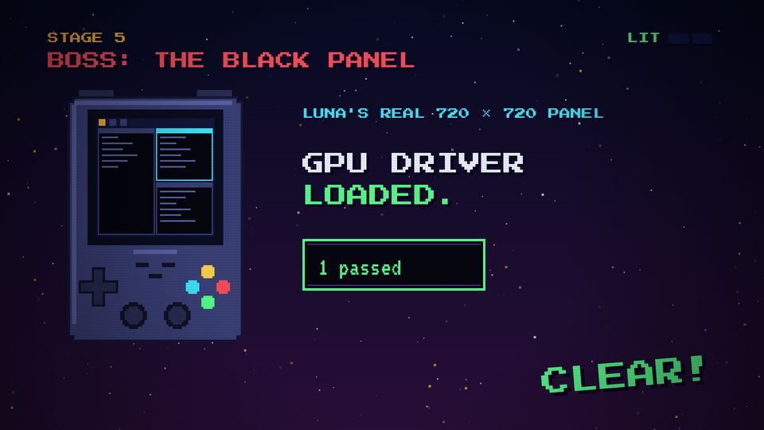
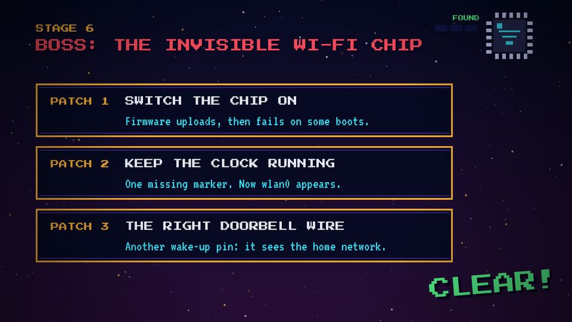

# T11 Boss fight

| Field | Value |
|---|---|
| Family | stage |
| Energy | hit |
| Length | 3–9 bars (6–18 s) |
| First used | Trailer, trailer sub-agent, 2026-10-25 |
| Used in | Trailer 44–57.5 s (the 1-GiB wall); Story 1 48–66 s (the Wi-Fi chip, 3 hits); Story 2 44–52 s (the black panel) |
| Status | core (one per episode: the hardest problem) |

## Concept
A red title on a dark red sky, an HP bar for the boss, a phase change on a flash, then a victory in A major. It is the hardest problem of the story, played as a fight with a clear before and after.

## When to use / not
- Use: once per episode, for the problem that cost the most.
- Not: for an easy step, or twice in a video.

## Dynamics
- Bar 1: red flash (0.4 s), BOSS title, the ostinato starts.
- Phase a (2–4 bars): the problem; each "hit" (finding, patch) removes an HP pip, shakes the boss icon, lands on a stamp.
- Phase change: a white flash on a beat (Story 2: 48.5); the hero sprite changes state (black → lit).
- Victory: A-major arpeggio; CLEAR! 1.5 s before the cut.

## Graphic elements
`stageBg(BOSS)` (sky `#2a0f3a`), `hud` with a red title and no pips, HP pips (`C.red` → `C.navy2`), boss icon (`chip`) whose visibility grows with hits, `luna` screen states (T12). Tokens: `C.red`, `C.green` for the fix.

## Text slots (phone rule)
- Key: phase a, one stamp (BLACK., P 64); phase b, the fix (GPU DRIVER / LOADED., P 56).
- Secondary: one VT323 64 line per phase (e.g. "1 passed").
- Glance: the panel tag, the driver line (P 28–32).

## Music cue
`ostinato(t0, t1, 28)` in E phrygian, `double_time`, the `BOSS_RIFF` melody, `boom` + `tri_drop` on the first hit, `stamp` per hit, `roll` + `noise_sweep` into the flash, `hit_all(..., 73, 76, 33)` and an A-major arpeggio for the victory.

## Variants seen
- Story 2: two phases, the real panel black then lit. 
- Story 1: three phases (interfaces, pin 2, three patches climbing Am → F → G). 
- Trailer: 4 GB VS 983 MiB, then a memory bar (see T13).

## Code
- `snippet.js`: Story 2 `s5` lines 562–588 (commit `1d8f355`); Story 1 boss icon and HP pips, `s5` lines 569–575 (commit `10d2bb4`).
- Trailer `scene6` 455–508 (commit `3039e69`). Score: Story 2 `boss()` 403–428.
