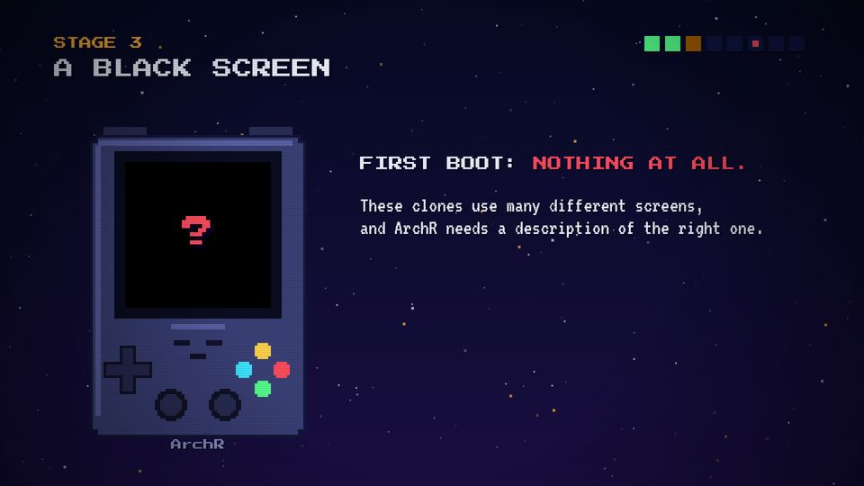
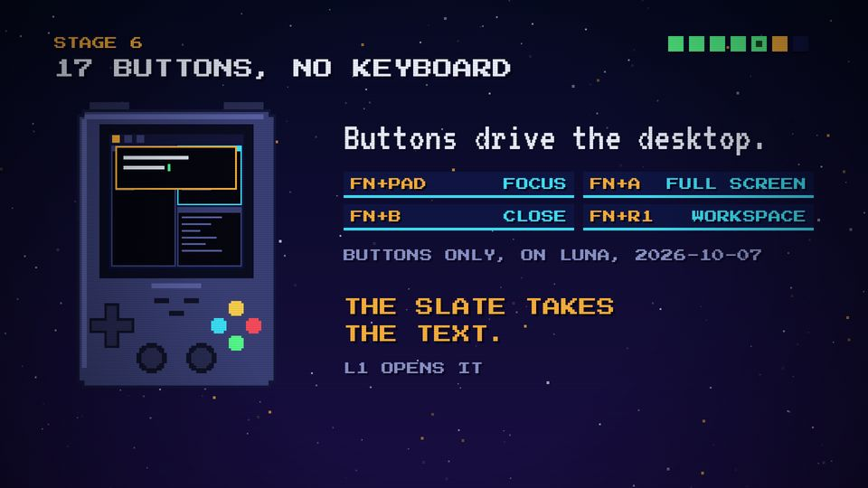

# T12 Handheld with screen states

| Field | Value |
|---|---|
| Family | data |
| Energy | calm |
| Length | any; it lives inside a stage |
| First used | Trailer, trailer sub-agent, 2026-10-25 (`device`) |
| Used in | Trailer 2 (player, select card); Story 1 4 (black screen, terminal, ssh, player); Story 2 2 (boss, buttons) |
| Status | core (the series' recurring prop) |

## Concept
The pixel handheld, whose square screen shows the device's state: moon (idle), black, "?", a white flash, a prompt, a tiled desktop, the Slate, Mike's window. The viewer reads the state of the machine without a word.

## When to use / not
- Use: whenever the story changes the device's state.
- Not: as decoration with no state change. It is an icon, not a picture of the real device.

## Dynamics
- The device bobs: `oy + round(sin(t·π)·2)·4–6` px.
- A state change lands on a beat, often with a 0.1 s white screen ('flash') between states.
- Buttons can be pressed (`press()`) on key clicks.

## Graphic elements
`device(ox, oy, s, t, screen)` (shared head) and `luna(...)` (per episode) at s = 5.5–7; `miniDesk` for the desktop screens. Tokens: `#3b4178` body, `C.amber` Slate edge, `C.green` cursor.

## Text slots (phone rule)
- None on the device. A small tag under it (P 24–28) is glance text.

## Music cue
No own cue. Key clicks (`key()`) for presses, a `ding` or `stamp` when the screen comes alive.

## Variants seen
- Story 1 stage 2: black screen with a red "?". 
- Story 2 stage 6: the Slate open over a tiled desktop. 
- Story 1 stage 4: black, then a text prompt; Story 2 boss: black, then a lit desktop.

## Code
- `snippet.js`: Story 1 `luna` lines 267–280 (commit `10d2bb4`); Story 2 `luna` 313–332 (commit `1d8f355`).
- Shared `device` lines 208–237 of every head; Story 2 `miniDesk` 280–303, `press` 334–347.
