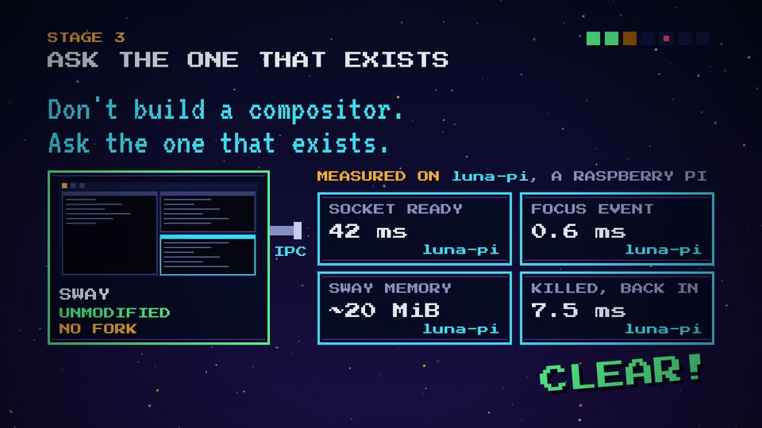
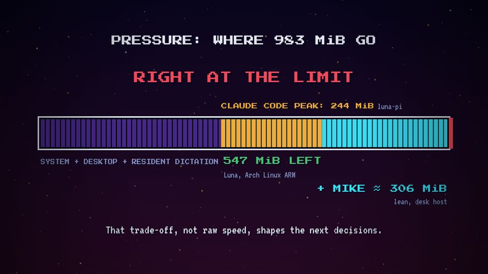

# T13 Metric tiles / gauge

| Field | Value |
|---|---|
| Family | data |
| Energy | build |
| Length | 1–2 bars inside a scene |
| First used | Trailer, trailer sub-agent, 2026-10-25 |
| Used in | Trailer: player stats 12–22 s, memory bar 44–57.5 s; Story 1: 48.8 GiB / 42 GB 12–20 s; Story 2: four IPC tiles 28–36 s |
| Status | optional |

## Concept
Measured numbers in tiles, each labelled with the machine it was measured on; or a segmented bar that fills with what uses the memory. Facts become visible, and the label keeps them honest.

## When to use / not
- Use: 1–4 real figures with their source machine.
- Not: for estimates without a source, or more than four tiles (nobody reads them on a phone).

## Dynamics
- One tile per beat (0.5 s), each value scales 1.5 → 1 on a rising blip.
- Bar variant: each segment fills in 0.3–0.4 s on a hit; the over-limit part blinks red at 8 Hz.

## Graphic elements
`box` tiles 490 × 185 with a `C.cyan` edge; value in `C.chrome`; machine tag (`luna-pi`) in `C.cyan` at bottom right. Bar: 20-px segments, `C.violet2` used, `C.amber` new load, `C.cyan`/`C.red` risk, a red limit marker.

## Text slots (phone rule)
- Key: usually elsewhere on the screen (Story 2: the VT 90 sentence).
- Secondary: the figures as a group, P 40 each, each tagged with its machine.
- Glance: tile labels and machine tags (P 28).

## Music cue
One `blip` per tile with a rising pitch (76, 79, 81, 84), a `ding` on the last; bar variant: `hit_all` on each segment, a high clash on the limit.

## Variants seen
- Story 2 stage 3: 42 ms / 0.6 ms / ~20 MiB / 7.5 ms, all on luna-pi. 
- Trailer: the 983 MiB bar, RIGHT AT THE LIMIT. 
- Story 1 stage 1: 48.8 GiB stamped in the card box (see T07 still).

## Code
- `snippet.js`: Story 2 `TILES` line 503 and tiles 522–529 (commit `1d8f355`); trailer bar `scene6` 469–500 (commit `3039e69`).
- Score: Story 2 `stage3()` 369–385; trailer `boss()` 421–471.
