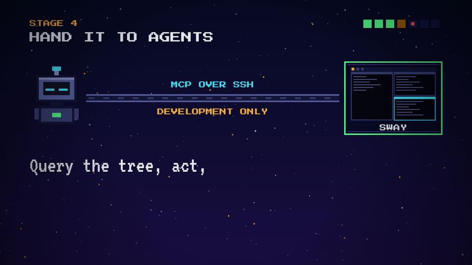
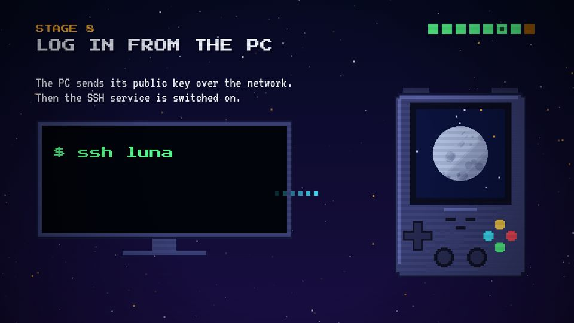

# T14 Flow / pipe

| Field | Value |
|---|---|
| Family | data |
| Energy | build |
| Length | 1–2 bars |
| First used | Story 1, S1 sub-agent, 2026-10-31 |
| Used in | Story 1: card → disk 12–20 s, PC → Luna 74–82 s; Story 2: agent → Sway 36–44 s, FN+B → Mike 57.5–62 s |
| Status | optional |

## Concept
A → link → B, with packets of pixels travelling along it. It shows who talks to whom, and in which order: query, answer, act, event.

## When to use / not
- Use: a protocol, a copy, a command and its answer.
- Not: for a static architecture diagram with many boxes; keep two ends.

## Dynamics
- The pipe appears on a beat; its dashes scroll (120 px/s).
- Each packet: 5 squares with a fading tail, 0.4 s from end to end (`easeOut`), on a sliding blip (up = out, down = back).
- Colour per message: `C.cyan` query, `C.green` answer/event, `C.amber` action.
- The receiving end reacts on arrival (focus moves, screen lights).

## Graphic elements
`packet(t, t0, t1, x0, x1, y, c)`, `arrowHead`, pipe `rect`s (`#5c64a8` / `#14173a`), ends: `agent`, `miniDesk` in a `box`, `monitor`, `luna`. Labels on the pipe: `C.cyan`, warning tag `C.amber`.

## Text slots (phone rule)
- Key: the protocol in words, VT323 90 (Story 2: "Query the tree, act, / wait for the event.").
- Secondary: one stamp or figure, P 48 (26 TOOLS).
- Glance: the pipe labels (MCP OVER SSH, DEVELOPMENT ONLY), P 28.

## Music cue
`blip(P2, t, m, 10, 9, 1, slide=±12)` per packet (up for out, down for back), `key()` when the target reacts, `stamp` for the figure. See `cue.py`.

## Variants seen
- Story 2 stage 4: agent ↔ Sway over MCP. 
- Story 1 stage 7: the signal from the PC to Luna. 

## Code
- `snippet.js` from Story 2 `index.html`: `packet`/`arrowHead` 357–364, `s4` 535–559; commit `1d8f355`.
- Story 1: bits to disk in `s1` 428–431, signal in `s7` 655–656; commit `10d2bb4`. Score: Story 2 `stage4()` 386–402.
