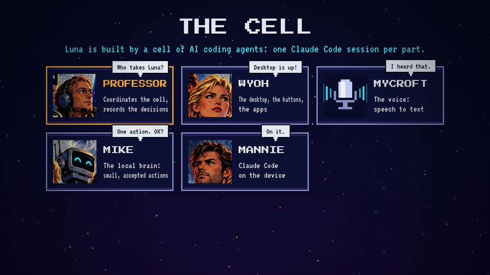
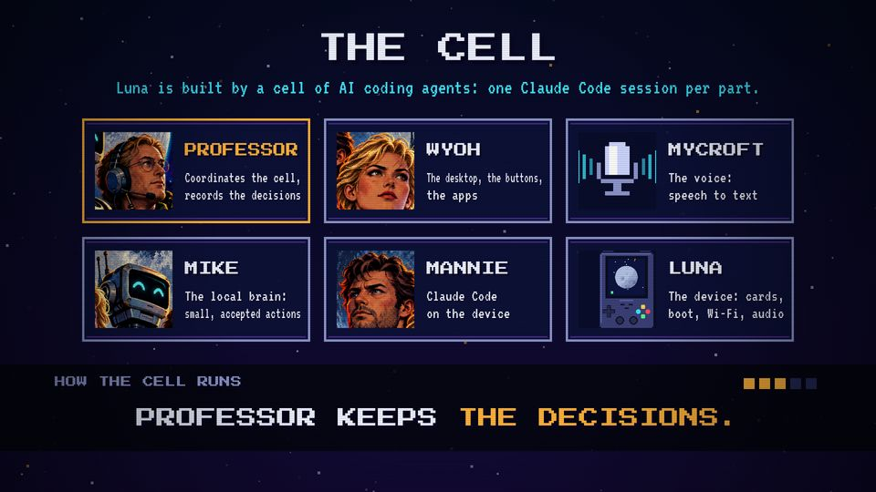

# T15 Roster

| Field | Value |
|---|---|
| Family | reveal |
| Energy | build (a march) |
| Length | 4 bars of choreography (8 s), 15.5 s with holds |
| First used | Trailer, trailer sub-agent, 2026-10-25 |
| Used in | Trailer 57.5–73 s (output) |
| Status | optional (unused since the trailer) |

## Concept
Six agent tiles with faces and jobs pop in, each says one line in a speech bubble, then the cell's rules are stamped one per second. The cell is shown as a team with rules.

## When to use / not
- Use: when the team matters to the story (a hand-off, a cell rule at work).
- Not: to list components with no role in the episode.

## Dynamics
- Bar 1: title; one tile per beat (0.5 s), scale-in with `easeBack`.
- Bar 2: speech bubbles pop 0.3 s apart, then vanish.
- Bars 2–4: a dark band; one rule per second, with a stamp scale 1.4 → 1 and a pip each.

## Graphic elements
3 × 2 grid of `box` tiles 500 × 230; `face(pic)`, `mic`, `device` portraits; `bubble()` (chrome, ink text); rule pips (`C.amber`). The coordinator's tile has an amber edge.

## Text slots (phone rule)
- Key: the current rule, PS2P 56 (trailer: 44).
- Secondary: the title THE CELL (P 64) or the agent names (P 40, trailer: 30).
- Glance: jobs and bubbles (VT 48; the trailer's VT 30–34 are too small: cut to names).

## Music cue
`cell()`: a steady march (kick, snare, triangle), the tiles as a rising arpeggio, two-note chirps for the bubbles, one `hit_all` per rule.

## Variants seen
- Trailer: tiles and bubbles. 
- Trailer: the rule ticker, PROFESSOR KEEPS THE DECISIONS. 

## Code
- `snippet.js` from `trailer/src/index.html`, `CELL`/`RULES`/`BUBBLES`/`bubble`/`scene7` lines 510–578; commit `3039e69`.
- Score: `trailer/src/score.py` `cell()` lines 472–520.
