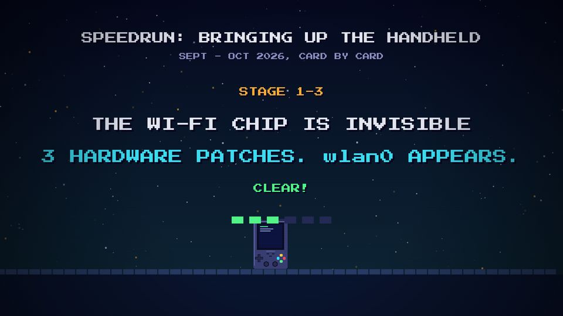

# T16 Speedrun

| Field | Value |
|---|---|
| Family | transition (a montage) |
| Energy | hit (fast) |
| Length | 3 bars (6 s): six one-second stages |
| First used | Trailer first cut, trailer sub-agent, 2026-10-25 |
| Used in | Trailer first cut 48–54 s (source time); replaced by T17 on 2026-10-31 |
| Status | retired (kept as a reference for a recap) |

## Concept
Six one-second "stages", each a problem and its fix, with a small handheld hopping along a scrolling floor. A whole story in six beats.

## When to use / not
- Use: a recap of a season, or the "previously" of a two-part story.
- Not: in place of the stories themselves. It was retired because the stories now tell these stages in full.

## Dynamics
- One stage per second (2 beats): problem on the beat, fix half a beat later (scale 1.3 → 1), CLEAR! at 0.7 s.
- A white flash on each second; a pip fills per stage.
- The device hops once per stage while the floor scrolls at 400 px/s.

## Graphic elements
`sky` dark teal, fast `stars` (220), floor tiles `#2a3e6a`, `device(..., 'term')` at s = 1.5, six pips (`C.green` / `#262c5a`). Tokens: `C.chrome` problem, `C.cyan` fix, `C.amber` stage label.

## Text slots (phone rule)
- Key: the fix line, PS2P 56 (first cut: 48). One second is short: ≤ 4 words.
- Secondary: the problem line, P 40.
- Glance: title and dates (P 24–40). Expect reading holds (the first cut needed 1–1.5 s per stage).

## Music cue
No surviving helper: the first-cut score was replaced. Use a double-time groove, a `blip` per stage and `clear()` on each fix.

## Variants seen
- Trailer first cut: stage 1-3, THE WI-FI CHIP IS INVISIBLE → 3 HARDWARE PATCHES. 

## Code
- `snippet.js` from `worklines/professor/video/src/index.html` at commit `7a76cc0` (the trailer before its move), `scene8` lines 563–594.
- The still was captured from that commit's renderer at output time 78.85 s (source 50.85 s).
