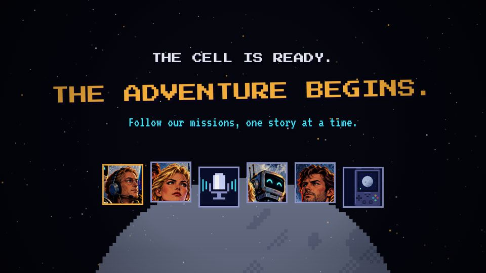

# T17 Opening / to be continued

| Field | Value |
|---|---|
| Family | transition |
| Energy | build (bright, major) |
| Length | 3 bars (6 s) |
| First used | Trailer, Professor, 2026-10-31 |
| Used in | Trailer 73–79 s (output) |
| Status | optional |

## Concept
"THE CELL IS READY. THE ADVENTURE BEGINS." The six members hop onto the Moon, and a line promises the next episodes. It turns an ending into a beginning.

## When to use / not
- Use: the end of a trailer or a season; a cliffhanger before the end card.
- Not: in a normal episode, where T22 (result) does the closing.

## Dynamics
- Bar 1, beat 1: white flash, the Moon rises (1.5 s).
- Beat 0.4–1.2: the six faces hop in, 0.15 s apart, each on a blip.
- Beat 3 (1.0 s): THE ADVENTURE BEGINS. stamps (scale 2.2 → 1).
- Bar 2: the follow line. Bar 2.5: PRESS START TO FOLLOW blinks.

## Graphic elements
`moon` (1300 px, alpha 0.55), a row of 150-px portraits (`face`, `mic`, `device`) with amber/dim frames, hopping on `|sin|`. Tokens: `C.chrome`, `C.amber` stamp, `C.cyan` follow line.

## Text slots (phone rule)
- Key: THE ADVENTURE BEGINS., PS2P 72.
- Secondary: the follow line, VT323 64 (trailer: 56).
- Glance: THE CELL IS READY. (P 40), PRESS START TO FOLLOW (P 28 → 40).

## Music cue
`opening()`: crash and kick on the cut, six rising slide-blips for the hops, `hit_all(74.0, 72, 79, 36)` on the stamp, C G Am F with a rising fanfare, a roll and `tri_drop`s into the doctrine.

## Variants seen
- Trailer: the cell on the Moon. 

## Code
- `snippet.js` from `trailer/src/index.html`, `ROW`/`scene8` lines 580–605; commit `3039e69` (content from `d9b7b7f`).
- Score: `trailer/src/score.py` `opening()` lines 521–546.
