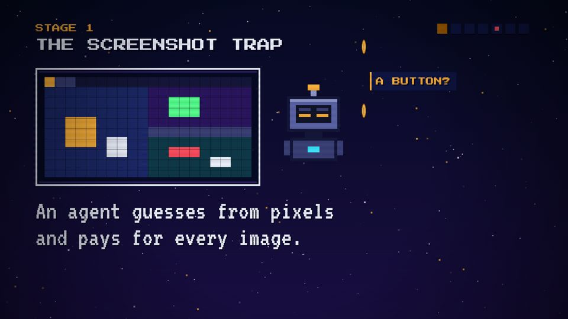

# T18 Pixel-grid guess

| Field | Value |
|---|---|
| Family | reveal |
| Energy | calm (uneasy) |
| Length | 3 bars (6 s) |
| First used | Story 2, S2 sub-agent, 2026-11-01 |
| Used in | Story 2 stage 1, 14–20 s |
| Status | optional |

## Concept
A drawn desktop is turned into big blocks, a robot squints at it, and guess bubbles appear, each costing a coin. It shows a problem as it looks from the outside: blurry, and paid for.

## When to use / not
- Use: to show what a model or a sensor "sees" and what it costs to look.
- Not: with a real screenshot (series rule): draw the scene first, then pixelate it.

## Dynamics
- Beat 1 after the HUD: the desktop box, already pixelated (35-px blocks, grid lines).
- 0.6 s: the robot squints. 1.0 s: first guess; then one guess per beat (0.5 s), each with a coin flying up.
- Bar 2: the key line. Bar 2.5: the turn (ON PAPER: …). CLEAR! at the end.

## Graphic elements
`miniDesk(..., {bright: true})` then `pixelate(x, y, w, h, 35)`, `agent(..., 'squint')`, `coin`, guess chips (`C.navy2`, amber edge). Tokens: `C.amber` guesses, `C.cyan` turn line.

## Text slots (phone rule)
- Key: "An agent guesses from pixels / and pays for every image." VT323 90.
- Secondary: ON PAPER: A DESKTOP DOM. PS2P 40.
- Glance: the three guesses, P 28.

## Music cue
Uneasy Am Dm E `groove`; per guess `coin(P2, t, 9)` and a falling slide-`blip`; a `ding` on the turn line. See `cue.py`.

## Variants seen
- Story 2 stage 1: A BUTTON? A WINDOW? WHICH ONE? 

## Code
- `snippet.js` from Story 2 `index.html`: `pixelate` 305–311, `GUESS`/`s1` 437–460; commit `1d8f355`.
- Score: Story 2 `stage1()` lines 342–354, commit `1c08176`.
