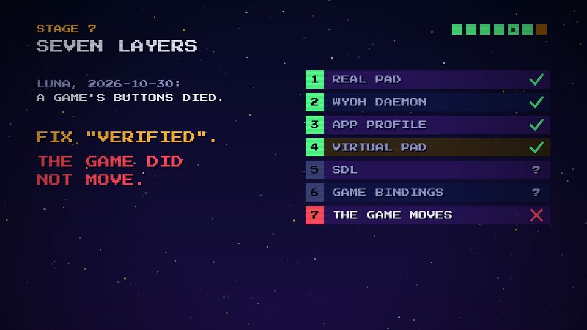
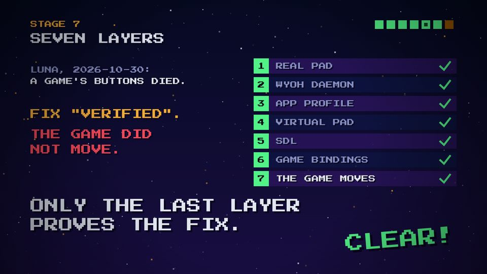

# T19 Layer stack

| Field | Value |
|---|---|
| Family | data |
| Energy | build, with a stop-time |
| Length | 5 bars (10 s) |
| First used | Story 2, S2 sub-agent, 2026-11-01 |
| Used in | Story 2 stage 7, 62–72 s |
| Status | optional |

## Concept
Numbered rows from cause to effect, ticked in turn. A fix is "verified" half-way, but the last row fails; then the remaining rows are ticked one by one and the stage ends on the lesson. It teaches where the proof really is.

## When to use / not
- Use: a chain of 4–7 steps where a check at the wrong level fooled us.
- Not: for a simple procedure (T07), or with more than 7 rows.

## Dynamics
- Bar 1: context tag; the rows appear.
- Bar 1.5: rows 1–4 tick, one every half beat (0.25 s), on rising blips.
- Next beat: FIX "VERIFIED". (amber, ding). One beat later: the last row crossed, THE GAME DID NOT MOVE. (buzz, `tri_drop`).
- Stop-time (Dsus4, 1 bar): "?" on rows 5–6.
- Then rows 5–7 tick, one per beat; the lesson stamps; CLEAR!.

## Graphic elements
Rows 800 × 60 alternating `C.violet` / `C.navy2`, a 60-px number square (`#3b4178` → `C.green` / `C.red`), `check` / `cross` at the right; the "verified" row tinted `#3a2a10`. Tokens: `C.amber`, `C.red`, `C.green`.

## Text slots (phone rule)
- Key: the lesson stamp, two lines at PS2P 56.
- Secondary: FIX "VERIFIED". / THE GAME DID NOT MOVE., P 40.
- Glance: the row names and the context tag, P 28.

## Music cue
Checks with `blip(P1, ...)` rising, `ding` on VERIFIED, `buzz` + `tri_drop` on the failure, a Dsus4 `chord_arp` with `tick`s (stop-time), `groove` Dm E, `stamp` on the lesson. See `cue.py`.

## Variants seen
- Story 2: row 7 crossed during the stop-time. 
- Story 2: all seven ticked, the lesson stamped. 

## Code
- `snippet.js` from Story 2 `index.html`, `LAYERS`/`LAYER_OK`/`s7` lines 642–669; commit `1d8f355`.
- Score: Story 2 `stage7()` lines 448–469, commit `1c08176`.
