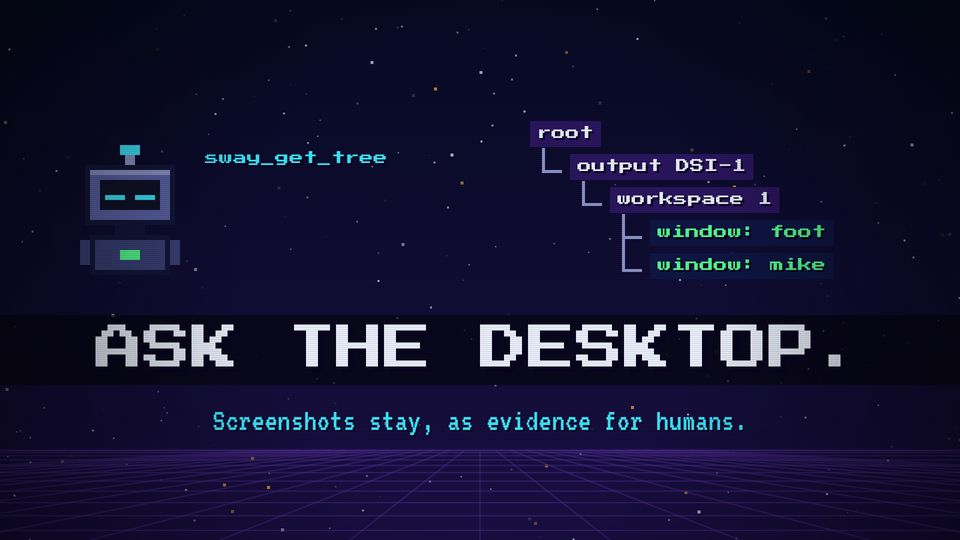
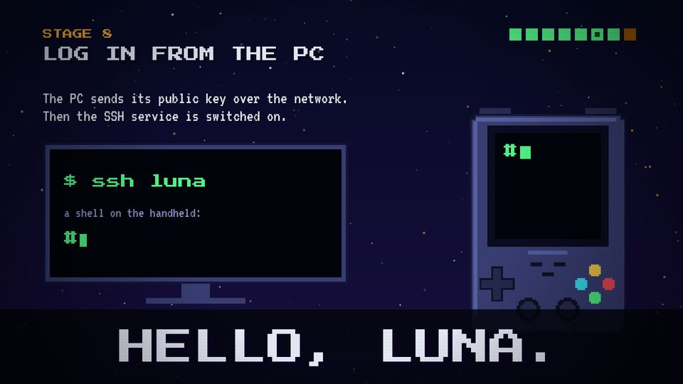

# T21 Payoff reprise

| Field | Value |
|---|---|
| Family | frame |
| Energy | hit (the biggest of the episode) |
| Length | 3 bars (6 s); the stamp lands 1.5 s in |
| First used | Story 1, S1 sub-agent, 2026-10-31 |
| Used in | Story 1 stage 7, 78.5 s (HELLO, LUNA.); Story 2 payoff 72–78 s (ASK THE DESKTOP.) |
| Status | core when the episode has a payoff |

## Concept
The title stamp of the episode returns on a dark band, with the trailer theme at full voice. It closes the loop: the promise of the title card is kept.

## When to use / not
- Use: once, at the moment the quest is achieved, just before the result screen.
- Not: when the episode ends without a win (then go straight to T22).

## Dynamics
- The action that achieves the quest (a prompt, a tree) on beats 1–3.
- On the downbeat of the theme: a dark band (`C.ink`, 70–85 %) slides in, the stamp lands (scale 2 → 1, shake), white flash.
- 1 s later: one secondary line. Last 0.25 s: block dissolve.

## Graphic elements
A full-width band (`rect(0, y, W, 140–210, C.ink, 0.7–0.85)`), `stampTxt` in `C.chrome`, `flash`, `dissolve`. Same words as T01, with a final full stop.

## Text slots (phone rule)
- Key: the stamp, PS2P 96–104.
- Secondary: one VT323 64 line (Story 2: "Screenshots stay, as evidence for humans.").

## Music cue
`hit_all(t, 69, 76, 33, 15, cym='crash')` on the stamp, `groove(t, Am F G)`, the trailer `THEME` replayed from the stamp at velocity 13. See `cue.py`.

## Variants seen
- Story 2: over the tree, with a secondary line. 
- Story 1: over the PC and Luna, the prompt on both screens. 

## Code
- `snippet.js`: Story 2 `sPayoff` band and stamp, lines 689–695 (commit `1d8f355`); Story 1 `s7` lines 658–664 (commit `10d2bb4`, source time 72.5 = cut 78.5).
- Score: Story 2 `payoff()` 470–482; Story 1 `ssh()` 471–490.
