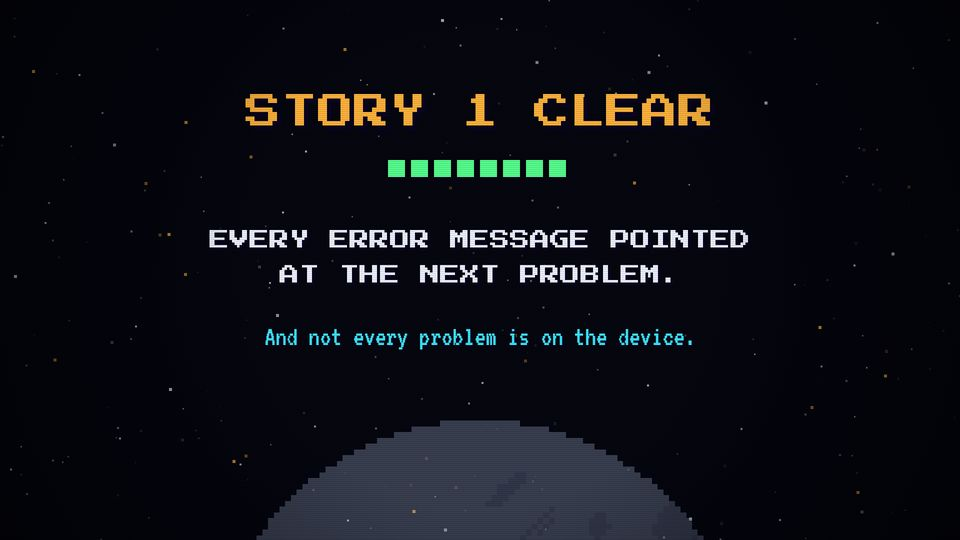
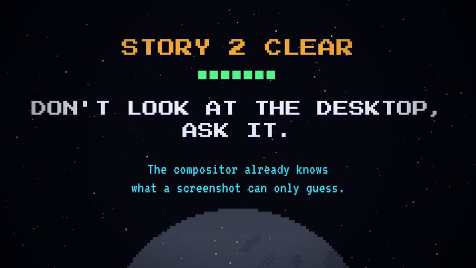

# T22 Result screen

| Field | Value |
|---|---|
| Family | frame |
| Energy | calm (after a fanfare) |
| Length | 3 bars (6 s) |
| First used | Story 1, S1 sub-agent, 2026-10-31 |
| Used in | Story 1 82–88 s; Story 2 78–84 s |
| Status | core (mandatory) |

## Concept
"STORY n CLEAR", the stage pips filling up, and the lesson of the episode in two sizes. It is the takeaway the viewer keeps.

## When to use / not
- Use: after the last stage or the payoff, before the end card.
- Not: with more than one lesson. No new facts here.

## Dynamics
- Beat 1: white flash, STORY n CLEAR stamps (scale 1.8 → 1) on the level-clear fanfare.
- 0.6 s: the pips fill, 0.08 s apart, on rising blips.
- Bar 1.5: the lesson (two lines). Bar 2.2: the secondary, then a quiet bed for reading.

## Graphic elements
`C.ink` background, `stars`, a low `moon` (alpha 0.3); a row of `C.green` pips (one per stage); lesson in `C.chrome`, secondary in `C.cyan`.

## Text slots (phone rule)
- Key: the lesson, PS2P 64, two lines (largest after the CLEAR stamp, P 72).
- Secondary: VT323 64, two lines.

## Music cue
`result()`: a level-clear fanfare (C E G C, `crash`, kick), one `blip` per pip, a light `groove` and the hero motif played quietly under the reading.

## Variants seen
- Story 1: EVERY ERROR MESSAGE POINTED AT THE NEXT PROBLEM. (P 40, too small). 
- Story 2: DON'T LOOK AT THE DESKTOP, ASK IT. (P 64). 

## Code
- `snippet.js` from Story 2 `index.html`, `sResult` lines 699–714; commit `1d8f355`.
- Story 1 `sResult` 670–684 (commit `10d2bb4`). Score: Story 2 `result()` 483–496.
