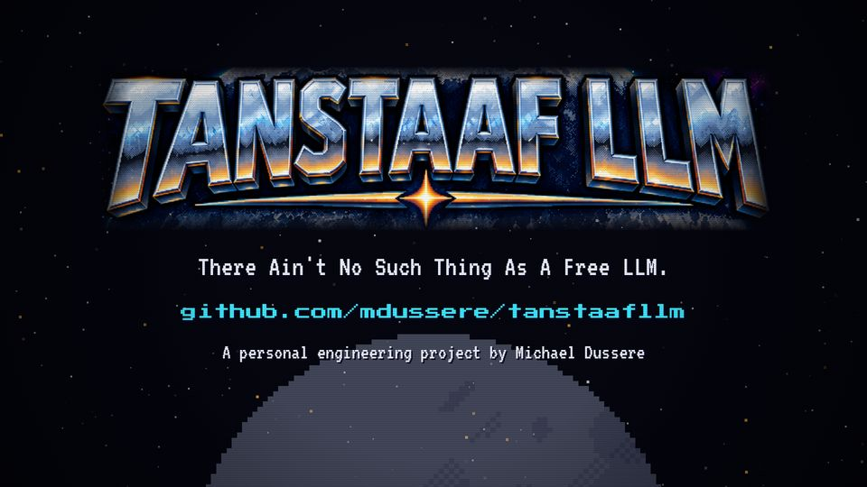
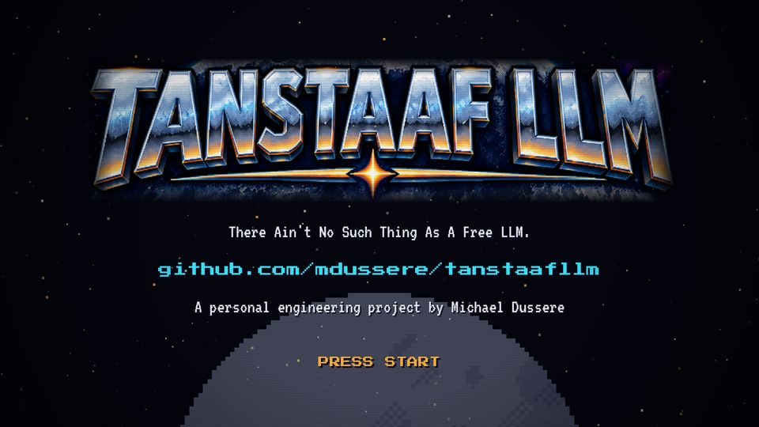

# T23 End card

| Field | Value |
|---|---|
| Family | frame |
| Energy | calm |
| Length | 3 bars (6 s), fade in the last 0.5 s |
| First used | Trailer, trailer sub-agent, 2026-10-25 |
| Used in | Trailer 82.5–86.5 s (output); Story 1 88–94 s; Story 2 84–90 s |
| Status | core (mandatory, unchanged) |

## Concept
The chrome logo from the key art, the motto, the URL, the byline, a blinking PRESS START, and a fade to black. It is the series' signature.

## When to use / not
- Use: the last scene of every video. Copy it; only shift the times.
- Not: with episode-specific text.

## Dynamics
- Beat 1: white flash (0.5 s), the logo shrinks 1700 → 1500 px wide.
- 0.3 / 0.6 / 0.9 s: motto, URL, byline fade in. 1.5 s: PRESS START blinks at 3 Hz.
- Last 0.5 s: fade to black.

## Graphic elements
`titleLogo` (crop of the key art), `stars`, low `moon` (alpha 0.35). Tokens: `C.chrome` motto and byline, `C.cyan` URL, `C.amber` PRESS START.

## Text slots (phone rule)
- Key: the logo (an image).
- Secondary: the motto, VT323 64 (Story 2; the trailer and Story 1 used 48).
- Glance: URL P 36, byline VT 48, PRESS START P 40.

## Music cue
`finale()`: the trailer's end-card cadence (Am F G with the theme's head), `hit_all` on the cut, then the A-minor chord fading in 4-bit steps (`E_fade`) while PRESS START blinks on P2.

## Variants seen
- Story 2: motto at VT 64, PRESS START P 40. 
- Trailer: the original. 

## Code
- `snippet.js` from Story 2 `index.html`, `sEnd` lines 717–728; commit `1d8f355`.
- Trailer `scene9` 622–631 (commit `3039e69`); Story 1 `sEnd` 687–698. Score: Story 2 `finale()` 497–516.
