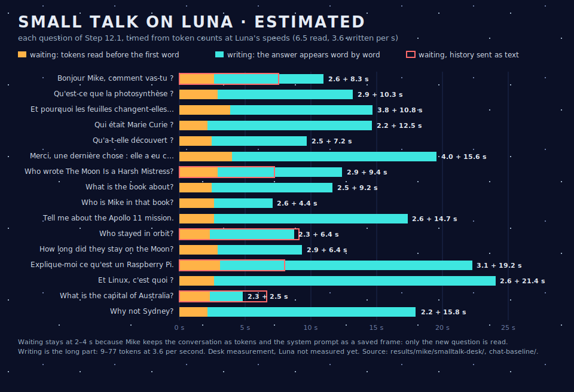

# Step 12.1–12.2 — Small talk with LFM2.5-350M raw, on the desk host

> **Freshness:** 🟡 historical · **Written:** 2026-10-31 · **Checked:** 2026-10-31 · **Step:** mike 12.1 ✅

**Question answered:** how does Mike's chosen model, untrained, do as a chat partner, and what would a turn cost on Luna once the prompt is cached? 
**Date:** 2026-10-31 
**Status:** measured on Termidor only. Luna's times are **estimates** from token counts at Luna's measured speeds (6.5 tokens/s read, 3.6 tokens/s written, `0405_01`, `0801_01`); not measured on Luna yet (12.5). Green light: the user, 2026-10-31 12:00.

- **Tests:** `test/mike/test_chat_baseline.py` (`chat_baseline.feature`, OpenAI chat endpoint, history sent as text) and `test/mike/test_smalltalk.py` (`smalltalk.feature`, Mike's client `src/mike/smalltalk.py`, history kept as token ids).
- **Evidence:** `results/mike/chat-baseline/20261031T110034Z/` (with `answers.md` to read) and `results/mike/smalltalk-desk/20261031T110408Z/`.
- **Setting:** LFM2.5-350M Q4_0, `llama-server` b11429, lean, context 2,048, 4 threads; a system prompt of 33–35 tokens asking for two or three short sentences, in French or English; Liquid AI's sampling (temperature 0.1, top-k 50, repeat penalty 1.05); at most 120 tokens per answer. Six conversations, 16 questions.

## Summary

- **Waiting is solved.** With the conversation kept as token ids and the system prompt restored from a saved frame, each question reads only itself: **14–26 tokens**, about **2–4 s on Luna** before the first word. After a restart too.
- **Writing is now the long part:** answers of 9–77 tokens (median about 35), about **2.5–21 s on Luna** at 3.6 tokens/s. The text appears as it is written, at about 2.5 words per second.
- **The model talks fluently and gets facts wrong.** On subjects it surely saw in training it often makes things up. It says *The Moon Is a Harsh Mistress* was written by "John Greenleaf Whittaker", about "a young teacher in Texas". It says Marie Curie studied "béryton" and that Apollo 11 carried "Edwin Armstrong". It gets the easy ones right: Canberra, Curie's two Nobel prizes, the date of Apollo 11.
- **Memory:** about 285 MiB RSS for the server, 230 MiB of it the mapped model file.

## Why the history must be kept as tokens

A chat client usually sends the whole history as text each turn. The server then turns it back into tokens and compares it with what it read last time. It reuses what matches and reads the rest.

- Sent as text (12.1), a follow-up usually read 14–26 tokens. But in one case ("Who stayed in orbit?") it read 59. The previous answer, turned back into tokens, did not match the tokens the model had generated, so the server read the whole answer again.
- LFM2 is a hybrid model. Part of its state cannot be rewound to an arbitrary point. A mismatch costs more than on a plain transformer.
- Kept as token ids (12.2, `smalltalk.py`), the history is exactly what the server has read, plus the new turn. Over 32 turns, no follow-up read more than 26 tokens.

## Layer L0 as a PreStaC frame

- The system prompt (35–38 tokens with the template) is read once and saved with the server's slot save. At the next start it is restored.
- With the client restarted, the first question read 14–20 tokens, against 43–52 when the system prompt is read again. On Luna that is about 2–3 s less at the first question after a start.
- The frame is small here because the chat prompt is short; Mike's tool prompt (1,053 tokens) made a 13 MB frame (`0902_01`).

## Asking for one sentence instead of two or three

Same questions, system prompt "answer in one short sentence" (`results/mike/chat-baseline/20261031T111000Z/lean-one/`):

- **Answers get shorter:** a median of 22 tokens instead of 37, at most 66 instead of 77. On Luna, the last word would come at a median of 11.6 s instead of 13.8 s, and at worst after 17.6 s instead of 26.6 s (estimate).
- **They are not more reliable.** It now says Sydney is the capital of Australia, which it had right before, and that Armstrong and Aldrin "stayed in orbit". One draw per question, so this is noise as much as a trend.
- The client keeps "two or three short sentences" for now; the length is cheap to change once Luna's own numbers are in.

## What is left for a fluid experience

1. **Measure on Luna (12.5):** start time (model load), waiting and writing, with Kroko resident.
2. **Shorten the writing:** a prompt asking for one or two sentences, a lower token limit; the user reads as it streams, so the limit matters less than the first words.
3. **Writing speed on Luna:** the lean setting turns off the repacked weights, which was measured as an x86 speed layout (`0302_05`). On ARM, Q4_0 repacking may speed up writing; to measure on Luna, with its memory cost.
4. **The window and the button** are Wyoh's (Wyoh plan 6.11): a terminal window "mike", the Slate's FN+B types the dictated text into it.
5. **Facts:** the model's knowledge is weak at 350M. That is the price of the size, not of the harness; the user chose to keep this model and see.
