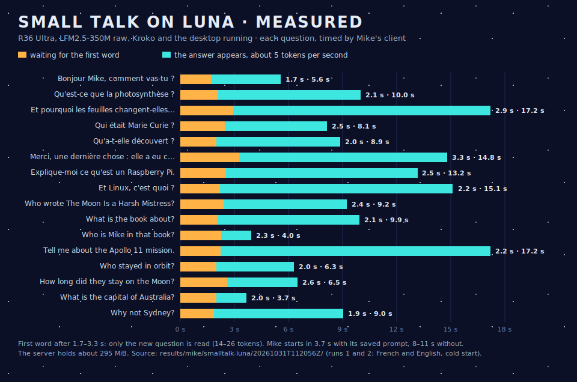

# Step 12.5 — Small talk on Luna: measured

**Question answered:** on Luna itself, how long does Mike take to start, to say its first word and to finish an answer, and does the repacked weight layout help? 
**Date:** 2026-10-31 
**Status:** measured on Luna (R36 Ultra, Cortex-A35 ×4, Arch Linux ARM), as michael, over SSH, without the window (Wyoh 6.11 builds it). Mannie on Luna was stopped on the user's order, relayed by Professor. Kroko, Sway and the Wyoh services kept running. No reboot.

- **Test:** `test/mike/test_smalltalk_luna.py` (`live`, `smalltalk_luna.feature`). **Evidence:** `results/mike/smalltalk-luna/20261031T112056Z/`: `chat.jsonl` (each start and each turn, timed by the client), each run's output and server log, `summary.json`.
- **Setting:** `src/mike/smalltalk.py`, llama-server b11429 arm64, LFM2.5-350M Q4_0, lean, 4 threads, context 2,048. The 12.1 questions are fed on stdin: French cold, English cold, French warm, French with repacked weights. 32 turns in 6 min 22 s.

## Summary

- **First word after 1.7–4.2 s**, with a median of 2.2–2.7 s depending on the run. Each question reads only itself: 14–26 tokens.
- **Last word after 3.7–18.9 s**, with a median of 9–14 s. The answer appears as it is written.
- **Luna writes faster than estimated:** 4.6–5.0 tokens/s against 3.6 measured in Step 4.5. That run had a grammar and Mike's long tool prompt; this one has neither.
- **Start:** 3.7 s when the system prompt's frame is on disk, and 8–11 s the first time, when it is read and saved. The model file is cached in memory after the first run, so a start after a reboot will be slower (not measured).
- **Memory:** the server holds 293–302 MiB (VmHWM). MemAvailable stayed at 550–558 MiB around the runs, with Kroko and the desktop loaded and Mannie stopped.
- **Repacked weights do not help** on Luna: 4.63 tokens/s written against 4.59–4.98 lean, for the same memory within a few MiB. The client stays lean.

| Run | Start | First word, median (max) | Last word, median (max) | Written per s |
| --- | --- | --- | --- | --- |
| French, cold | 11.0 s, L0 read | 2.45 s (3.26) | 13.2 s (17.2) | 4.98 |
| English, cold | 8.1 s, L0 read | 2.22 s (2.59) | 9.0 s (17.2) | 4.88 |
| French, warm | 3.7 s, L0 restored | 2.69 s (3.52) | 13.9 s (17.3) | 4.59 |
| French, repacked | 3.7 s, L0 restored | 2.57 s (4.17) | 12.1 s (18.9) | 4.63 |

## What it means

- **The 12 acceptance proposal is met:** first word within about 3 s of the question, streamed. The 105 s of Step 4.5 came from reading a 1,000-token prompt at every request; a short chat prompt, the history kept as tokens and L0 as a saved frame remove that.
- **Mannie and Mike cannot run together** on Luna today: Mike needs about 300 MiB and Mannie's Claude process about 300 MiB, with about 400 MiB available when both Kroko and the desktop are loaded (Mannie on Luna, 2026-10-31).
- **The answers are still the model's:** fluent, and often wrong on facts. On Luna it wrote that *The Moon Is a Harsh Mistress* is by "John C. Allen", about "a young man who falls in love", and that Armstrong and "Edwin Armstrong" stayed in orbit. It had Canberra, photosynthesis and Curie's two Nobel prizes right.
- **Next:** the window and the button (Wyoh 6.11), then the user's own try: take Luna out, FN+B, talk.
