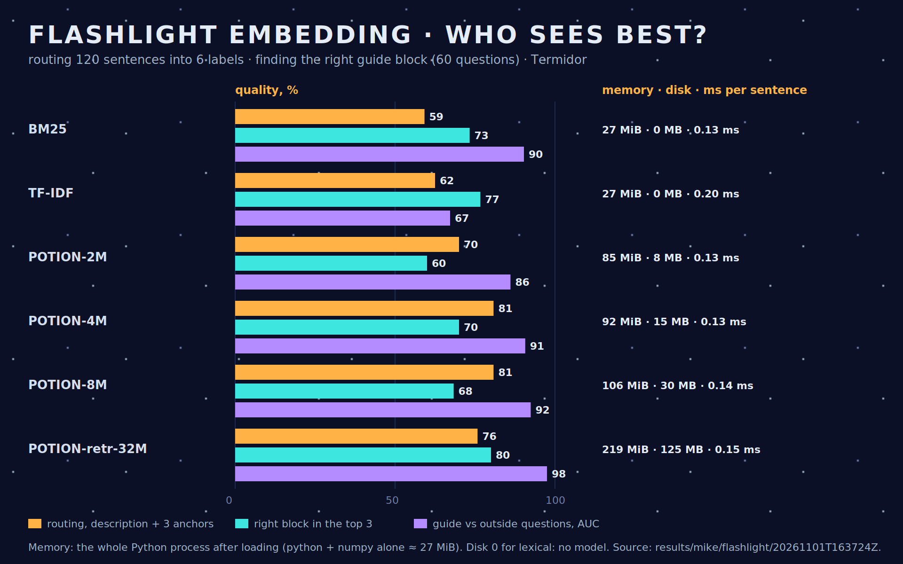

# Step 14.1–14.3 — The "flashlight embedding", measured on Termidor

> **Freshness:** 🟢 current · **Written:** 2026-11-01 · **Checked:** 2026-11-01 · **Step:** mike 14.3 ⏳

**Question answered:** which is the smallest, fastest embedding that serves both zero-shot routing of short English sentences and retrieval of short knowledge blocks from Luna's guide? 
**Answer, for review:** no single candidate is best at both. Speed does not separate them: every candidate takes 0.13–0.20 ms per sentence.
- **Routing** needs a static embedding. POTION-4M routes 81 % of 120 sentences, against 59–62 % for word overlap. It costs 15 MB on disk and about 92 MiB for the whole Python process.
- **Retrieval** over the guide's own words does not need one. BM25 and TF-IDF put the right block in the top 3 for 44 and 46 of 60 questions, against 42 for POTION-4M. Only the 125 MB POTION-retrieval-32M does better, with 48.
- **Proposal (agreed by Professor):** POTION-4M as the flashlight for routing. For retrieval, BM25 fused with POTION-4M by reciprocal rank: it reaches the 32M's 48/60 top-3 with only POTION-4M's 15 MB, at 0.34 ms per sentence. Nothing has run on Luna yet.

- **Go:** the user via Professor, 2026-11-01. Termidor only; nothing goes into Mike's conversation.
- **Test:** `test/mike/test_flashlight.py` (`integration`, `flashlight.feature`), with `flashlight_bench.py`, which measures each candidate in its own process.
- **Data:** `flashlight_data.json`, enlarged at Professor's request so that one item is worth less than 1 point:
  - 120 routing sentences, 20 for each of 6 labels: small talk, a question about the guide, a Luna action, weather, cooking, music. Each label is given as a description and three anchor sentences that are not in the test.
  - 60 guide questions, each with its expected blocks, and 20 questions the guide does not answer.
  - 45 ASR-like variants: 30 for routing and 15 for retrieval. They are written in the style of Kroko English's errors (`results/mycroft/english-candidates/20261101T115520Z`): lower case, no question mark, "net surf" for NetSurf, "dyno" for Dino, "manny" for Mannie, "why oh" for Wyoh.
- **Blocks:** `flashlight_blocks.py` cuts `docs/10`–`15` and the gamepad how-to into 65 prose blocks of 16–120 words, each cited as file, heading and part.
- **Evidence:** `results/mike/flashlight/20261101T163917Z/candidates.jsonl`. It includes the fusion and the same numbers as `20261101T163724Z` for the others. The first, smaller run is in `20261101T163351Z`.
- **Candidates:**
  - Model2Vec `minishlab/potion-base-2M`, `-4M` and `-8M`, and `potion-retrieval-32M` as a larger reference; MIT licence, weights in the Hugging Face cache, not in Git;
  - BM25 and TF-IDF, written in standard Python;
  - `model2vec` 0.10 is in the `embed` dependency group.

| Candidate | Disk | Process RSS | ms per sentence / per 100 words | Routing (120): description only / + anchors / noisy (30) | Retrieval (60): top-1 / top-3 | Noisy retrieval (15): top-1 / top-3 | Guide vs outside: AUC / best threshold |
| --- | --- | --- | --- | --- | --- | --- | --- |
| BM25 | — | 27 MiB | 0.13 / 0.54 | 32 % / 59 % / 63 % | 31 / 44 | 6 / 10 | 0.90 / 90 % |
| TF-IDF | — | 27 MiB | 0.20 / 1.19 | 31 % / 62 % / 67 % | 36 / **46** | 8 / 10 | 0.67 / 78 % |
| POTION-2M | 8 MB | 85 MiB | 0.13 / 0.35 | 72 % / 70 % / 70 % | 24 / 36 | 6 / 8 | 0.86 / 81 % |
| **POTION-4M** | 15 MB | 92 MiB | 0.13 / 0.35 | 78 % / **81 %** / **77 %** | 29 / 42 | 7 / 10 | 0.91 / 88 % |
| POTION-8M | 30 MB | 107 MiB | 0.14 / 0.38 | 79 % / 81 % / 67 % | 31 / 41 | 7 / 10 | 0.92 / 89 % |
| POTION-retrieval-32M | 125 MB | 219 MiB | 0.15 / 0.41 | 81 % / 76 % / 77 % | **39 / 48** | **10 / 11** | **0.98 / 95 %** |
| **BM25 + POTION-4M, fused** (RRF, k = 60) | 15 MB | 92 MiB | 0.34 / 0.98 | — / 72 % / — | 35 / **48** | 8 / **11** | 0.87 ¹ |

¹ The fused score is built from ranks, not similarities, so its AUC is not comparable. A threshold would use the BM25 or POTION-4M score.

## What the numbers say

- **Speed is not the limit.**
  - On the desk, every candidate handles a sentence in 0.13–0.20 ms and a 100-word block in under 1.2 ms.
  - Loading POTION-4M takes about 0.6 s; indexing the 65 blocks takes about 11 ms.
  - Luna's Cortex-A35 will be several times slower, which still leaves a margin under "a few milliseconds", but it is not measured.
- **Memory is the cost.**
  - The figure is the whole process: Python and numpy take about 27 MiB, and `model2vec` with its tokenizer about 55 MiB more before any weights.
  - A numpy-only loader on Luna should take less; to measure.
- **Routing needs vectors.**
  - Word overlap cannot tell "Do you like cats or dogs?" from a cooking question.
  - The static models route 70–81 % of the sentences. POTION-4M equals 8M at half the size, and keeps 77 % on the noisy variants, where 8M falls to 67 %.
  - The anchor sentences help the small models; the 32M does slightly better with descriptions alone.
- **Retrieval over the guide favours words.**
  - Questions and blocks share the guide's own terms, such as Kroko, ArchR or lean, and the lexical scores use them directly.
  - TF-IDF has the best top-3 among the small candidates (46/60). The static base models are below it, at 36–42.
  - The misses go to a neighbouring block on the same subject. Blocks summarised offline, as the user plans, may change this; this set used raw prose.
- **Noise** (Professor: Kroko English's known-words list, 77f598e, should fix most misheard names upstream; retrieval is not tuned to ASR errors):
  - ASR-like variants cost every candidate a lot in retrieval: at best 11 of 15 in the top 3.
  - Misheard names ("crow co" for Kroko, "arc r" for ArchR) defeat word overlap, and they hurt the vectors too.
  - Routing holds up better.
- **Out of domain:**
  - POTION-4M separates guide questions from outside questions with an AUC of 0.91, and BM25 with 0.90; the 32M reaches 0.98.
  - This is a measurement only: no filter was built, as the user decided.
- **Precision of the sets:** one routing sentence is now worth 0.8 points and one guide question 1.7. Differences of 1–2 questions between candidates are still noise.

## Proposal (for Professor and the user)

- **Flashlight for routing: POTION-4M.** It is the smallest model with the best routing, and it is the most robust to noise among the small ones.
- **Retrieval: BM25 fused with POTION-4M** (reciprocal-rank fusion, Professor's check). It gets 48/60 in the top 3, the same as the 32M and above BM25 alone (44) or POTION-4M alone (42). Its top-1 is 35, against 39 for the 32M. It runs both models on the question: 0.34 ms on the desk.
  - POTION-retrieval-32M is the only vector model that beats lexical retrieval here, at 125 MB and about 220 MiB of process memory, which is too much for Luna today.
- **Next:**
  - 14.4 on Luna (ms per sentence and RAM, warm and resident), when Luna is back and Professor arranges the slot with Mannie.
  - Retrieval measured again on offline-summarised blocks, when they exist.
