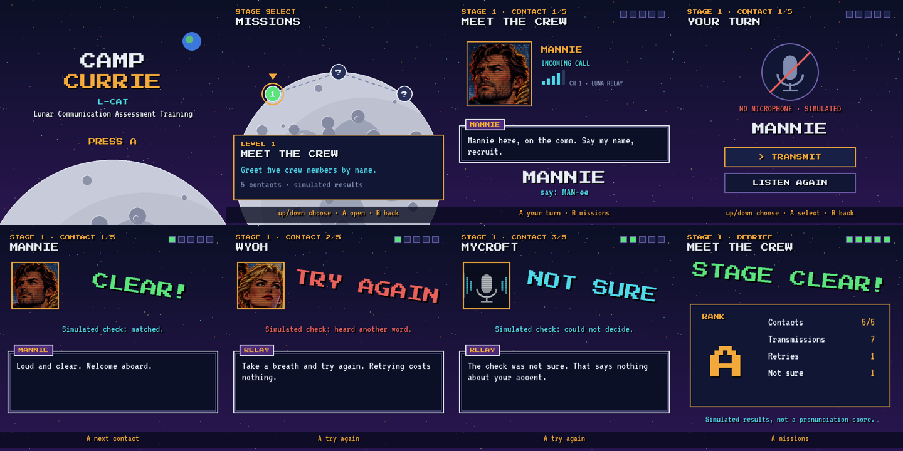
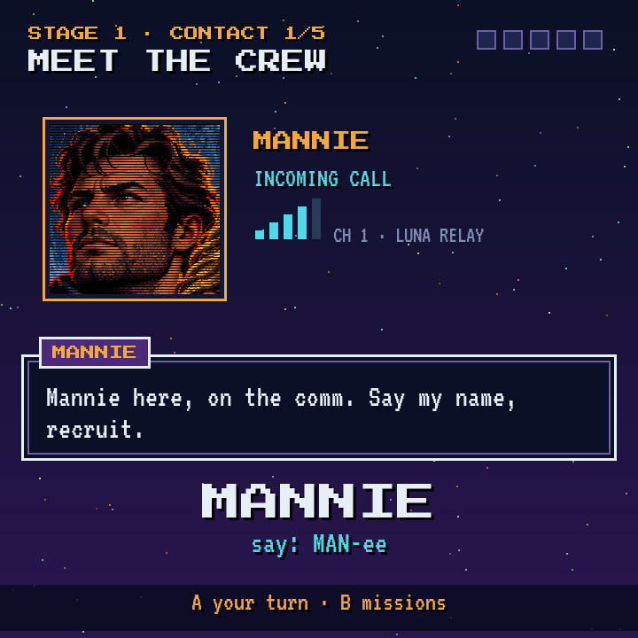

# Camp Currie — the navigable shell (Step 2)

> **Freshness:** 🟢 current · **Written:** 2026-11-02 · **Checked:** 2026-11-02 · **Step:** Camp Currie 2

The shell runs, every screen is reached with the arrows, Return and Escape, and nothing in it records or plays sound. The design is in [0101_01](0101_01_design-and-stack.md); the five-contact mission is in [0301_01](0301_01_first-mission-result.md).

## What exists

| Piece | File |
|---|---|
| Pure game logic: scenes, actions, simulated evaluator, semantic state | [`src/camp-currie/camp_currie/core.py`](../../../../src/camp-currie/camp_currie/core.py) |
| Drawing at 720×720: starfield, Moon, comm frame, dialogue box, stamps, node map, results | [`…/render.py`](../../../../src/camp-currie/camp_currie/render.py) |
| Entry point: play with the keys, or `--agent` (JSON lines), `--script` | [`…/__main__.py`](../../../../src/camp-currie/camp_currie/__main__.py) |
| Portraits cropped from the key art, and the OFL fonts with their licences | [`src/camp-currie/assets/`](../../../../src/camp-currie/assets/), [`tools/make_portraits.py`](../../../../src/camp-currie/tools/make_portraits.py) |
| Tests and their contract | [`test/camp-currie/test_camp_currie.py`](../../../../test/camp-currie/test_camp_currie.py), [`camp_currie_shell.feature`](../../../../test/camp-currie/camp_currie_shell.feature) |

Run it on the desk: `cd src/camp-currie && uv run --group camp-currie python -m camp_currie`.

## Evidence

- `uv run --group camp-currie pytest test/camp-currie`: 10 passed. The rendered test plays the whole game through `--agent`, as an agent would, and saves every screen in `results/camp-currie/shell/20261101T231341Z/`. Every screen was inspected, and two defects found that way were fixed: a reason line wider than the screen, and the briefing prompt overlapping its box.
- **On `luna-pi`'s real Sway** (720×720 headless, Wayland, the same session type as Luna): a full mission was played through `--agent` and the window captured with grim. It shows Mannie's call as on the desk.

  

## Memory (peak RSS, whole process)

| Where | Peak | What dominates |
|---|---|---|
| Termidor, SDL dummy driver, full mission | 38.8 MiB | Python, pygame, fonts, portraits |
| `luna-pi`, real Wayland, full mission | 106.5 MiB | file-backed 59 MiB, of which Mesa's libLLVM 41 MiB and libgallium 12 MiB, shared with other GL clients; anonymous 31 MiB |
| Luna | not measured | Luna's GPU uses ARM's libmali (no LLVM): needs a slot |

**Finding:** SDL2 has no software framebuffer on Wayland ("Window framebuffer support not available" with `SDL_FRAMEBUFFER_ACCELERATION=0`), so every window goes through EGL and the GPU driver. Most of the excess is that driver's code, mapped from files and shared, not the game's own memory. Adam's word: "50 MiB is fine, optimise once the look is right". Options for later: SDL3, whose Wayland backend may offer a software path (to check), or a thin `wl_shm` client.
