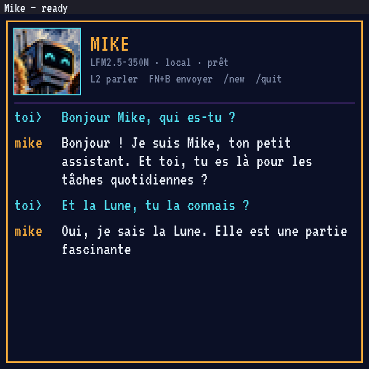
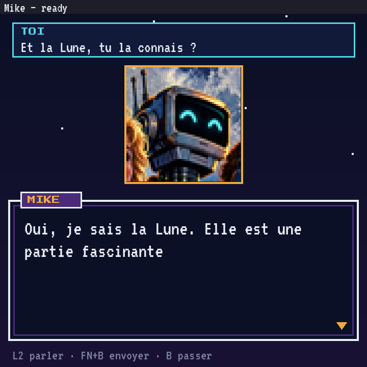

# Mike's new look — two mock-ups (Wyoh 6.13)

> **Freshness:** ⚪ draft · **Written:** 2026-11-01 · **Checked:** 2026-11-01 · **Step:** Wyoh 6.13

Adam (2026-11-01, via Professor): "Mike in plain text doesn't please me much; I'd like something nicer." Two directions are rendered below at Luna's 720×720, using the series' fonts and colours and the real answer Mike gave on Luna on 2026-10-31. Generator: [`src/wyoh/apps/mike/mockups.py`](../../../src/wyoh/apps/mike/mockups.py). The portrait is a rough crop of the robot from Hazel's key art, and still shows the neighbours' hair: Hazel would supply a clean portrait, and its thinking and speaking frames.

| A — terminal skin | B — RPG dialogue |
|---|---|
|  |  |

## A — terminal skin

The same foot window as today, dressed up: VT323 as the terminal font, an amber frame, Mike's portrait at the top, the conversation as a scrolling log (questions in cyan, Mike in white), and the answer streaming in place.

- **Cost on Luna:** no new package. foot already shows sixel images, so the portrait is a 128 px sixel; the VT323 file goes in the user's fonts. Memory is the same as today, about foot's.
- **Thinking animation:** a few characters cycling on the last line.
- **Limits:** the look stays a terminal. No overlay, no smooth animation, and no blips without an extra sound command.
- **FN+B and the Mike ↔ Mannie switch:** unchanged. It is the same window, app_id `mike`, with the same titles.

## B — RPG dialogue

A real game screen: your question at the top, Mike's portrait in the middle, and a classic dialogue box (name tag, double border, a "more" cursor) where the answer types itself letter by letter. B skips to the end of the answer; the next question replaces the box.

- **Cost on Luna:** a small SDL window, written in Python with pygame on the root's SDL2 (sdl2-compat), drawn in software at 720×720. Whether Arch Linux ARM has `python-pygame`, and what it costs in memory, must be measured before building. Estimate: tens of MiB, next to Mike's ~300 MiB.
- **Thinking animation:** the portrait's eyes blink or its antenna pulses, until the first token arrives.
- **Blips:** NES-style blips per letter, from Hazel's sound set, played through SDL audio; they can be switched off.
- **History:** only the last exchange is on screen. Older ones need a scroll view, which is not drawn yet.
- **FN+B and the Mike ↔ Mannie switch:** the window keeps app_id `mike` and sets the same `Mike — …` titles. It reads the question typed by FN+B, a line and Return, with SDL text input. Mike's client (`mike.py`) moves behind it, as a library or a subprocess. The interface needs agreeing with Mike.

## Recommendation

**B** is what Adam described: a character, a dialogue window, and letters arriving one at a time. It is also the look Mike will take to Android (`worklines/project/mike-android/plan_mike_android.md`). **A** is a cheap first step, and could ship in an hour.

Proposed order: first measure pygame on Luna (package, memory, CPU while streaming), then build B on the desk against `mike.py`, then run it on Luna in one slot.

## Decision

**Adam, 2026-11-01: "A first, then B".** A is built now as the cheap step. B follows once pygame has been measured on Luna, which needs a slot.
